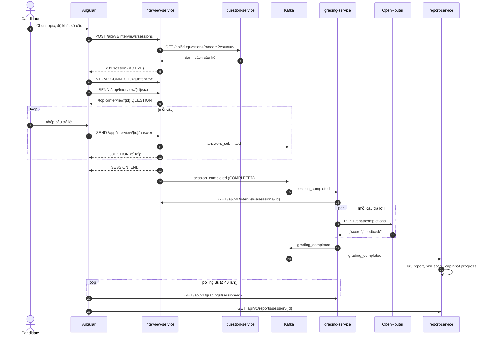
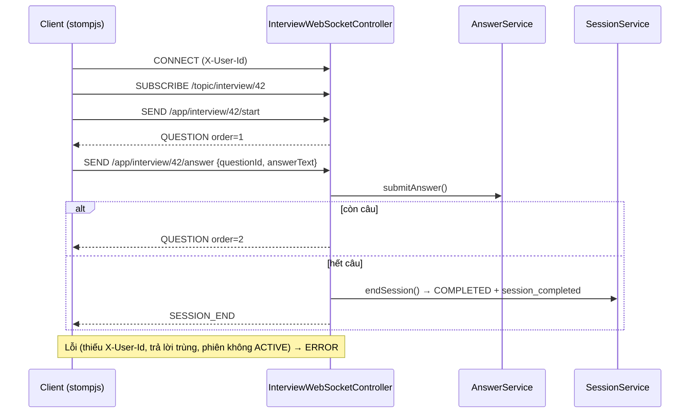

# 05 – Thiết kế tích hợp

Chuỗi nghiệp vụ chính chạy qua 2 sự kiện Kafka (`session_completed`, `grading_completed`), 1 kênh WebSocket và 3 lời gọi REST liên service.

## 5.1 Luồng end-to-end



## 5.2 Danh mục sự kiện Kafka

| Topic | Producer | Consumer (group) | Key | Khi nào phát |
|---|---|---|---|---|
| `answers_submitted` | interviews (`AnswerEventProducer`) | *chưa có* | sessionId | Mỗi câu trả lời được lưu |
| `session_completed` | interviews (`SessionEventProducer`) | grading (`grading-service`) | sessionId | Phiên kết thúc (thủ công, hết câu, hết hạn) |
| `grading_completed` | grading (`GradingCompletedProducer`) | report (`report-service`) | sessionId | Chấm xong một phiên |

Cấu hình chung: `JsonSerializer`/`JsonDeserializer`, **không** type header, consumer `ignoreUnknown`, `auto-offset-reset=earliest`. Tên topic cấu hình qua `kafka.topics.*` (grading/report nhận override từ `KAFKA_TOPIC_*`).

### 5.2.1 `answers_submitted`
```json
{
  "sessionId": 42,
  "questionId": "b1f0c1d2-...",
  "userId": "7",
  "questionText": "Giải thích Spring Bean lifecycle",
  "answerText": "...",
  "submittedAt": "2026-09-29T10:15:30"
}
```

### 5.2.2 `session_completed`
```json
{
  "sessionId": 42,
  "userId": "7",
  "topic": "Spring Boot",
  "difficulty": "MEDIUM",
  "finalStatus": "COMPLETED",
  "startedAt": "2026-09-29T10:00:00",
  "endedAt": "2026-09-29T10:20:00",
  "totalQuestions": 5,
  "answeredQuestions": 5
}
```
`finalStatus` ∈ `COMPLETED` | `EXPIRED`. Consumer xử lý: 3 retry cách 5 s (`FixedBackOff(5000, 3)`), sau đó log và bỏ qua.

### 5.2.3 `grading_completed`
```json
{
  "sessionId": "42",
  "userId": "7",
  "topic": "Spring Boot",
  "questionScores": [
    {
      "questionId": "b1f0c1d2-...",
      "questionText": "...",
      "answerText": "...",
      "score": 7.5,
      "maxScore": 10.0,
      "feedback": "...",
      "skillName": null
    }
  ]
}
```
⚠️ `sessionId` là **Long** ở `session_completed` nhưng **String** ở `grading_completed`; report parse `userId` sang Long.
⚠️ `skillName` hiện luôn `null` → report không tạo được skill score / progress (xem [11](11-van-de-ton-dong.md)).

### 5.2.4 Quy ước đề xuất cho sự kiện mới
- Tên topic `snake_case`, thì quá khứ (`resume_parsed`).
- Payload có `eventId` (UUID), `occurredAt` (ISO-8601 UTC), `version`.
- Consumer idempotent theo khóa nghiệp vụ; lỗi không phục hồi → dead-letter topic `<topic>.DLT`.

## 5.3 Giao thức WebSocket (interview)

| Thuộc tính | Giá trị |
|---|---|
| Endpoint | `/ws/interview` (SockJS), allowed origins `*` |
| Application prefix | `/app` |
| Broker | Simple broker `/topic` |
| Header định danh | `X-User-Id` trong STOMP CONNECT/SEND |

| Hướng | Destination | Payload | Kết quả |
|---|---|---|---|
| Client → Server | `/app/interview/{sessionId}/start` | – | Gửi câu thứ nhất; không có câu → `SESSION_END` (total 0) |
| Client → Server | `/app/interview/{sessionId}/answer` | `{questionId, answerText}` | Lưu trả lời, gửi câu kế; hết câu → kết thúc phiên + `SESSION_END` |
| Server → Client | `/topic/interview/{sessionId}` | `QuestionMessage` | – |

`QuestionMessage`:
```json
{ "type": "QUESTION", "questionId": "…", "questionText": "…", "questionOrder": 2, "totalQuestions": 5 }
```
`type` ∈ `QUESTION` | `SESSION_END` | `ERROR`.



⚠️ Broker `/topic` là kênh chung theo sessionId, không gắn với user; ai biết sessionId đều subscribe được. Đề xuất: `/user/queue/interview` + xác thực JWT ở CONNECT.

## 5.4 REST liên service

| Caller | Callee | Request | Mục đích | Xử lý lỗi |
|---|---|---|---|---|
| interviews `QuestionServiceClient` | question | `GET /api/v1/questions/random?count=&topic_id=&difficulty_id=` | Lấy câu hỏi cho phiên | 5 s; lỗi → list rỗng → `NoQuestionsAvailableException` |
| grading `InterviewServiceClient` | interviews | `GET /api/v1/interviews/sessions/{id}` + `X-User-Id` | Lấy câu hỏi + câu trả lời | 10 s; lỗi → throw → Kafka retry |
| question `ResumeAggregateClient` | resume | `GET /api/v1/resumes/{resumeId}/profile` | Dữ liệu CV để AI sinh câu hỏi | – |

Base URL cấu hình: `question-service.base-url`, `interview-service.base-url`, `clients.resume.base-url` (và `report-service.base-url` ở grading – khai báo nhưng chưa dùng).

⚠️ interviews truyền `topic_id=null`, `difficulty_id=null` → câu hỏi lấy ngẫu nhiên toàn ngân hàng, không theo topic đã chọn.

## 5.5 Hợp đồng chung cho REST

| Mục | Quy ước |
|---|---|
| Version | Tiền tố `/v1` |
| JSON | interviews, question (rubric): `snake_case`; các service khác `camelCase` → **cần thống nhất** |
| Phân trang | `page` (0-based), `size` (giới hạn 100), `sort=field,dir` |
| Lỗi | `{ code, message, timestamp, path, errors? }`, code dạng `<PREFIX>_<số>` (`AUTH_*`, `QUE_*`, `FILE_*`, `JOB_*`, `REVIEW_*`, `GRD_*`, `RPT_*`) |
| Định danh | `Authorization: Bearer <JWT>`; qua gateway thêm `X-User-Id`, `X-User-Role`, `X-User-Name` |
| Tài liệu | springdoc: `/v3/api-docs` hoặc `/api-docs`, `/swagger-ui.html` |
