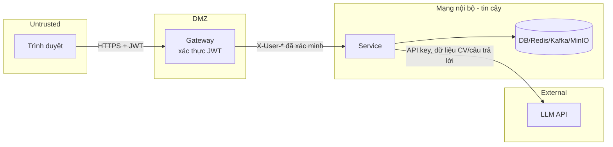

# 07 – Thiết kế bảo mật

Hiện chỉ auth service xác thực JWT; 5 service còn lại tin header `X-User-*` do client gửi. Ưu tiên số một là đưa gateway vào để xác thực tập trung và ghi đè các header này.

## 7.1 Mô hình tin cậy

## 7.2 Xác thực & phân quyền

| Service | Hiện trạng | Mục tiêu |
|---|---|---|
| auth | Spring Security + JWT filter; `/v1/admin/**` yêu cầu `ADMIN`/`SUPER_ADMIN` | Thêm `@PreAuthorize` theo permission code |
| question | Chỉ đọc `X-User-Id`, `X-User-Name`; không kiểm role | Endpoint admin + moderation yêu cầu `ADMIN`; tạo câu hỏi yêu cầu đăng nhập |
| resume | `HeaderAuthFilter` gán `user-001` nếu thiếu, không bao giờ từ chối | Bắt buộc `X-User-Id` từ gateway; kiểm `resume.user_id == X-User-Id` |
| interviews | `HeaderAuthFilter` bị tắt | Bật lại; WS xác thực JWT ở STOMP CONNECT; kiểm sở hữu phiên |
| grading | `/admin/all` kiểm header `X-User-Role` | `history/{userId}` chỉ trả dữ liệu của chính người gọi, trừ admin |
| report | Không có security | Kiểm sở hữu (`RPT_007`), admin mới xem `/admin/all` |

### Ma trận quyền (mục tiêu)

| Tài nguyên | USER | ADMIN / SUPER_ADMIN |
|---|---|---|
| Hồ sơ, phiên đăng nhập của mình | RW | RW |
| Account, role, permission | – | RW (xóa role hệ thống: không) |
| Resume và các mục | RW của mình | R |
| Câu hỏi | R (đã duyệt), C (PENDING), U câu của mình khi bị từ chối | RW, kiểm duyệt |
| Topic, tag, độ khó, bài học | R | RW |
| Phiên phỏng vấn | RW của mình | R |
| Kết quả chấm, báo cáo | R của mình | R tất cả |

## 7.3 Kiểm soát đã có

| Kiểm soát | Chi tiết |
|---|---|
| Băm mật khẩu | BCrypt cost 12 |
| Token email | 32 byte ngẫu nhiên, lưu SHA-256, TTL 24h (xác thực) / 1h (reset), dùng một lần |
| Refresh token | Lưu theo `jti`, xoay vòng, khóa dòng khi refresh, thu hồi theo lý do |
| Chống dò tài khoản | forgot-password trả cùng một thông báo |
| Khóa tài khoản | Sau `PASSWORD_MAX_FAILED_ATTEMPTS` lần sai |
| Rate limit | Token bucket theo IP + URI cho endpoint public |
| Idle timeout | Redis `session:activity` 30 phút + `IdleService` ở FE |
| Upload | Kiểm MIME + ≤ 5MB, key MinIO sinh ngẫu nhiên |
| Prompt injection | Prompt chấm điểm bọc câu trả lời bằng delimiter và dặn bỏ qua chỉ thị trong câu trả lời |
| Secret | Mọi secret qua biến môi trường |

## 7.4 STRIDE

| Mối đe dọa | Ví dụ trong IntelliHire | Mức | Biện pháp |
|---|---|---|---|
| **S**poofing | Gửi `X-User-Id` tùy ý tới resume/report/grading để giả làm người khác | Cao | Gateway ghi đè header; service chỉ nhận từ mạng nội bộ |
| **S**poofing | OAuth callback không kiểm `state` | Trung bình | Lưu `state` (Redis, TTL ngắn), so khớp ở callback |
| **T**ampering | Sửa rubric / câu hỏi qua endpoint admin không khóa | Cao | Kiểm role ADMIN |
| **R**epudiation | Không truy vết ai duyệt câu hỏi | Thấp | Audit `last_updated_by` từ JWT, log có correlation id |
| **I**nformation disclosure | Đọc CV (PII: email, SĐT) của người khác theo resume id | Cao | Kiểm sở hữu; không log nội dung CV |
| **I**nformation disclosure | Subscribe `/topic/interview/{id}` của người khác | Trung bình | User destination + xác thực STOMP |
| **I**nformation disclosure | Gửi CV/câu trả lời tới LLM bên ngoài | Trung bình | Thông báo trong điều khoản; tối thiểu hóa dữ liệu gửi đi |
| **D**enial of service | Spam `/generate`, `/review/generate`, tạo phiên → tốn chi phí LLM | Trung bình | Rate limit theo user ở gateway, hạn mức mỗi ngày |
| **D**enial of service | Upload file lớn / nhiều | Thấp | Giới hạn 5MB, 1 file/resume |
| **E**levation of privilege | Người dùng gọi `/api/v1/admin/questions` | Cao | Kiểm role |

## 7.5 Dữ liệu nhạy cảm

| Dữ liệu | Nơi lưu | Phân loại | Xử lý |
|---|---|---|---|
| Mật khẩu | `accounts.password` | Bí mật | BCrypt, không bao giờ trả về |
| Refresh token | Client; server lưu `jti` | Bí mật | Thu hồi được |
| Email, SĐT, địa chỉ | `accounts`, `user_profiles`, `resume_contacts` | PII | Chỉ chủ sở hữu và admin; không log |
| File CV | MinIO | PII | Bucket private, tải qua API có kiểm quyền |
| Câu trả lời phỏng vấn | `user_answers_raw`, `grading_results` | Nội bộ | Chỉ chủ sở hữu |
| API key LLM, JWT secret, MinIO key | Env | Bí mật | Không commit, xoay vòng định kỳ |

## 7.6 Checklist bắt buộc trước khi release

- [ ] Gateway xác thực JWT, service không mở port ra ngoài
- [ ] Bỏ fallback `user-001` (resume), bật `HeaderAuthFilter` (interviews)
- [ ] Kiểm sở hữu ở resume, interviews, grading, report
- [ ] Kiểm role ở question admin/moderation
- [ ] OAuth kiểm `state`
- [ ] CORS whitelist, WS không dùng `*`
- [ ] Quét secret (gitleaks) và dependency (OWASP Dependency-Check) trong CI
