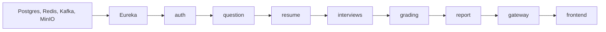

# 10 – Triển khai & vận hành

Mỗi service có `Dockerfile` và `docker-compose.yml` riêng; tài liệu này đề xuất một compose chung cho toàn hệ thống, liệt kê biến môi trường và cách giám sát.

## 10.1 Môi trường

| Môi trường | Mục đích | Đặc điểm |
|---|---|---|
| local | Phát triển | `ng serve` + proxy, service chạy bằng `mvnw spring-boot:run`, hạ tầng bằng docker compose; email in ra console (profile `dev`) |
| staging | Kiểm thử tích hợp, E2E | Toàn bộ trong Docker, đi qua gateway, LLM key riêng có hạn mức |
| production | Người dùng thật | Profile `prod` (SMTP thật, rate limit chặt), HTTPS, sao lưu DB |

## 10.2 Thứ tự khởi động



Hạ tầng phải sẵn sàng trước (healthcheck); các service không phụ thuộc cứng vào nhau khi khởi động (lỗi REST/Kafka được xử lý lúc chạy).

## 10.3 Compose chung (khung đề xuất)

```yaml
services:
  postgres:
    image: postgres:16
    environment:
      POSTGRES_USER: ${DB_USERNAME}
      POSTGRES_PASSWORD: ${DB_PASSWORD}
      POSTGRES_DB: intellihire
    volumes: [pgdata:/var/lib/postgresql/data]
    healthcheck: { test: ["CMD-SHELL", "pg_isready"], interval: 5s }
  redis:
    image: redis:7
  kafka:
    image: bitnami/kafka:3.7
    environment:
      KAFKA_CFG_NODE_ID: 1
      KAFKA_CFG_PROCESS_ROLES: broker,controller
      KAFKA_CFG_LISTENERS: PLAINTEXT://:9092,CONTROLLER://:9093
      KAFKA_CFG_ADVERTISED_LISTENERS: PLAINTEXT://kafka:9092
      KAFKA_CFG_CONTROLLER_QUORUM_VOTERS: 1@kafka:9093
      KAFKA_CFG_CONTROLLER_LISTENER_NAMES: CONTROLLER
  minio:
    image: minio/minio
    command: server /data --console-address ":9001"
    environment:
      MINIO_ROOT_USER: ${MINIO_ACCESS_KEY}
      MINIO_ROOT_PASSWORD: ${MINIO_SECRET_KEY}
  auth:
    build: ./intelli-hire-auth
    env_file: .env
    environment: { SERVER_PORT: 8090, DB_SCHEMA: auth }
    depends_on: { postgres: { condition: service_healthy }, redis: { condition: service_started } }
  question:
    build: ./intelli-hire-question
    env_file: .env
    environment: { SERVER_PORT: 8081, DB_SCHEMA: question }
  resume:
    build: ./intelli-hire-resume
    env_file: .env
    environment: { SERVER_PORT: 8082 }
  interviews:
    build: ./intelli-hire-interviews
    env_file: .env
    environment: { QUESTION_SERVICE_URL: http://question:8081, KAFKA_SERVERS: kafka:9092 }
  grading:
    build: ./intelli-hire-grading
    env_file: .env
    environment: { SERVER_PORT: 8084, INTERVIEW_SERVICE_URL: http://interviews:8083, KAFKA_SERVERS: kafka:9092 }
  report:
    build: ./intelli-hire-report
    env_file: .env
    environment: { SERVER_PORT: 8085, KAFKA_SERVERS: kafka:9092 }
volumes:
  pgdata:
```

`intelli-hire-resume` hiện chưa có `Dockerfile` → cần bổ sung.

## 10.4 Biến môi trường

| Nhóm | Biến | Dùng bởi |
|---|---|---|
| Server | `SERVER_PORT`, `CONTEXT_PATH` | tất cả |
| DB | `DB_HOST`, `DB_PORT`, `DB_NAME`/`DATABASE_NAME`, `DB_SCHEMA`, `DB_USERNAME`/`DATABASE_USERNAME`, `DB_PASSWORD`/`DATABASE_PASSWORD` | tất cả (tên biến chưa thống nhất ⚠️) |
| Redis | `REDIS_HOST`, `REDIS_PORT` | auth, question, resume, grading, report |
| Kafka | `KAFKA_SERVERS`, `KAFKA_TOPIC_SESSION_COMPLETED`, `KAFKA_TOPIC_GRADING_COMPLETED` | interviews, grading, report |
| JWT | `JWT_SECRET`, `JWT_ISSUER`, `JWT_ACCESS_EXPIRATION_SECONDS`, `JWT_REFRESH_EXPIRATION_SECONDS`, `JWT_ACCESS_AUDIENCE`, `JWT_REFRESH_AUDIENCE` | auth (+ gateway) |
| Mật khẩu | `PASSWORD_MAX_FAILED_ATTEMPTS`, `PASSWORD_LOCK_DURATION_MINUTES` | auth |
| Email | `SMTP_HOST`, `SMTP_PORT`, `SMTP_USERNAME`, `SMTP_PASSWORD` | auth |
| MinIO | `MINIO_ENDPOINT`, `MINIO_ACCESS_KEY`, `MINIO_SECRET_KEY`, `MINIO_BUCKET` | resume |
| AI | `AI_PROVIDER`, `OPENAI_*`, `CLAUDE_*`, `GEMINI_*`, `GROK_*`, `OPENROUTER_*` | resume, question, grading |
| URL service | `QUESTION_SERVICE_URL`, `INTERVIEW_SERVICE_URL`, `REPORT_SERVICE_URL`, `clients.resume.base-url` | interviews, grading, question |
| FE | `API_URL` (prod) | frontend |

File `.env` không được commit; cung cấp `.env.example` với giá trị giả.

## 10.5 Giám sát

| Hạng mục | Cách làm |
|---|---|
| Health | `/actuator/health` (grading: `/api/actuator/health`) → dùng cho healthcheck Docker |
| Metric | `/actuator/prometheus` → Prometheus + Grafana |
| Metric nghiệp vụ | `resume.parse.duration{outcome}`, `file.upload.count{fileType}`, thời gian chấm (`latency_ms`), số lượt chấm `FAILED` |
| Kafka | Consumer lag của `grading-service`, `report-service` |
| Log | JSON log, MDC correlation id (`MdcLoggingFilter` ở resume) → nên áp dụng cho mọi service; không log token, mật khẩu, nội dung CV |
| Cảnh báo | Tỷ lệ 5xx > 1%, lag Kafka > 100, job parse `FAILED` tăng đột biến, chi phí LLM theo ngày |

## 10.6 Vận hành thường gặp

| Tình huống | Xử lý |
|---|---|
| Phiên đã xong nhưng không có kết quả chấm | Kiểm log grading; lượt `FAILED` → gửi lại `POST /api/v1/gradings` hoặc phát lại sự kiện |
| Chấm xong nhưng không có báo cáo | Report nuốt lỗi consumer → gọi `POST /api/v1/reports` với dữ liệu chấm |
| Job parse kẹt ở `QUEUED` | Kiểm Redis `resume:parse:queue`; gọi `POST /resumes/{id}/reprocess` |
| Người dùng bị khóa | Admin `PATCH /v1/admin/accounts/{id}/status` |
| Đổi nhà cung cấp LLM | Đổi `AI_PROVIDER` + key, khởi động lại resume |

## 10.7 Sao lưu

- PostgreSQL: `pg_dump` hằng ngày, giữ 7 bản; kiểm tra khôi phục hằng tháng.
- MinIO: bật versioning hoặc mirror sang bucket dự phòng.
- Redis, Kafka: không cần sao lưu (dữ liệu tạm / có thể phát lại), nhưng Kafka nên đặt retention ≥ 7 ngày.
