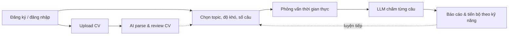

# 01 – Giới thiệu

## 1.1 Tổng quan hệ thống

IntelliHire là nền tảng giúp ứng viên luyện phỏng vấn kỹ thuật với sự hỗ trợ của AI. Ứng viên tải CV lên để hệ thống phân tích và đánh giá, tham gia các phiên phỏng vấn mô phỏng theo thời gian thực, được mô hình ngôn ngữ lớn (LLM) chấm điểm từng câu trả lời và theo dõi sự tiến bộ theo từng kỹ năng qua các lần luyện tập.

### Bài toán

- Ứng viên khó có môi trường luyện phỏng vấn sát thực tế và nhận phản hồi chi tiết, khách quan sau mỗi lần luyện.
- Việc tự đánh giá CV và xác định kỹ năng còn yếu thường cảm tính, thiếu số liệu theo dõi qua thời gian.
- Ngân hàng câu hỏi cần được chuẩn hóa (topic, độ khó, tiêu chí chấm) và có quy trình kiểm duyệt khi cộng đồng đóng góp.

### Mục tiêu

| # | Mục tiêu | Thể hiện trong hệ thống |
|---|---|---|
| 1 | Luyện phỏng vấn sát thực tế | Phiên hỏi–đáp thời gian thực qua WebSocket, giới hạn 60 phút |
| 2 | Phản hồi tự động, có căn cứ | LLM chấm từng câu theo rubric, kèm nhận xét |
| 3 | Theo dõi tiến bộ | Báo cáo theo phiên, thống kê và xu hướng điểm theo kỹ năng |
| 4 | Khai thác CV | Parse CV bằng AI, sinh skill profile, AI review CV |
| 5 | Ngân hàng câu hỏi chất lượng | Phân loại theo topic dạng cây, tag, độ khó; kiểm duyệt câu hỏi người dùng gửi |

## 1.2 Mục đích tài liệu

Bộ tài liệu mô tả phân tích và thiết kế hệ thống IntelliHire trước khi triển khai, nhằm:

- Làm nguồn tham chiếu chung khi phát triển, review và tích hợp các service.
- Chốt các hợp đồng giữa service: REST API, sự kiện Kafka, giao thức WebSocket, JWT.
- Làm cơ sở cho kiểm thử, triển khai và bảo trì.
- Nhận diện sớm các rủi ro khi triển khai và biện pháp giảm thiểu.

Đối tượng đọc: lập trình viên backend/frontend, người kiểm thử, người vận hành và người review thiết kế.

## 1.3 Chức năng chính

| Nhóm chức năng | Mô tả ngắn | Service |
|---|---|---|
| Tài khoản & bảo mật | Đăng ký, xác thực email, đăng nhập (mật khẩu, Google, GitHub), quên mật khẩu, quản lý phiên đăng nhập, RBAC | auth |
| Quản lý CV | CRUD resume, upload PDF/DOCX ≤ 5MB, parse bất đồng bộ bằng AI, skill profile, AI review CV | resume |
| Ngân hàng câu hỏi | Câu hỏi technical / behavioral / coding, rubric, topic, tag, độ khó, kiểm duyệt, sinh câu hỏi bằng AI | question |
| Phỏng vấn | Tạo phiên (1–20 câu), hỏi–đáp thời gian thực, kết thúc thủ công hoặc tự động | interviews |
| Chấm điểm | Tự chấm khi phiên kết thúc, điểm và nhận xét từng câu, chấm lại khi lỗi | grading |
| Báo cáo | Báo cáo phiên, điểm theo kỹ năng, thống kê, xu hướng tiến bộ | report |
| Quản trị | Quản lý tài khoản, role, permission; kiểm duyệt và quản lý câu hỏi | auth, question |

Chi tiết yêu cầu và mã truy vết `FR-*` / `NFR-*` xem [02 – Đặc tả yêu cầu](02-dac-ta-yeu-cau.md).

## 1.4 Tác nhân

| Tác nhân | Vai trò |
|---|---|
| Khách (Guest) | Người chưa đăng nhập: đăng ký, đăng nhập, quên mật khẩu, xác thực email |
| Candidate (`USER`) | Người luyện phỏng vấn: quản lý CV, gửi câu hỏi, phỏng vấn, xem kết quả và báo cáo |
| Admin (`ADMIN`, `SUPER_ADMIN`) | Quản trị tài khoản, phân quyền; kiểm duyệt và quản lý câu hỏi |
| Hệ thống ngoài | LLM provider, SMTP server, OAuth provider (Google, GitHub) |

## 1.5 Luồng nghiệp vụ chính

1. Ứng viên đăng ký, xác thực email và đăng nhập.
2. (Tùy chọn) Upload CV; hệ thống parse CV bằng AI, sinh skill profile và đánh giá CV.
3. Ứng viên tạo phiên phỏng vấn theo topic, độ khó và số câu; câu hỏi được lấy ngẫu nhiên từ ngân hàng.
4. Hệ thống gửi lần lượt từng câu qua WebSocket, ứng viên trả lời cho đến khi hết câu hoặc tự kết thúc.
5. Khi phiên kết thúc, sự kiện `session_completed` kích hoạt chấm điểm bằng LLM.
6. Kết quả chấm (`grading_completed`) được tổng hợp thành báo cáo; ứng viên xem điểm và xu hướng tiến bộ.

Chi tiết tích hợp xem [05 – Thiết kế tích hợp](05-thiet-ke-tich-hop.md).

## 1.6 Phạm vi

### Trong phạm vi

| Thành phần | Công nghệ |
|---|---|
| Auth service | Spring Boot 3.4.2, Java 21 |
| Question service | Spring Boot 3.2.1, Java 17 |
| Resume service | Spring Boot 3.2.1, Java 17 |
| Interview service | Spring Boot 3.2.4, Java 17 |
| Grading service | Spring Boot 3.2.1, Java 17 |
| Report service | Spring Boot 3.2.1, Java 17 |
| API Gateway | Spring Cloud Gateway |
| Service discovery | Eureka Server |
| Frontend | Angular 19, Angular Material |
| Hạ tầng | PostgreSQL, Redis, Apache Kafka, MinIO |

### Ngoài phạm vi

- Thanh toán, gói dịch vụ.
- Tuyển dụng phía doanh nghiệp (đăng tin, quản lý pipeline ứng viên).
- Ứng dụng mobile.

## 1.7 Kiến trúc tóm tắt

IntelliHire được thiết kế theo kiến trúc microservice gồm 6 service Spring Boot, mỗi service sở hữu một schema PostgreSQL riêng.

- **Đồng bộ:** frontend gọi các service qua REST/JSON; một số service gọi nhau qua REST (interviews → question, question → resume, grading → interviews).
- **Bất đồng bộ:** chuỗi phỏng vấn → chấm → báo cáo chạy qua Kafka.
- **Thời gian thực:** phiên phỏng vấn dùng STOMP over SockJS.
- **AI:** parse/review CV, sinh câu hỏi và chấm điểm gọi tới LLM (OpenAI, Anthropic Claude, Google Gemini, xAI Grok, OpenRouter).
- **Gateway:** API Gateway xác thực JWT tập trung, định tuyến qua Eureka.

Chi tiết xem [04 – Kiến trúc tổng thể](04-kien-truc-tong-the.md) và [08 – ADR](08-adr.md).

## 1.8 Thuật ngữ

| Thuật ngữ | Nghĩa |
|---|---|
| Candidate / USER | Người dùng luyện phỏng vấn; role mặc định `USER` |
| Admin | Role `ADMIN` hoặc `SUPER_ADMIN`; quản trị tài khoản, phân quyền, kiểm duyệt câu hỏi |
| Interview session | Một lượt phỏng vấn gồm N câu hỏi (1–20, mặc định 5) theo topic và độ khó |
| Question log | Bản ghi câu hỏi đã được đưa vào một phiên, có thứ tự |
| Rubric | Tiêu chí chấm gắn 1–1 với câu hỏi (criteria, keywords, lỗi thường gặp, đáp án mẫu, điểm tối đa) |
| Moderation | Quy trình kiểm duyệt câu hỏi do người dùng gửi: PENDING → APPROVED / REJECTED |
| Parse job | Tác vụ bất đồng bộ trích xuất CV (PDF/DOCX) thành dữ liệu có cấu trúc bằng AI |
| Skill profile | Tổng hợp kỹ năng nổi bật, số năm kinh nghiệm, seniority từ CV |
| Grading session / result | Một lượt chấm cho một phiên phỏng vấn / điểm của từng câu |
| Report | Báo cáo tổng hợp điểm của một phiên và tiến bộ theo kỹ năng |
| LLM | Mô hình ngôn ngữ lớn dùng để parse CV, sinh câu hỏi và chấm điểm |
| JWT | JSON Web Token dùng để xác thực giữa frontend và các service |
| STOMP | Giao thức nhắn tin chạy trên WebSocket, dùng cho phiên phỏng vấn |

## 1.9 Hướng dẫn đọc tài liệu

| Nếu bạn cần… | Đọc |
|---|---|
| Hiểu hệ thống làm gì, cho ai | [02 – Đặc tả yêu cầu](02-dac-ta-yeu-cau.md), [03 – Use case](03-use-case.md) |
| Hiểu các thành phần và cách chúng giao tiếp | [04 – Kiến trúc tổng thể](04-kien-truc-tong-the.md), [05 – Thiết kế tích hợp](05-thiet-ke-tich-hop.md) |
| Phát triển frontend | [06 – Thiết kế frontend](06-thiet-ke-frontend.md) |
| Phát triển một service cụ thể | Thư mục [services/](services/) |
| Xác thực, phân quyền, rủi ro bảo mật | [07 – Bảo mật](07-bao-mat.md) |
| Lý do các quyết định kiến trúc | [08 – ADR](08-adr.md) |
| Viết và chạy test | [09 – Chiến lược kiểm thử](09-chien-luoc-kiem-thu.md) |
| Cấu hình, triển khai, giám sát | [10 – Triển khai & vận hành](10-trien-khai-van-hanh.md) |
| Rủi ro và lưu ý khi triển khai | [11 – Rủi ro & lưu ý khi triển khai](11-rui-ro-trien-khai.md) |
