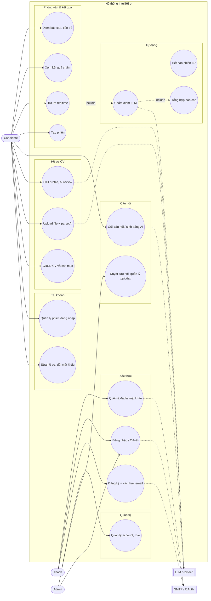

# 03 – Use case

Candidate là tác nhân chính; chấm điểm và lập báo cáo do hệ thống tự chạy qua Kafka sau khi phiên kết thúc.

## 3.1 Sơ đồ use case tổng thể

## 3.2 Ma trận tác nhân × use case

| Use case | Khách | Candidate | Admin | Service |
|---|:-:|:-:|:-:|---|
| Đăng ký, xác thực email, quên mật khẩu | ✔ | | | auth |
| Đăng nhập (mật khẩu / OAuth) | ✔ | | | auth |
| Sửa hồ sơ, đổi mật khẩu, quản lý phiên | | ✔ | ✔ | auth |
| Quản lý account, role, permission | | | ✔ | auth |
| CRUD CV, upload, parse, review | | ✔ | | resume |
| Gửi câu hỏi, gửi lại khi bị từ chối | | ✔ | | question |
| Kiểm duyệt, CRUD topic/tag/độ khó/bài học | | | ✔ | question |
| Tạo phiên, trả lời, kết thúc | | ✔ | | interviews |
| Xem kết quả chấm | | ✔ | ✔ (tất cả) | grading |
| Xem báo cáo, thống kê, tiến bộ | | ✔ | ✔ (tất cả) | report |

## 3.3 Đặc tả use case chính

### UC-01 Đăng nhập bằng mật khẩu

| Mục | Nội dung |
|---|---|
| Tác nhân | Khách |
| Tiền điều kiện | Tài khoản tồn tại, trạng thái `ACTIVE` |
| Luồng chính | 1. Nhập email/username + mật khẩu → 2. Auth so khớp BCrypt → 3. Reset bộ đếm sai, ghi `last_login_at` → 4. Sinh access token + refresh token (`jti`), lưu `refresh_tokens` kèm IP, User-Agent → 5. Tạo key Redis `session:activity:{accountId}` (TTL 30') → 6. Trả token; FE lưu và chuyển trang |
| Luồng thay thế | 2a. Sai mật khẩu → tăng `failed_login_attempts`; đạt ngưỡng → `LOCKED` · 1a. Tài khoản `LOCKED/INACTIVE` → từ chối · 1b. Vượt rate limit → 429 + `Retry-After` |
| Hậu điều kiện | Phiên mới xuất hiện ở `GET /v1/auth/sessions` |

### UC-02 Quên mật khẩu

| Mục | Nội dung |
|---|---|
| Tác nhân | Khách, SMTP |
| Luồng chính | 1. Nhập email → 2. Nếu email tồn tại: vô hiệu token cũ, sinh token 32 byte, lưu SHA-256, gửi link `/auth/reset-password?token=` (TTL 1h) → 3. Luôn trả cùng một thông báo → 4. Người dùng mở link, nhập mật khẩu mới → 5. Kiểm token còn hạn, chưa dùng → đổi mật khẩu, đánh dấu `used_at`, thu hồi mọi refresh token (lý do `password_reset`) |
| Luồng thay thế | 5a. Token sai/hết hạn → `PASSWORD_RESET_TOKEN_INVALID` |

### UC-03 Upload và parse CV

| Mục | Nội dung |
|---|---|
| Tác nhân | Candidate, LLM provider |
| Tiền điều kiện | Đã tạo resume; resume chưa có file |
| Luồng chính | 1. Chọn file → 2. Kiểm MIME (PDF/DOCX) và kích thước (≤ 5MB) → 3. Lưu MinIO `{resumeId}/{uuid}.{ext}`, ghi `resume_files` → 4. Tạo/reset parse job `QUEUED` → 5. Sau commit, đẩy `resumeId` vào Redis `resume:parse:queue` → 6. Scheduler (5 s) lấy job, worker tải file, trích text, gọi LLM → 7. Ghi đè liên hệ/học vấn/kinh nghiệm/kỹ năng/skill profile → job `SUCCEEDED`, resume `COMPLETED` → 8. FE polling thấy tiến độ 100% |
| Luồng thay thế | 2a. Sai định dạng/kích thước → `FILE_002`/`FILE_003` · 1a. Đã có file → `FILE_004` · 6a. LLM lỗi → retry 2/4/8 s; hết retry → job `FAILED`, resume `FAILED`, cho phép `reprocess` |
| Hậu điều kiện | Người dùng rà soát và chỉnh sửa dữ liệu parse |

### UC-04 Thực hiện phỏng vấn

| Mục | Nội dung |
|---|---|
| Tác nhân | Candidate |
| Tiền điều kiện | Đã đăng nhập; ngân hàng có đủ câu hỏi |
| Luồng chính | 1. Chọn topic, độ khó, số câu → 2. Interview gọi `GET /api/v1/questions/random` theo topic, độ khó → lưu `question_logs`, phiên `ACTIVE` → 3. FE kết nối STOMP `/ws/interview` kèm JWT, subscribe `/user/queue/interview`, gửi `/app/interview/{id}/start` → 4. Nhận `QUESTION` → 5. Gửi `/app/interview/{id}/answer` → lưu `user_answers_raw`, nhận câu kế → 6. Hết câu → phiên `COMPLETED`, nhận `SESSION_END`, phát `session_completed` |
| Luồng thay thế | 2a. Không lấy được câu hỏi → `NoQuestionsAvailableException` · 5a. Trả lời trùng câu → lỗi `ERROR` · 5b. Quá 60 phút → scheduler đặt `EXPIRED`, phát `session_completed` (finalStatus `EXPIRED`) · 5c. Người dùng bấm kết thúc → `PUT .../end` |
| Hậu điều kiện | Grading nhận sự kiện và bắt đầu chấm |

### UC-05 Chấm điểm tự động (hệ thống)

| Mục | Nội dung |
|---|---|
| Tác nhân | Grading service, LLM provider |
| Kích hoạt | Sự kiện `session_completed` |
| Luồng chính | 1. Gọi interview lấy chi tiết phiên → 2. Tạo `grading_sessions` `PROCESSING` → 3. Chấm song song từng câu (pool 10–20 luồng), mỗi câu 1 lời gọi LLM → 4. Lưu `grading_results`, đặt `COMPLETED` → 5. Phát `grading_completed` |
| Luồng thay thế | 1a. Interview không phản hồi → Kafka retry 3 lần × 5 s · 3a. LLM lỗi 5xx/timeout → retry 1 lần sau 2 s; vẫn lỗi → điểm 0, feedback "Unable to grade" · 4a. Mọi câu lỗi → `FAILED` (cho phép chấm lại) |

### UC-06 Xem báo cáo và tiến bộ

| Mục | Nội dung |
|---|---|
| Tác nhân | Candidate |
| Tiền điều kiện | Report đã nhận `grading_completed` |
| Luồng chính | 1. Mở trang Reports → 2. Xem thống kê (`/stats`), lịch sử (`/history`) → 3. Chọn phiên → điểm tổng, điểm từng câu, điểm theo kỹ năng → 4. Xem biểu đồ xu hướng theo kỹ năng (`/progress`) |
| Luồng thay thế | 3a. Chưa có báo cáo → FE hiển thị "đang chấm" (polling 3 s, tối đa 40 lần) |

### UC-07 Kiểm duyệt câu hỏi

| Mục | Nội dung |
|---|---|
| Tác nhân | Candidate (người gửi), Admin |
| Luồng chính | 1. Candidate tạo câu hỏi → `PENDING` → 2. Admin xem danh sách → 3. Đặt `APPROVED` hoặc `REJECTED` + lý do → 4. Nếu bị từ chối, người gửi sửa và gửi lại → `PENDING` |
| Luồng thay thế | 4a. Không phải người gửi → `QUE_403` · 4b. Trạng thái không phải `REJECTED` → `QUE_409` |
