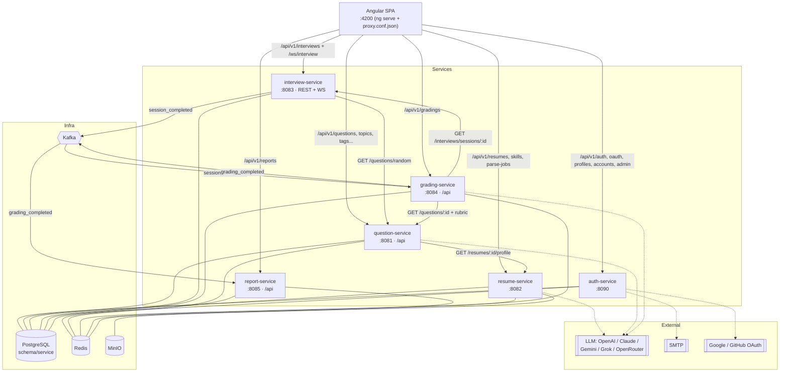
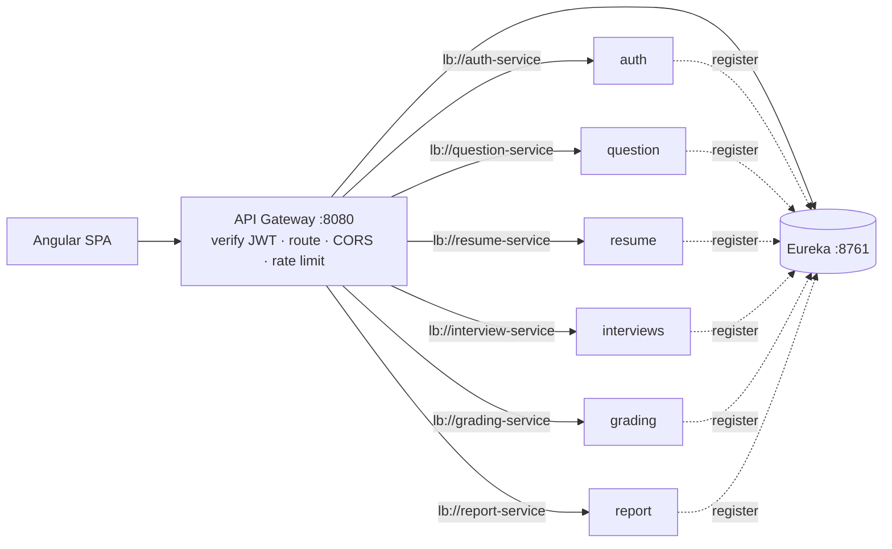
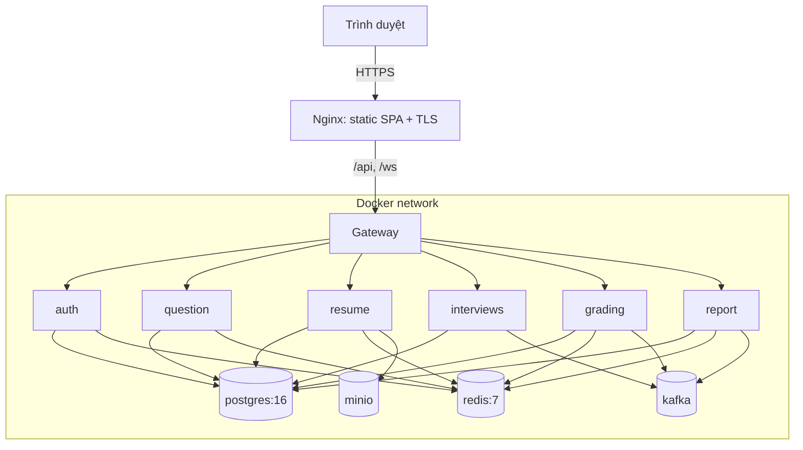

# 04 – Kiến trúc tổng thể (HLD)

IntelliHire được thiết kế theo kiến trúc microservice gồm 6 service Spring Boot, mỗi service sở hữu một schema PostgreSQL; giao tiếp đồng bộ qua REST và bất đồng bộ qua Kafka cho chuỗi phỏng vấn → chấm → báo cáo.

## 4.1 Sơ đồ thành phần

### Sơ đồ thành phần logic

Ở môi trường phát triển, frontend gọi thẳng từng service qua dev proxy của Angular.

### Định tuyến qua API Gateway

Ở môi trường staging/production, mọi request đi qua API Gateway.

Gateway xác thực JWT một lần và chuyển tiếp `X-User-Id`, `X-User-Role`, `X-User-Name` cho các service phía sau. Xem [services/gateway-eureka.md](services/gateway-eureka.md).

## 4.2 Danh mục service

| Service | Trách nhiệm | Port | Context path | Schema DB | Redis | Kafka | Ngoài |
|---|---|---|---|---|---|---|---|
| auth | Danh tính, JWT, OAuth, RBAC, phiên | 8090 (`SERVER_PORT`) | `/` | `${DB_SCHEMA}` | Hoạt động phiên | – | SMTP, Google, GitHub |
| question | Ngân hàng câu hỏi, rubric, kiểm duyệt, topic/tag | 8081 | `/api` | `question` | Cache + random pool | – | OpenRouter |
| resume | CV, file, parse AI, review | 8082 | – (path có `/api`) | mặc định | Cache + hàng đợi parse | – | MinIO, LLM |
| interviews | Phiên phỏng vấn, WebSocket | 8083 | – | `interviews` | – | Produce | – |
| grading | Chấm bằng LLM | 8084 | `/api` | mặc định | Cache | Consume + produce | OpenRouter |
| report | Báo cáo, thống kê, tiến bộ | 8085 | `/api` | mặc định | Cache | Consume | – |

## 4.3 Công nghệ

| Lớp | Công nghệ |
|---|---|
| Backend | Java 17/21, Spring Boot 3.2–3.4, Spring Web, Data JPA, Validation, Cache, WebSocket (STOMP), Spring Kafka, Spring Security (auth) |
| Mapping / tiện ích | MapStruct, Lombok, springdoc-openapi, jjwt |
| Dữ liệu | PostgreSQL 14+ (Flyway, JSONB), Redis 7 |
| Messaging | Apache Kafka (JSON serializer, không type header) |
| Lưu file | MinIO (S3-compatible) |
| Xử lý tài liệu | Apache PDFBox 3, Apache POI |
| AI | REST tới OpenAI / Anthropic / Gemini / xAI / OpenRouter |
| Frontend | Angular 19 standalone, Angular Material, RxJS, @stomp/stompjs + SockJS |
| Test | JUnit 5, Mockito, Testcontainers (resume), Karma/Jasmine (FE) |
| Đóng gói | Docker, docker-compose từng service |

## 4.4 Kiểu giao tiếp

| Từ → Đến | Kiểu | Mục đích | Timeout / retry |
|---|---|---|---|
| FE → service | REST/JSON | Mọi thao tác người dùng | FE retry 1 lần sau refresh token |
| FE ↔ interviews | STOMP over SockJS | Hỏi–đáp thời gian thực | reconnect do client |
| interviews → question | REST | Lấy câu hỏi ngẫu nhiên | 5 s, lỗi → danh sách rỗng |
| question → resume | REST | Hồ sơ tổng hợp để sinh câu hỏi | – |
| grading → interviews | REST | Lấy câu hỏi + câu trả lời của phiên | 10 s, lỗi → Kafka retry |
| grading → question | REST | Lấy rubric, topic/tag của câu hỏi | 10 s, lỗi → Kafka retry |
| interviews → grading | Kafka `session_completed` | Kích hoạt chấm | 3 retry × 5 s, lỗi → DLT |
| grading → report | Kafka `grading_completed` | Kích hoạt lập báo cáo | Retry có giới hạn, lỗi → DLT |
| resume (nội bộ) | Redis list `resume:parse:queue` | Hàng đợi parse CV | retry 2/4/8 s cho LLM |

## 4.5 Mẫu kiến trúc nội bộ

| Service | Mẫu | Ghi chú |
|---|---|---|
| auth | Hexagonal theo feature: `adapter/web`, `adapter/repository`, `usecase`, `domain` | Use case = interface + Impl, command record |
| còn lại | Layered: `controller` → `service`/`impl` → `repository`; `dto`, `mapper`, `entity`, `exception`, `config` | Không dùng quan hệ JPA; FK là cột String/Long |

Nguyên tắc chung: database-per-service, không truy cập bảng của service khác; ID dạng UUID String (question, resume, grading, report) hoặc BIGINT identity (auth, interviews).

## 4.6 Sơ đồ triển khai

Chi tiết môi trường và biến cấu hình: [10-trien-khai-van-hanh.md](10-trien-khai-van-hanh.md).
