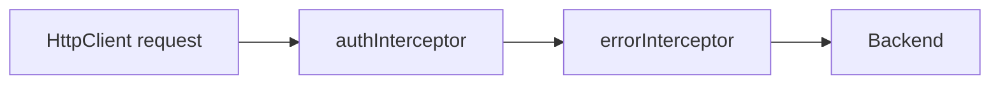
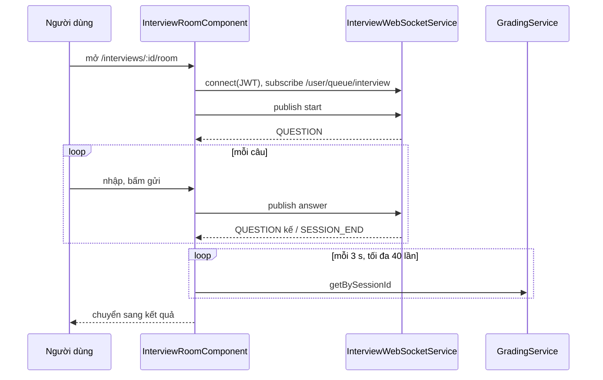

# 06 – Thiết kế frontend

Frontend được thiết kế là SPA Angular 19 (standalone component, lazy loading), gọi backend qua `ApiService` với `environment.apiUrl` (`/api` khi dev) và kết nối WebSocket STOMP cho phòng phỏng vấn.

| Thuộc tính | Giá trị |
|---|---|
| Thư mục | `intelli-hire-uiux/intelli-hire-frontend` |
| Stack | Angular 19.2, Angular Material/CDK, RxJS 7.8, @stomp/stompjs 7 + sockjs-client |
| State | Service + Observable (không NgRx) |
| Theme | Neon Cyberpunk, token trong `src/styles/_variables.scss`, quy tắc tại `src/design-system.md` |
| Test | Karma + Jasmine |

## 6.1 Sitemap

```mermaid
flowchart TD
    ROOT["/"] --> AUTH["/auth (AuthLayout)"]
    ROOT --> MAIN["/ (MainLayout, authGuard)"]
    AUTH --> A1[login] & A2[register] & A3[verify-email] & A4[forgot-password] & A5[reset-password] & A6["callback/:provider"]
    MAIN --> R["/resumes"] --> R1[list] & R2[create] & R3[":id"] & R4[":id/edit"]
    MAIN --> Q["/questions"] --> Q1[list] & Q2[overview] & Q3[create] & Q4[topics] & Q5[tags] & Q6[difficulties] & Q7[articles] & Q8[random-lab] & Q9[bulk-import] & Q10[submitted] & Q11[":id"] & Q12[":id/edit"]
    MAIN --> I["/interviews"] --> I1[list] & I2[create] & I3[":id/room"] & I4[":id/detail"]
    MAIN --> RP["/reports"] --> RP1[dashboard] & RP2[history] & RP3[":id"]
    MAIN --> AC["/account"] --> AC1[profile] & AC2[security]
    MAIN --> AD["/admin (adminGuard)"] --> AD1[accounts] & AD2["accounts/:id"] & AD3[questions]
```



Trang mặc định sau đăng nhập: admin → `/admin/accounts`, người dùng → `/resumes`. Đường dẫn không khớp → `/resumes`.

## 6.2 Routing & guard

| Route | Component | Guard |
|---|---|---|
| `/auth/login`, `register`, `verify-email`, `forgot-password`, `reset-password` | Auth pages | – |
| `/auth/callback/:provider` | `OAuthCallbackComponent` | – |
| `/resumes/**` | ResumeList / Create / Detail / Edit | `authGuard` |
| `/questions/**` | QuestionList, QuestionDashboard, … SubmittedQuestions | `authGuard` |
| `/interviews`, `create`, `:id/room`, `:id/detail` | InterviewList / Create / Room / Detail | `authGuard` |
| `/reports`, `history`, `:id` | ReportDashboard / History / Detail | `authGuard` |
| `/account/profile`, `/account/security` | Account pages | `authGuard` |
| `/admin/accounts`, `accounts/:id`, `questions` | Admin pages | `authGuard` + `adminGuard` |

- `authGuard`: `auth.isLoggedIn` → ngược lại chuyển `/auth/login`.
- `adminGuard`: `auth.isAdmin` → ngược lại chuyển `/resumes`.

## 6.3 Cấu trúc thư mục

```
src/app/
├── core/
│   ├── guards/         authGuard, adminGuard
│   ├── interceptors/   authInterceptor, errorInterceptor
│   ├── models/
│   └── services/       ApiService, AuthService, ProfileService, AdminService, AdminQuestionService, IdleService, TokenManager
├── features/           account · admin · auth · contact · education · experience · file · interviews · parse-job · questions · reports · resume · resume-skills · skill-profile · skills
├── layouts/            auth-layout, main-layout
└── shared/components/
```

## 6.4 Interceptor pipeline



| Interceptor | Hành vi |
|---|---|
| `authInterceptor` | Gắn `Authorization: Bearer`; refresh chủ động khi JWT còn < 30 s; 401 `AUTH_1009` → dừng idle + đăng xuất; 401 khác → refresh và thử lại 1 lần, thất bại → đăng xuất; thành công → reset idle timer |
| `errorInterceptor` | Hiện MatSnackBar cho mọi lỗi trừ 404 |

`IdleService`: đăng xuất sau 30 phút không thao tác (localStorage `lastActivityAt`), khớp TTL Redis `session:activity` ở auth.

## 6.5 Service ↔ API

| Service FE | API |
|---|---|
| `AuthService` | `/v1/auth/{login,register,logout,refresh,forgot-password,reset-password,verify-email}`, `/v1/oauth/providers`, `/v1/oauth/{p}/authorize|callback`, `/v1/accounts/me/change-password` |
| `ProfileService` | `/v1/profiles/me`, `/v1/oauth/me/providers`, `/v1/oauth/{p}/unlink` |
| `AdminService` | `/v1/admin/accounts[/{id}[/status|/roles[/{roleId}]]]`, `/v1/admin/roles[/{id}]` |
| `AdminQuestionService` | `/v1/admin/questions` |
| `InterviewService` | 6 endpoint `/v1/interviews/sessions` |
| `InterviewWebSocketService` | SockJS `/ws/interview` (JWT ở CONNECT), subscribe `/user/queue/interview`, publish `/app/interview/{id}/start|answer` |
| `GradingService` | `/v1/gradings/session/{id}` |
| `ReportService` | `/v1/reports/history/{userId}`, `/{id}`, `/session/{sid}` (GET, DELETE), `/stats/{uid}`, `/progress/{uid}[/{skill}]`, `POST /{id}/regenerate` |
| Resume features | `/v1/resumes/**`, `/v1/skills/**`, `/v1/parse-jobs/**` |
| Question features | `/v1/questions/**`, `/v1/topics`, `/v1/tags`, `/v1/difficulties`, `/v1/study-articles` |

## 6.6 Luồng phòng phỏng vấn



## 6.7 Dev proxy (`proxy.conf.json`)

| Tiền tố | Đích | Rewrite |
|---|---|---|
| `/api/v1/auth`, `/oauth`, `/profiles`, `/accounts`, `/admin` | :8090 | bỏ `/api` |
| `/api/v1/admin/questions` | :8081 | giữ |
| `/api/v1/resumes`, `/skills`, `/parse-jobs` | :8082 | giữ |
| `/api/v1/interviews`, `/ws/interview` (ws) | :8083 | giữ |
| `/api/v1/gradings` | :8084 | giữ |
| `/api/v1/reports` | :8085 | giữ |
| `/api` (còn lại) | :8081 | giữ |

## 6.8 Nguyên tắc UI

- Chỉ dùng token trong `_variables.scss`, không hardcode màu hex.
- Nút outline neon, card có `clip-path` + glow ở `::before`, font mono cho tag/mã trạng thái.
- Animation khai báo trong `_animations.scss`; `prefers-reduced-motion` xử lý toàn cục.
- **Chỉ gọi API thật; không dùng mảng mock hoặc trường dữ liệu tự bịa trong component.**

## 6.9 Rủi ro & lưu ý khi triển khai

1. Mất kết nối WebSocket giữa phiên làm gián đoạn phỏng vấn → `InterviewWebSocketService` cần tự kết nối lại (`reconnectDelay` > 0) và dùng REST gửi câu trả lời làm dự phòng (FR-INT-03).
2. Chấm bằng LLM có thể lâu hơn thời gian polling (tối đa 2 phút) → hiển thị trạng thái "chấm lâu hơn dự kiến" và cho phép xem lại sau, không báo lỗi.
