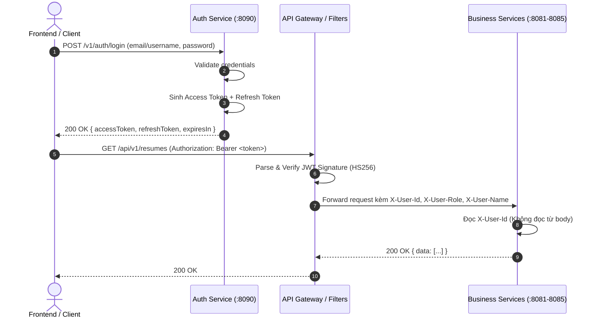

# Hợp Đồng Token JWT (JWT Contract Specification)

> **Dự án:** IntelliHire Monorepo Microservices  
> **Tác giả:** Người A (Platform & Identity Owner)  
> **Phạm vi áp dụng:** Toàn bộ hệ thống (`intelli-hire-auth`, `intelli-hire-gateway`, `intelli-hire-resume`, `intelli-hire-question`, `intelli-hire-interviews`, `intelli-hire-grading`, `intelli-hire-report`, `intelli-hire-frontend`)  
> **Trạng thái:** Chuẩn hóa (SSOT - Single Source of Truth)

---

## 1. Tổng Quan Kiến Trúc Xác Thực (Architecture Overview)

Hệ thống IntelliHire áp dụng mô hình xác thực **Stateless JWT Token Pair** kết hợp phân quyền đa tầng (RBAC - Role-Based Access Control):
- **Access Token:** Mang thông tin định danh và phân quyền đầy đủ, thời hạn sống ngắn, được dùng để gọi trực tiếp các API dịch vụ hoặc qua API Gateway.
- **Refresh Token:** Dùng để cấp lại Access Token mới khi hết hạn, được lưu vết trong cơ sở dữ liệu (`refresh_tokens`) và Redis để hỗ trợ thu hồi tức thì (Revocation/Logout).
- **Microservices Trust Boundary:**
  - Client gửi JWT trong header `Authorization: Bearer <access_token>`.
  - API Gateway (hoặc filter cục bộ `JwtAuthenticationFilter` / `HeaderAuthFilter`) xác thực chữ ký JWT, kiểm tra `exp`, `iss`, `aud`.
  - Sau khi xác thực thành công, Gateway/Filter trích xuất thông tin người dùng và chuyển tiếp xuống các service nội bộ qua các HTTP Headers:
    - `X-User-Id`
    - `X-User-Role`
    - `X-User-Name`



---

## 2. Thông Số Kỹ Thuật (Cryptographic Parameters)

| Tham số | Giá trị chuẩn | Biến môi trường tương ứng | Mô tả |
|---|---|---|---|
| **Thuật toán ký** | `HS256` (HMAC với SHA-256) | – | Thuật toán ký khóa đối xứng chuẩn RFC 7519 |
| **Độ dài Secret Key** | Tối thiểu 256 bits (≥ 32 ký tự UTF-8) | `JWT_SECRET` | Khóa bí mật dùng chung giữa Auth Service và Gateway |
| **Issuer (`iss`)** | `intellihire-auth` | `JWT_ISSUER` | Tên bên phát hành token |
| **Access Audience (`aud`)** | `intellihire-api` | `JWT_ACCESS_AUDIENCE` | Đối tượng tiếp nhận Access Token |
| **Refresh Audience (`aud`)** | `intellihire-refresh` | `JWT_REFRESH_AUDIENCE` | Đối tượng tiếp nhận Refresh Token |
| **Access TTL** | `900` giây (15 phút) | `JWT_ACCESS_EXPIRATION_SECONDS` | Thời gian sống của Access Token |
| **Refresh TTL** | `604800` giây (7 ngày) | `JWT_REFRESH_EXPIRATION_SECONDS` | Thời gian sống của Refresh Token |

---

## 3. Cấu Trúc Payload Token (Token Claims Specification)

### 3.1. Access Token Payload

Access Token chứa đầy đủ định danh người dùng, vai trò (`roles`) và quyền hạn cụ thể (`permissions`):

```json
{
  "iss": "intellihire-auth",
  "aud": "intellihire-api",
  "sub": "1",
  "email": "candidate@intellihire.com",
  "username": "candidate_pro",
  "roles": [
    "ROLE_CANDIDATE"
  ],
  "permissions": [
    "resume:read",
    "resume:write",
    "interview:participate",
    "report:read"
  ],
  "token_type": "ACCESS",
  "iat": 1728460800,
  "exp": 1728461700
}
```

#### Chi tiết các trường (Claims):
- `sub` *(String, Bắt buộc)*: ID tài khoản dạng chuỗi chuẩn canonical (ví dụ `"1"` hoặc UUID).
- `email` *(String, Bắt buộc)*: Email đã được xác minh của chủ sở hữu tài khoản.
- `username` *(String, Bắt buộc)*: Tên định danh đăng nhập của người dùng.
- `roles` *(Array of Strings, Bắt buộc)*: Danh sách vai trò người dùng (chuẩn tiền tố `ROLE_`, ví dụ `ROLE_ADMIN`, `ROLE_CANDIDATE`, `ROLE_RECRUITER`).
- `permissions` *(Array of Strings, Bắt buộc)*: Danh sách quyền chi tiết dạng `<resource>:<action>` (ví dụ `question:create`, `user:manage`).
- `token_type` *(String, Bắt buộc)*: Luôn mang giá trị cố định `"ACCESS"`.
- `iat` *(Long, Bắt buộc)*: Thời điểm cấp phát (Epoch time in seconds).
- `exp` *(Long, Bắt buộc)*: Thời điểm hết hạn = `iat + 900`.

---

### 3.2. Refresh Token Payload

Refresh Token có kích thước tối giản, chứa `jti` để quản lý trạng thái thu hồi trong CSDL:

```json
{
  "jti": "d3b07384-d113-4c95-8b9a-4c28f09d845e",
  "iss": "intellihire-auth",
  "aud": "intellihire-refresh",
  "sub": "1",
  "email": "candidate@intellihire.com",
  "token_type": "REFRESH",
  "iat": 1728460800,
  "exp": 1729065600
}
```

#### Chi tiết các trường (Claims):
- `jti` *(String UUID, Bắt buộc)*: Mã định danh duy nhất của phiên Refresh Token (khớp với cột `token_id` trong bảng `refresh_tokens`).
- `sub` *(String, Bắt buộc)*: ID tài khoản.
- `email` *(String, Bắt buộc)*: Email tài khoản.
- `token_type` *(String, Bắt buộc)*: Luôn mang giá trị cố định `"REFRESH"`.
- `iat` *(Long, Bắt buộc)*: Thời điểm cấp phát.
- `exp` *(Long, Bắt buộc)*: Thời điểm hết hạn = `iat + 604800`.

---

## 4. Quy Ước HTTP Headers Cho Toàn Bộ Microservices (Downstream Headers)

Sau khi Gateway hoặc Filter thẩm định tính hợp lệ của JWT, các thông tin định danh bắt buộc phải được gắn vào Request Headers khi gọi tới các dịch vụ phía trong:

| Header Name | Kiểu | Bắt buộc | Mô tả | Ví dụ |
|---|---|---|---|---|
| `X-User-Id` | `String` | **Có** | ID tài khoản duy nhất thực hiện thao tác. Backend **tuyệt đối không** nhận `userId` từ request body để chống tấn công IDOR. | `1` hoặc `c9bf9e57-1685-4c89-bafb-ff5af830be8a` |
| `X-User-Role` | `String` | Tùy chọn | Vai trò chính của người dùng (ngăn cách bởi dấu phẩy nếu nhiều role). | `ROLE_CANDIDATE` |
| `X-User-Name` | `String` | Tùy chọn | Tên người dùng / username hỗ trợ audit log và thống kê. | `candidate_pro` |
| `X-Request-Id` | `String` | Tùy chọn | UUID theo dõi vết truy vết phân tán (Tracing). | `8f1c4e72-a169-4560-bf8c-1296c00d5a32` |

> [!CAUTION]
> **Quy tắc an toàn bảo mật:**
> - Nếu request tới endpoint được bảo vệ mà thiếu header `X-User-Id`, các microservice lập tức trả về mã lỗi `401 Unauthorized` (`COM_002` hoặc `ErrorCode.COM_004`).
> - Tài nguyên thuộc về người khác phải trả về mã lỗi `404 Not Found` thay vì `403 Forbidden` để tránh để lộ sự tồn tại của tài nguyên (Resource enumeration protection).

---

## 5. Quy Trình Vòng Đời Token (Token Lifecycle & Flows)

### 5.1. Cấp Phát Cặp Token (Login / Registration)
- **Endpoint:** `POST /v1/auth/login`
- **Response chuẩn:**
  ```json
  {
    "success": true,
    "message": "Đăng nhập thành công",
    "data": {
      "accessToken": "eyJhbGciOi...",
      "refreshToken": "eyJhbGciOi...",
      "tokenType": "Bearer",
      "expiresIn": 900,
      "refreshExpiresIn": 604800,
      "user": {
        "id": 1,
        "email": "candidate@intellihire.com",
        "username": "candidate_pro",
        "roles": ["ROLE_CANDIDATE"]
      }
    },
    "timestamp": "2026-10-09T10:00:00"
  }
  ```

### 5.2. Làm Mới Token (Refresh Flow - Token Rotation)
- **Endpoint:** `POST /v1/auth/refresh`
- **Request:**
  ```json
  {
    "refreshToken": "eyJhbGciOi..."
  }
  ```
- **Xử lý:**
  1. Parse & kiểm tra tính hợp lệ của JWT Refresh Token (chữ ký, `iss`, `aud`, `exp`).
  2. Kiểm tra `jti` trong CSDL bảng `refresh_tokens`: nếu trạng thái đã bị thu hồi (`revoked = true`) hoặc không tồn tại → lập tức từ chối và cảnh báo nghi ngờ bị tấn công chiếm đoạt token (Token Reuse Detection).
  3. Đánh dấu token cũ là `revoked = true` (Refresh Token Rotation).
  4. Cấp cặp token mới và trả về cho Client.

### 5.3. Đăng Xuất (Logout / Revoke Flow)
- **Endpoint:** `POST /v1/auth/logout`
- **Xử lý:**
  1. Thu hồi toàn bộ Refresh Token của phiên làm việc hiện tại (`revoked = true`).
  2. Tùy chọn: Đưa `jti` của Access Token vào danh sách đen Redis Blacklist với TTL bằng thời gian sống còn lại của Access Token (nếu bật chế độ Instant Revocation).

---

## 6. Danh Mục Mã Lỗi Liên Quan Đến Token (Error Codes Matrix)

| Mã lỗi | HTTP Status | Thông báo hiển thị | Nguyên nhân & Hành động xử lý |
|---|---|---|---|
| `AUTH_1001` | `401 Unauthorized` | Email/tên đăng nhập hoặc mật khẩu không đúng | Sai thông tin xác thực khi đăng nhập |
| `AUTH_1005` | `401 Unauthorized` | Token không hợp lệ hoặc đã hết hạn | Access token hết hạn hoặc sai chữ ký → Client tự động gọi API refresh |
| `AUTH_1006` | `401 Unauthorized` | Không tìm thấy refresh token | Không tìm thấy bản ghi token trong CSDL |
| `AUTH_1007` | `401 Unauthorized` | Refresh token đã bị thu hồi | Token đã bị đăng xuất hoặc bị tái sử dụng → Buộc đăng nhập lại |
| `AUTH_1008` | `401 Unauthorized` | Refresh token đã hết hạn | Refresh token vượt quá 7 ngày → Buộc đăng nhập lại |
| `AUTH_1009` | `401 Unauthorized` | Phiên đã hết hạn do không hoạt động | Không có thao tác trong thời gian quy định |
| `COM_002` | `401 Unauthorized` | Thiếu hoặc sai X-User-Id | Downstream service không nhận được thông tin người dùng từ header |
| `GEN_9003` | `403 Forbidden` | Không có quyền truy cập | Người dùng thiếu Role hoặc Permission tương ứng |

---

## 7. Ví Dụ Xác Thực Trên Microservices (Code Reference)

```java
// Đọc bối cảnh an toàn từ Header:
@GetMapping("/api/v1/resumes")
public ResponseEntity<ApiResponse<List<ResumeResponse>>> listResumes(
        @RequestHeader("X-User-Id") String userId,
        @RequestHeader(value = "X-User-Role", required = false) String userRole
) {
    return ResponseEntity.ok(ApiResponse.success(resumeService.list(userId)));
}
```
