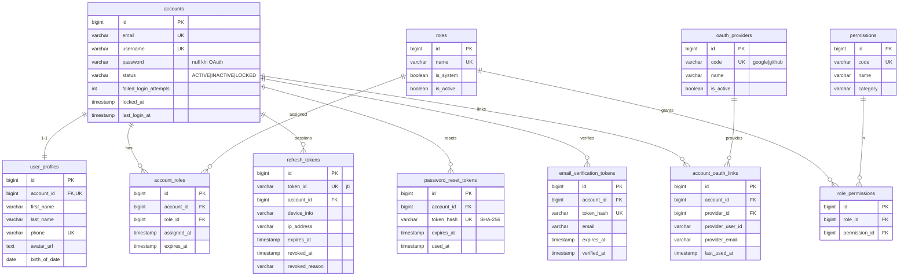
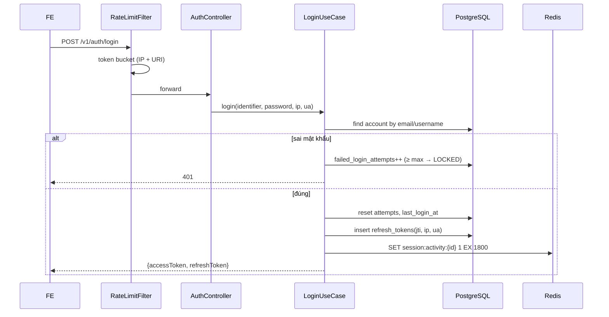
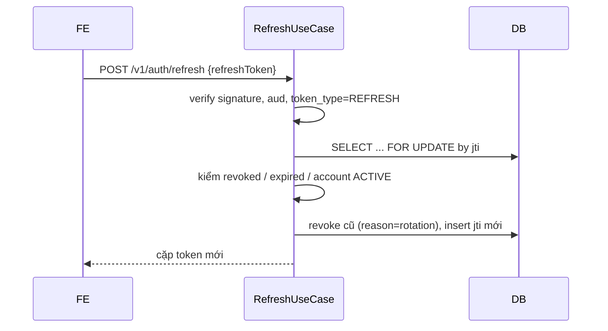
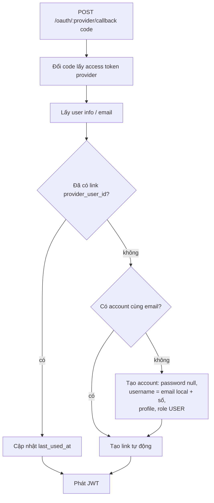
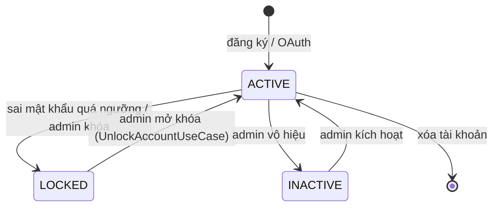

# Auth service – Thiết kế chi tiết

Auth service quản lý danh tính, phát JWT, phiên đăng nhập, OAuth và phân quyền RBAC cho toàn hệ thống.

| Thuộc tính | Giá trị |
|---|---|
| Repo | `intelli-hire-auth` |
| Stack | Spring Boot 3.4.2, Java 21, Spring Security, Data JPA, Redis, jjwt, Flyway |
| Port / context | `${SERVER_PORT}` (dev 8090) / `/` |
| DB | PostgreSQL, schema `${DB_SCHEMA}`, `ddl-auto: validate`, Flyway `V001..V012` (bảng `flyway_schema_history_auth`) |
| Package gốc | `org.aibles.intellihire.authservice` |

## 1. Trách nhiệm

- Đăng ký, xác thực email, đăng nhập (email hoặc username), khóa tài khoản khi sai nhiều lần.
- Phát và xoay vòng access/refresh token; đăng xuất một/tất cả phiên; quản lý phiên.
- Quên / đặt lại / đổi mật khẩu; xóa tài khoản.
- OAuth Google, GitHub: đăng nhập, tự liên kết theo email, liên kết/hủy liên kết.
- RBAC: role, permission, gán role; API quản trị.
- Theo dõi hoạt động phiên (idle 30 phút) qua Redis.

## 2. Mô hình dữ liệu



### Từ điển dữ liệu (các ràng buộc quan trọng)

| Bảng | Ràng buộc / ghi chú |
|---|---|
| `accounts` | `email` ≤100, `username` ≤50, đều unique; `status` mặc định `ACTIVE`; audit `created_*`, `updated_*` |
| `user_profiles` | 1–1 với account (`account_id` unique); `phone` ≤20 unique; `github_url`, `linked_in_url`, `gender`, `address` |
| `account_roles` | UQ(`account_id`,`role_id`); có `expires_at` cho role tạm thời |
| `role_permissions` | UQ(`role_id`,`permission_id`) |
| `refresh_tokens` | `token_id` = claim `jti` (≤64); `ip_address` ≤45 (IPv6) |
| `account_oauth_links` | UQ(`provider_id`,`provider_user_id`), UQ(`account_id`,`provider_id`) |
| Tất cả FK tới `accounts` | `ON DELETE CASCADE` |

### Dữ liệu khởi tạo (V012)

| Loại | Giá trị |
|---|---|
| OAuth provider | `google`, `github` |
| Role hệ thống | `USER`, `ADMIN`, `SUPER_ADMIN` |
| Permission (15) | `accounts:read:self`, `accounts:update:self`, `profiles:read:self`, `profiles:update:self`, `admin:accounts:{read,create,update,delete,lock}`, `admin:roles:{read,create,update,delete,assign}`, `admin:permissions:read` |
| Gán quyền | `USER` → 4 quyền `self`; `ADMIN`, `SUPER_ADMIN` → mọi permission active |

## 3. API

Public = không cần token, đi qua filter chain có rate limit.

| Method | Path | Mô tả | Quyền |
|---|---|---|---|
| POST | `/v1/auth/register` | Đăng ký, gửi link xác thực | Public |
| POST | `/v1/auth/verify-email` | Xác thực email bằng token | Public |
| POST | `/v1/auth/login` | Đăng nhập, trả cặp JWT | Public |
| POST | `/v1/auth/refresh` | Đổi refresh token lấy cặp mới (rotation) | Public |
| POST | `/v1/auth/forgot-password` | Gửi link đặt lại mật khẩu | Public |
| POST | `/v1/auth/reset-password` | Đặt lại mật khẩu bằng token | Public |
| POST | `/v1/auth/logout` | Thu hồi refresh token hiện tại | Đăng nhập |
| POST | `/v1/auth/logout-all` | Thu hồi mọi refresh token | Đăng nhập |
| GET | `/v1/auth/sessions` | Danh sách phiên đang hoạt động | Đăng nhập |
| DELETE | `/v1/auth/sessions/{sessionId}` | Thu hồi một phiên | Đăng nhập |
| POST | `/v1/accounts/me/change-password` | Đổi mật khẩu | Đăng nhập |
| DELETE | `/v1/accounts/me` | Xóa tài khoản (xác nhận mật khẩu) | Đăng nhập |
| GET / PUT | `/v1/profiles/me` | Xem / sửa hồ sơ | Đăng nhập |
| GET | `/v1/oauth/providers` | Danh sách provider | Public |
| GET | `/v1/oauth/{provider}/authorize` | URL ủy quyền + `state` | Public |
| POST | `/v1/oauth/{provider}/callback` | Đổi code, đăng nhập/đăng ký | Public |
| POST | `/v1/oauth/{provider}/link` | Liên kết provider | Đăng nhập |
| DELETE | `/v1/oauth/{provider}/unlink` | Hủy liên kết | Đăng nhập |
| GET | `/v1/oauth/me/providers` | Provider đã liên kết | Đăng nhập |
| GET | `/v1/admin/accounts` | Danh sách account (phân trang) | ADMIN, SUPER_ADMIN |
| GET | `/v1/admin/accounts/{accountId}` | Chi tiết account | ADMIN, SUPER_ADMIN |
| PATCH | `/v1/admin/accounts/{accountId}/status` | Khóa / mở / vô hiệu | ADMIN, SUPER_ADMIN |
| GET / POST | `/v1/admin/accounts/{accountId}/roles` | Xem / gán role | ADMIN, SUPER_ADMIN |
| DELETE | `/v1/admin/accounts/{accountId}/roles/{roleId}` | Bỏ role | ADMIN, SUPER_ADMIN |
| GET / POST | `/v1/admin/roles` | Danh sách / tạo role | ADMIN, SUPER_ADMIN |
| PUT / DELETE | `/v1/admin/roles/{roleId}` | Sửa / xóa role (không xóa role hệ thống) | ADMIN, SUPER_ADMIN |
| GET | `/v1/admin/permissions` | Danh sách permission | ADMIN, SUPER_ADMIN |

FE gọi qua `/api/v1/...`; proxy bỏ tiền tố `/api`.

## 4. Thiết kế token

| Thuộc tính | Access token | Refresh token |
|---|---|---|
| Thuật toán | HMAC-SHA (`Keys.hmacShaKeyFor(JWT_SECRET)`) | như access |
| TTL | `JWT_ACCESS_EXPIRATION_SECONDS` | `JWT_REFRESH_EXPIRATION_SECONDS` |
| `aud` | `JWT_ACCESS_AUDIENCE` | `JWT_REFRESH_AUDIENCE` |
| Claims | `sub`=accountId, `iss`, `iat`, `exp`, `email`, `username`, `roles[]`, `permissions[]`, `token_type=ACCESS` | `jti`, `sub`, `iss`, `iat`, `exp`, `email`, `token_type=REFRESH` |
| Lưu trữ server | Không | Bảng `refresh_tokens` theo `jti` |

Filter JWT: kiểm chữ ký, `iss`, `aud`, `token_type`; ánh xạ role → `ROLE_<name>`, permission → authority; kiểm key Redis `session:activity:{accountId}` (thiếu → 401 `SESSION_INACTIVE`) và gia hạn 30 phút.

## 5. Sequence

### 5.1 Đăng nhập


### 5.2 Làm mới token (rotation)


### 5.3 OAuth callback


## 6. State machine tài khoản



Ngưỡng khóa: `PASSWORD_MAX_FAILED_ATTEMPTS`.

## 7. Cấu trúc package

```
authservice/
├── account/   adapter/web · usecase · domain       (change-password, delete)
├── admin/     adapter/web · usecase                (accounts, roles, permissions)
├── auth/      adapter/web · usecase · token/       (login, refresh, logout, sessions, verify, reset)
├── oauth/     adapter/web · usecase · client/      (Google, GitHub)
├── profile/   adapter/web · usecase · domain
├── rbac/      adapter/repository · domain          (roles, permissions, AccountAuthorizationRepository - JDBC)
└── shared/    config (Security, JwtFilter, CORS) · email · exception · ratelimit · service · util · dto
```

## 8. Cấu hình

| Biến | Ý nghĩa |
|---|---|
| `SERVER_PORT`, `DB_HOST`, `DB_PORT`, `DB_NAME`, `DB_SCHEMA`, `DB_USERNAME`, `DB_PASSWORD` | Server & DB |
| `JWT_SECRET`, `JWT_ISSUER`, `JWT_ACCESS_*`, `JWT_REFRESH_*` | Token |
| `PASSWORD_MAX_FAILED_ATTEMPTS`, `PASSWORD_LOCK_DURATION_MINUTES` | Khóa tài khoản |
| `SMTP_HOST` (smtp.gmail.com), `SMTP_PORT` (587), `SMTP_USERNAME`, `SMTP_PASSWORD` | Email (profile `prod`; `dev` in link ra console) |
| `REDIS_HOST`, `REDIS_PORT` | Redis |
| Google/GitHub client id/secret, redirect URI | OAuth |
| CORS allowed-origins (mặc định `http://localhost:3000`) | CORS |

Rate limit (in-memory token bucket, khóa `IP:URI`): base 60/60s · prod 30/60s · dev 200/60s; vượt → 429 + `Retry-After`.

## 9. Mã lỗi tiêu biểu

`SESSION_INACTIVE`, `RATE_LIMIT_EXCEEDED`, `REFRESH_TOKEN_*`, `PASSWORD_RESET_TOKEN_INVALID`, `EMAIL_VERIFICATION_TOKEN_INVALID`, `SAME_PASSWORD`, `PASSWORD_MISMATCH`, `ACCOUNT_INACTIVE`, `AUTH_1009` (FE dùng để đăng xuất khi idle).

## 10. Điểm lệch cần xử lý ⚠️

1. OAuth callback **không kiểm `state`** phía server → rủi ro CSRF đăng nhập.
2. OAuth callback **không tạo key `session:activity`** → access token từ OAuth bị 401 `SESSION_INACTIVE`.
3. `/v1/auth/resend-verification` được permit nhưng chưa có controller.
4. Đổi mật khẩu **không thu hồi** các phiên khác (OpenAPI mô tả là có).
5. `PASSWORD_LOCK_DURATION_MINUTES` chưa có cơ chế tự mở khóa.
6. Xác thực email chỉ ghi `verified_at`; đăng nhập không yêu cầu email đã xác thực.
7. Rate limit in-memory → không chia sẻ khi chạy nhiều instance; nên chuyển Redis.
8. Chưa dùng `@PreAuthorize` theo permission; quyền admin chỉ kiểm theo role ở `SecurityConfig`.
