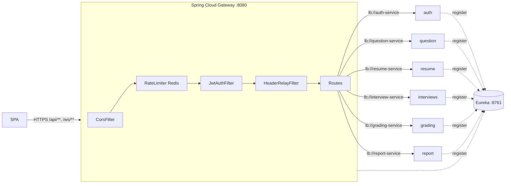
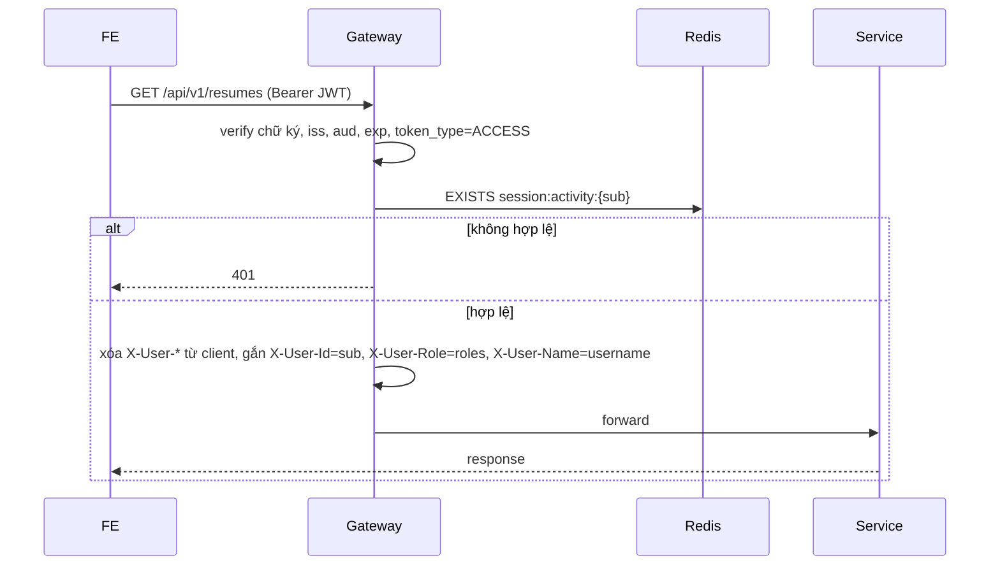

# API Gateway & Service Discovery – Thiết kế chi tiết

Repo `intelli-hire-gateway` cung cấp API Gateway làm điểm vào duy nhất của hệ thống; repo `intelli-hire-eureka-service` cung cấp service discovery. Gateway gom xác thực, CORS và rate limit về một chỗ.

## 1. Vai trò

| Mối quan tâm | Thiết kế |
|---|---|
| Điểm vào | Một điểm vào duy nhất `:8080` cho REST và WebSocket |
| Xác thực | Gateway xác thực JWT, **ghi đè** header `X-User-*`; question, resume, interviews, grading, report tin các header này vì chỉ nhận request từ gateway |
| CORS | Tập trung ở gateway |
| Rate limit | Redis ở gateway, dùng chung giữa các instance |
| Định tuyến | Eureka + `lb://`, không cấu hình cứng URL service |

## 2. Kiến trúc



## 3. Bảng route

| Path vào gateway | Service | Rewrite | Public |
|---|---|---|---|
| `/api/v1/auth/**`, `/api/v1/oauth/**` | auth-service | bỏ `/api` | một phần (login, register, refresh, forgot/reset, verify, resend-verification, oauth providers/authorize/callback) |
| `/api/v1/profiles/**`, `/api/v1/accounts/**` | auth-service | bỏ `/api` | – |
| `/api/v1/admin/questions/**` | question-service | giữ | – |
| `/api/v1/admin/**` | auth-service | bỏ `/api` | – |
| `/api/v1/questions/**`, `/topics/**`, `/tags/**`, `/difficulties/**`, `/study-articles/**` | question-service | giữ | – |
| `/api/v1/resumes/**`, `/skills/**`, `/parse-jobs/**` | resume-service | giữ | – |
| `/api/v1/interviews/**` | interview-service | giữ | – |
| `/ws/interview/**` | interview-service (WebSocket) | giữ | token qua query/STOMP header |
| `/api/v1/gradings/**` | grading-service | giữ | – |
| `/api/v1/reports/**` | report-service | giữ | – |

Thứ tự: route cụ thể (`/admin/questions`) phải đứng trước route rộng (`/admin/**`).

## 4. Xác thực tại gateway



Gateway dùng chung `JWT_SECRET`, `JWT_ISSUER`, `JWT_ACCESS_AUDIENCE` với auth. Các service chỉ chấp nhận request trong mạng nội bộ (không mở port ra ngoài).

## 5. Cấu hình mẫu

```yaml
server:
  port: 8080
spring:
  application:
    name: api-gateway
  cloud:
    gateway:
      globalcors:
        cors-configurations:
          '[/**]':
            allowedOrigins: ${CORS_ORIGINS:http://localhost:4200}
            allowedMethods: [GET, POST, PUT, PATCH, DELETE, OPTIONS]
            allowedHeaders: ['*']
            allowCredentials: true
      routes:
        - id: auth
          uri: lb://auth-service
          predicates: [Path=/api/v1/auth/**,/api/v1/oauth/**,/api/v1/profiles/**,/api/v1/accounts/**]
          filters: [StripPrefix=1]
        - id: admin-questions
          uri: lb://question-service
          predicates: [Path=/api/v1/admin/questions/**]
        - id: admin
          uri: lb://auth-service
          predicates: [Path=/api/v1/admin/**]
          filters: [StripPrefix=1]
        - id: interview-ws
          uri: lb:ws://interview-service
          predicates: [Path=/ws/interview/**]
eureka:
  client:
    service-url:
      defaultZone: ${EUREKA_URL:http://localhost:8761/eureka}
```

## 6. Eureka server

| Thuộc tính | Giá trị |
|---|---|
| Port | 8761 |
| `register-with-eureka` / `fetch-registry` | false / false |
| Client (mỗi service) | thêm `spring-cloud-starter-netflix-eureka-client`, đặt `spring.application.name` thống nhất (`auth-service`, `question-service`, `resume-service`, `interview-service`, `grading-service`, `report-service`) |
| Heartbeat | mặc định 30 s |

## 7. Thứ tự triển khai

1. Dựng Eureka, cấu hình Eureka client và `spring.application.name` cho từng service.
2. Dựng gateway với bảng route ở mục 3.
3. Bật `JwtAuthFilter` + `HeaderRelayFilter`; các service chỉ đọc `X-User-*` do gateway gắn và từ chối request thiếu header.
4. Cấu hình `environment.apiUrl` của FE trỏ tới gateway ở mọi môi trường.
5. Bật rate limit Redis ở gateway.
