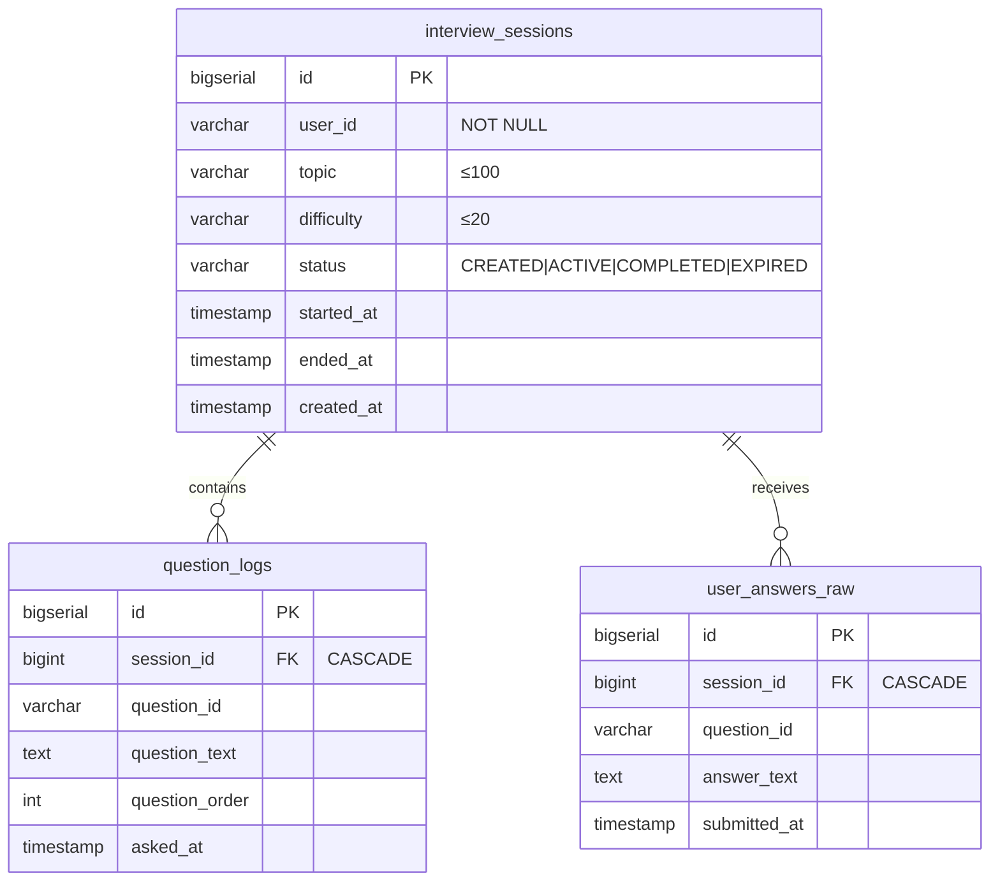
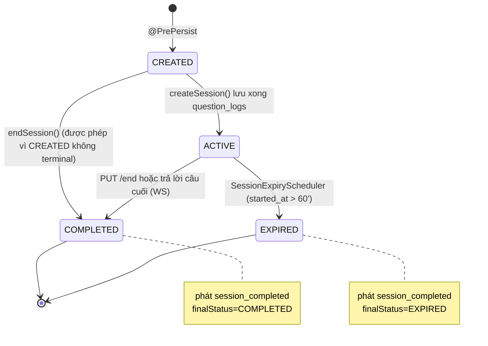
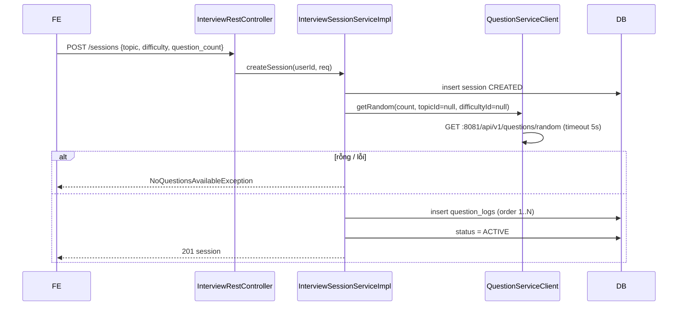
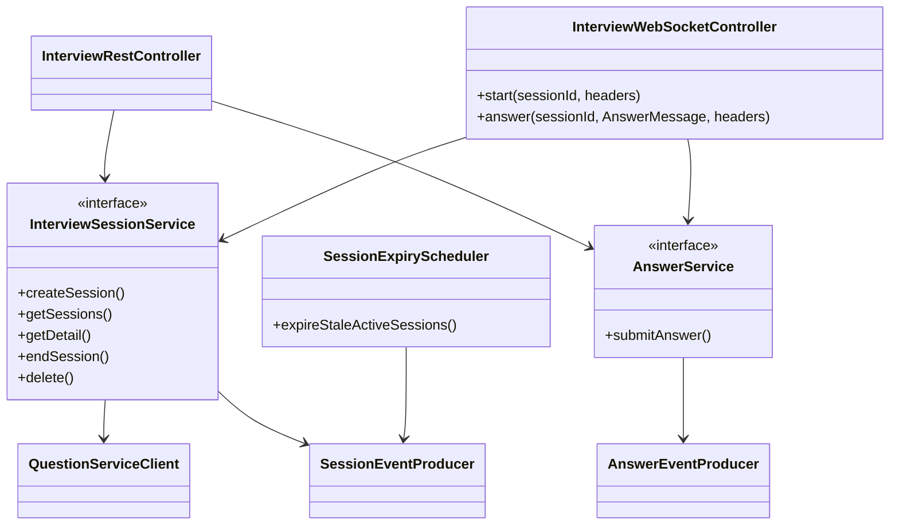

# Interview service – Thiết kế chi tiết

Interview service điều phối phiên phỏng vấn: tạo phiên từ câu hỏi của question service, hỏi–đáp thời gian thực qua WebSocket, kết thúc/hết hạn phiên và phát sự kiện cho grading.

| Thuộc tính | Giá trị |
|---|---|
| Repo | `intelli-hire-interviews` |
| Stack | Spring Boot 3.2.4, Java 17, Web, WebSocket (STOMP + SockJS), Data JPA, Validation, Spring Kafka, Flyway |
| Tên ứng dụng / port | `interview-service` / 8083 |
| DB | PostgreSQL `interview_db`, schema `interviews`, bảng Flyway `flyway_schema_history_interviews` |
| JSON | Jackson `SNAKE_CASE` |
| Package gốc | `org.aibles.intellihireinterview` |

## 1. Trách nhiệm

- Tạo phiên (topic, độ khó, 1–20 câu), lưu danh sách câu hỏi theo thứ tự.
- Phát câu hỏi và nhận câu trả lời qua STOMP; REST dự phòng.
- Kết thúc phiên (thủ công / hết câu), tự hết hạn sau 60 phút.
- Phát `answers_submitted`, `session_completed`.

## 2. Mô hình dữ liệu

- Index: `interview_sessions(user_id)`, `interview_sessions(status)`.
- V2 đổi `user_id` BIGINT → VARCHAR(255); V3 đổi `question_id` BIGINT → VARCHAR(255) (để khớp UUID của question service).
- Trùng câu trả lời (session, question) được chặn trong code, **chưa có unique constraint** ở DB.

## 3. API REST – `/api/v1/interviews/sessions`

| Method | Path | Mô tả | Body / tham số |
|---|---|---|---|
| POST | `/` | Tạo phiên → 201 | `topic` (bắt buộc), `difficulty`, `question_count` 1–20 (mặc định 5) |
| GET | `/` | Phiên của tôi | `page`=0, `size`=20 (≤100), sắp theo `created_at` giảm dần |
| GET | `/{sessionId}` | Chi tiết + câu hỏi + câu trả lời | – |
| PUT | `/{sessionId}/end` | Kết thúc phiên | – |
| DELETE | `/{sessionId}` | Xóa phiên | – |
| POST | `/{sessionId}/answers` | Gửi câu trả lời | `question_id`, `answer_text` (≤ 10000) |

`userId` lấy từ request attribute do `HeaderAuthFilter` gán từ `X-User-Id`.

## 4. WebSocket

| Thuộc tính | Giá trị |
|---|---|
| Endpoint | `/ws/interview` (SockJS), allowed origins `*` |
| Prefix | app `/app`, broker `/topic` |
| Nhận | `/app/interview/{sessionId}/start`, `/app/interview/{sessionId}/answer` (`AnswerMessage{questionId, answerText}`) |
| Gửi | `/topic/interview/{sessionId}` – `QuestionMessage{type, questionId, questionText, questionOrder, totalQuestions}` |

Chi tiết giao thức: [05-thiet-ke-tich-hop.md §5.3](../05-thiet-ke-tich-hop.md#53-giao-thức-websocket-interview).

## 5. State machine phiên

- `submitAnswer` yêu cầu `ACTIVE`, nếu không → `SessionNotActiveException`.
- Scheduler: `@Scheduled(fixedDelay = session.expiry.check-interval-ms, mặc định 300000)`, `@Transactional`.

## 6. Sequence tạo phiên

## 7. Class chính

## 8. Cấu hình

| Khóa / biến | Mặc định |
|---|---|
| `server.port` | 8083 |
| `DB_HOST`, `DB_NAME` (interview_db), `DB_SCHEMA` (interviews) | localhost |
| `KAFKA_SERVERS` | localhost:9092 |
| `kafka.topics.answers-submitted` / `session-completed` | `answers_submitted` / `session_completed` |
| `session.expiry.minutes` / `check-interval-ms` | 60 / 300000 |
| `QUESTION_SERVICE_URL` | http://localhost:8081 |

## 9. Điểm lệch cần xử lý ⚠️

1. `HeaderAuthFilter.shouldNotFilter` luôn trả `true` (TODO local dev) → REST không có định danh người dùng.
2. `createSession` truyền `topicId=null`, `difficultyId=null` → câu hỏi không theo topic đã chọn; cần tra `topicId` từ tên topic hoặc FE gửi id.
3. WS `/topic/interview/{id}` không kiểm quyền sở hữu phiên; origins `*`.
4. `answers_submitted` chưa có consumer.
5. Chưa có unique constraint (session_id, question_id) trong `user_answers_raw`.
6. CREATED → COMPLETED vẫn phát `session_completed` cho phiên chưa có câu hỏi.
