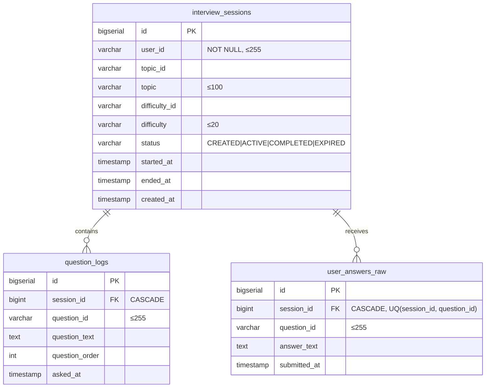
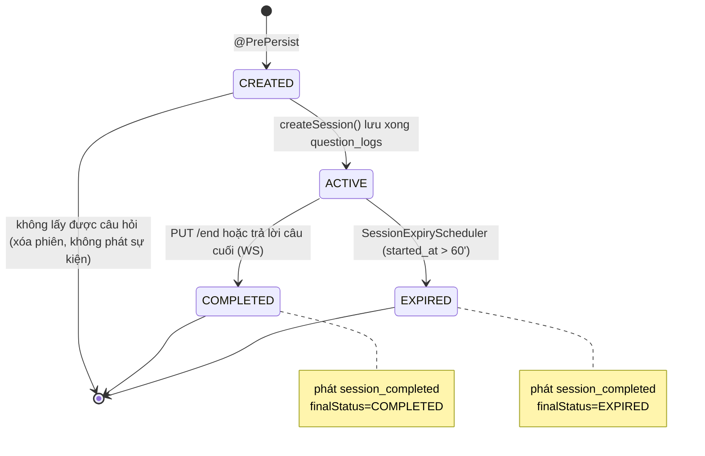
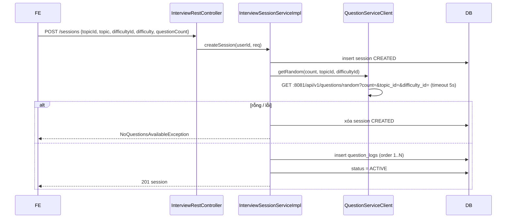
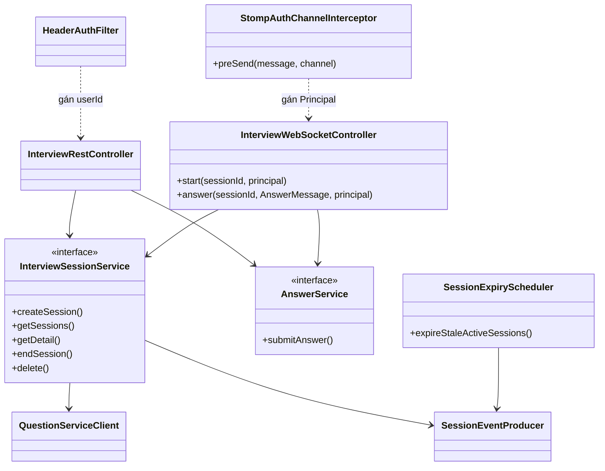

# Interview service – Thiết kế chi tiết

Interview service điều phối phiên phỏng vấn: tạo phiên từ câu hỏi của question service, hỏi–đáp thời gian thực qua WebSocket, kết thúc/hết hạn phiên và phát sự kiện cho grading.

| Thuộc tính | Giá trị |
|---|---|
| Repo | `intelli-hire-interviews` |
| Stack | Spring Boot 3.2.4, Java 17, Web, WebSocket (STOMP + SockJS), Data JPA, Validation, Spring Kafka, Flyway |
| Tên ứng dụng / port | `interview-service` / 8083 |
| DB | PostgreSQL `interview_db`, schema `interviews`, bảng Flyway `flyway_schema_history_interviews` |
| JSON | Jackson camelCase (thống nhất với mọi service) |
| Package gốc | `org.aibles.intellihireinterview` |

## 1. Trách nhiệm

- Tạo phiên (topic, độ khó, 1–20 câu), lưu danh sách câu hỏi theo thứ tự.
- Phát câu hỏi và nhận câu trả lời qua STOMP; REST dự phòng.
- Kết thúc phiên (thủ công / hết câu), tự hết hạn sau 60 phút.
- Phát sự kiện `session_completed` cho grading service.
- Chỉ chủ phiên được xem, trả lời, kết thúc và xóa phiên.

## 2. Mô hình dữ liệu

- Index: `interview_sessions(user_id)`, `interview_sessions(status)`.
- `user_id` và `question_id` kiểu VARCHAR(255) để khớp định danh String của auth service và UUID của question service (ADR-010).
- Mỗi câu hỏi chỉ nhận một câu trả lời trong một phiên: kiểm tra ở tầng service và ràng buộc `UNIQUE (session_id, question_id)` trên `user_answers_raw`.

## 3. API REST – `/api/v1/interviews/sessions`

| Method | Path | Mô tả | Body / tham số |
|---|---|---|---|
| POST | `/` | Tạo phiên → 201 | `topicId` (bắt buộc), `topic` (tên hiển thị), `difficultyId`, `difficulty`, `questionCount` 1–20 (mặc định 5) |
| GET | `/` | Phiên của tôi | `page`=0, `size`=20 (≤100), sắp theo `createdAt` giảm dần |
| GET | `/{sessionId}` | Chi tiết + câu hỏi + câu trả lời | – |
| PUT | `/{sessionId}/end` | Kết thúc phiên | – |
| DELETE | `/{sessionId}` | Xóa phiên | – |
| POST | `/{sessionId}/answers` | Gửi câu trả lời | `questionId`, `answerText` (≤ 10000) |

- `HeaderAuthFilter` bắt buộc cho mọi endpoint `/api/**`: đọc `X-User-Id` do API gateway gán sau khi xác thực JWT, đặt vào request attribute `userId`; thiếu header → 401.
- Mọi thao tác trên `/{sessionId}` kiểm tra `session.userId` khớp người gọi; không khớp → 403. Riêng lời gọi nội bộ từ grading service (`GET /{sessionId}` kèm `X-User-Id` của chủ phiên) cũng đi qua kiểm tra này.

## 4. WebSocket

| Thuộc tính | Giá trị |
|---|---|
| Endpoint | `/ws/interview` (SockJS), allowed origins giới hạn theo domain frontend (`ws.allowed-origins`) |
| Prefix | app `/app`, user destination prefix `/user` |
| Xác thực | JWT trong header `Authorization` của frame STOMP CONNECT; `ChannelInterceptor` xác thực và gán `Principal` = `userId` |
| Nhận | `/app/interview/{sessionId}/start`, `/app/interview/{sessionId}/answer` (`AnswerMessage{questionId, answerText}`) |
| Gửi | `/user/queue/interview` – `QuestionMessage{type, sessionId, questionId, questionText, questionOrder, totalQuestions}` |

- Server gửi bằng `convertAndSendToUser(userId, "/queue/interview", msg)` nên chỉ chủ phiên nhận được.
- Mỗi message `start`/`answer` kiểm tra `Principal` là chủ phiên; không phải → `ERROR`.

Chi tiết giao thức: [05-thiet-ke-tich-hop.md §5.3](../05-thiet-ke-tich-hop.md#53-giao-thức-websocket-interview).

## 5. State machine phiên

- `CREATED` là trạng thái tạm trong lúc lấy câu hỏi; `endSession` và `submitAnswer` chỉ áp dụng cho phiên `ACTIVE`, nếu không → `SessionNotActiveException`.
- `session_completed` chỉ phát cho phiên đã từng `ACTIVE` (có câu hỏi).
- Scheduler: `@Scheduled(fixedDelay = session.expiry.check-interval-ms, mặc định 300000)`, `@Transactional`.

## 6. Sequence tạo phiên

## 7. Class chính

## 8. Cấu hình

| Khóa / biến | Mặc định |
|---|---|
| `server.port` | 8083 |
| `DB_HOST`, `DB_NAME` (interview_db), `DB_SCHEMA` (interviews) | localhost |
| `KAFKA_SERVERS` | localhost:9092 |
| `kafka.topics.session-completed` | `session_completed` |
| `session.expiry.minutes` / `check-interval-ms` | 60 / 300000 |
| `QUESTION_SERVICE_URL` | http://localhost:8081 |
| `ws.allowed-origins` | domain frontend (ví dụ http://localhost:3000) |
| `JWT_SECRET` / public key | dùng chung với auth service để xác thực STOMP CONNECT |

## 9. Rủi ro & lưu ý khi triển khai

1. **Tin cậy header định danh**: REST dựa vào `X-User-Id` do gateway gán → service chỉ được expose qua gateway (không mở port ra ngoài), gateway phải xóa header `X-User-*` do client tự gửi.
2. **Khớp topic/độ khó**: FE phải gửi `topicId`/`difficultyId` lấy từ danh mục của question service; nếu topic không đủ câu hỏi, question service có thể trả ít hơn `questionCount` → phiên dùng số câu thực nhận (`totalQuestions`), trả rỗng → `NoQuestionsAvailableException`.
3. **Bảo mật WebSocket**: JWT hết hạn giữa phiên làm kết nối STOMP vẫn mở → cần kiểm tra hạn token ở mỗi message hoặc ngắt kết nối khi token hết hạn; cấu hình origins sai sẽ chặn FE hợp lệ.
4. **Trả lời trùng / đồng thời**: hai message `answer` cùng lúc cho một câu có thể vượt qua kiểm tra ở service → dựa vào `UNIQUE (session_id, question_id)` và chuyển lỗi vi phạm ràng buộc thành `ERROR` cho client.
5. **Phát sự kiện và giao dịch**: `session_completed` nên phát sau khi commit (`@TransactionalEventListener(AFTER_COMMIT)` hoặc outbox) để tránh grading đọc phiên chưa cập nhật; mất sự kiện khi Kafka lỗi → cân nhắc outbox.
6. **Phiên hết hạn**: phiên `EXPIRED` vẫn phát `session_completed` với `finalStatus=EXPIRED`; grading chấm các câu đã trả lời (xem [grading-service.md](grading-service.md) §8). Scheduler chạy 5 phút/lần nên phiên có thể kéo dài tối đa ~65 phút.
7. **Nhiều instance**: khi scale ngang, simple broker không chia sẻ session STOMP giữa các instance và scheduler chạy trùng → cần sticky session hoặc broker relay, và khóa phân tán (ví dụ ShedLock) cho scheduler.

Danh sách rủi ro toàn hệ thống: [11 – Rủi ro & lưu ý khi triển khai](../11-rui-ro-trien-khai.md).
