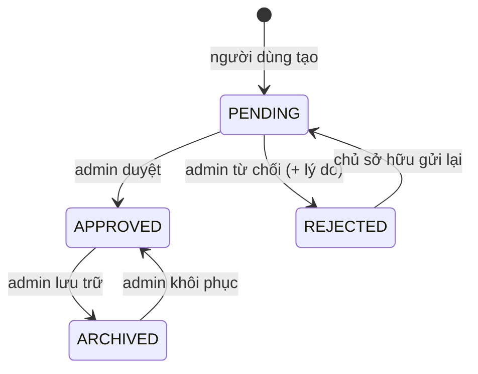
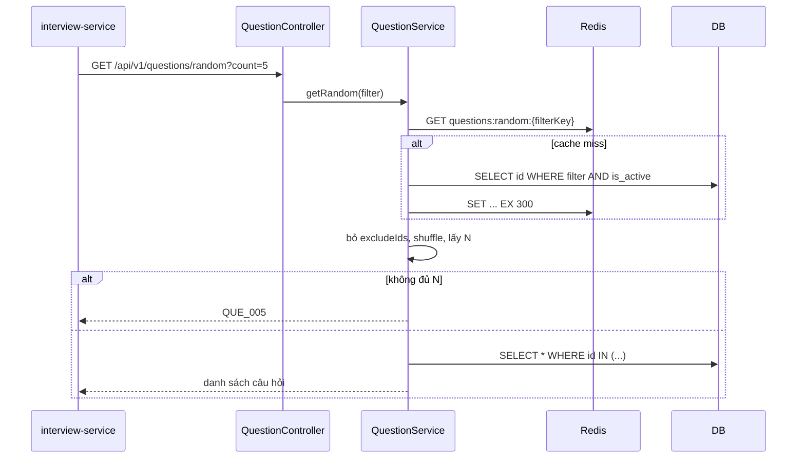
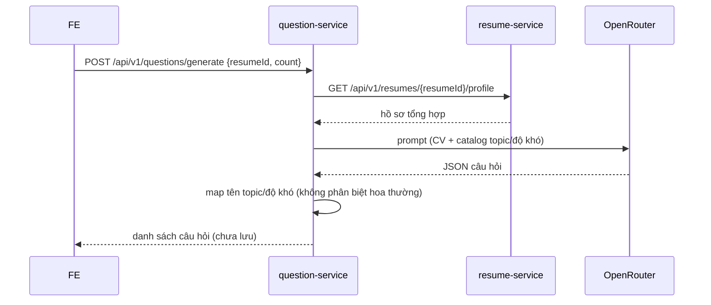

# Question service – Thiết kế chi tiết

Question service quản lý ngân hàng câu hỏi (topic dạng cây, tag, độ khó, rubric), kiểm duyệt câu hỏi người dùng gửi và cung cấp câu hỏi ngẫu nhiên cho interview.

| Thuộc tính | Giá trị |
|---|---|
| Repo | `intelli-hire-question` |
| Stack | Spring Boot 3.2.1, Java 17, Data JPA, Redis cache, Flyway, MapStruct |
| Port / context | `${SERVER_PORT:8080}` (dev cần 8081) / `${CONTEXT_PATH:/api}` |
| DB | PostgreSQL schema `question`, Flyway `V1..V6` (bảng `flyway_schema_history_question`) |
| Package gốc | `org.aibles.intellihirequestion` |

## 1. Trách nhiệm

- CRUD câu hỏi + rubric; xóa mềm.
- Topic dạng cây, tag, độ khó, bài học tham khảo.
- Tìm kiếm, đếm, lấy ngẫu nhiên có loại trừ.
- Kiểm duyệt câu hỏi người dùng gửi.
- Nhập hàng loạt; sinh câu hỏi bằng AI từ CV (không lưu).

## 2. Mô hình dữ liệu


Mọi bảng kế thừa `BaseEntity`: `id` UUID (sinh ở `@PrePersist`), `created_at`, `created_by`, `last_updated_at`, `last_updated_by` (auditing, người dùng lấy từ `X-User-Name`, mặc định `SYSTEM`). Không dùng quan hệ JPA; FK chỉ nằm trong SQL.

| Migration | Nội dung |
|---|---|
| V1 | Schema ban đầu |
| V2 | `rubrics.is_active` |
| V3 | Default `study_articles.is_active` |
| V4 | Index (`topic_id`, `is_active`) |
| V5 | Seed: EASY(1), MEDIUM(2), HARD(3) … |
| V6 | Cột kiểm duyệt: `status`, `submitted_by`, `submitted_by_id`, `rejection_reason` |

## 3. API

Đường dẫn đầy đủ có tiền tố `/api`.

### 3.1 Câu hỏi – `/api/v1/questions`
| Method | Path | Mô tả |
|---|---|---|
| POST | `/` | Tạo câu hỏi (status `PENDING`); header `X-User-Id`, `X-User-Name` |
| POST | `/bulk` | Nhập hàng loạt |
| POST | `/generate` | Sinh câu hỏi bằng AI từ CV; body `resumeId`, `count` 1–20 (8), `questionType`, `difficultyName`, `language` (en), `focusAreas`; cần `X-User-Id` |
| GET | `/{id}` | Chi tiết |
| PUT | `/{id}` | Cập nhật |
| DELETE | `/{id}` | Xóa mềm (kèm rubric) |
| GET | `/search` | Tìm theo từ khóa, phân trang |
| GET | `/random` | Ngẫu nhiên: `count`, `topic_id`, `difficulty_id`, type, tags, `excludeIds` |
| GET | `/count` | Đếm theo `topicId`, `difficultyId` |
| GET | `/submitted` | Câu hỏi do chính mình gửi (`X-User-Id`) |
| PATCH | `/{id}/moderation-status` | Gửi lại câu bị từ chối (chỉ chủ sở hữu) |
| POST / GET / PUT | `/{id}/rubric` | Tạo / xem / sửa rubric |

### 3.2 Quản trị – `/api/v1/admin/questions`
| Method | Path | Mô tả |
|---|---|---|
| GET | `/` | Danh sách (phân trang, lọc) |
| GET / PUT | `/{id}` | Xem / sửa |
| PATCH | `/{id}/moderation-status` | Đặt trạng thái bất kỳ; `rejection_reason` chỉ giữ khi `REJECTED` |

### 3.3 Danh mục
| Resource | Endpoint |
|---|---|
| Topic `/api/v1/topics` | GET `/`, GET `/tree`, POST, GET/PUT/DELETE `/{id}`, GET `/{id}/questions` |
| Độ khó `/api/v1/difficulties` | GET, POST, GET/PUT/DELETE `/{id}` |
| Tag `/api/v1/tags` | GET, POST, PUT/DELETE `/{id}` |
| Bài học `/api/v1/study-articles` | GET (phân trang), POST, GET/PUT/DELETE `/{id}` |
| Health | GET `/api/health` |

### 3.4 Rubric request (snake_case)
| Trường | Ràng buộc |
|---|---|
| `criteria` | Bắt buộc, ≤ 5000 ký tự |
| `keywords`, `common_mistakes`, `hints` | `List<String>` → jsonb |
| `example_answer` | ≤ 10000 ký tự |
| `max_score` | 1–100, mặc định 10 |

## 4. State machine kiểm duyệt



Gửi lại khi không phải chủ sở hữu → `QUE_403`; khi trạng thái không phải `REJECTED` → `QUE_409`. Endpoint admin cho phép đặt trạng thái bất kỳ.

## 5. Sequence

### 5.1 Lấy câu hỏi ngẫu nhiên


### 5.2 Sinh câu hỏi bằng AI


## 6. Cache (Redis, TTL mặc định 1h)

| Cache / key | Nội dung | Evict |
|---|---|---|
| `difficulties` (`all`) | Danh sách độ khó | create/update/delete |
| `tags` (`all`) | Danh sách tag | ghi tag |
| `topics:all`, `topics:tree` | Danh sách, cây topic | mọi ghi topic (allEntries) |
| `questions:random:*` | Danh sách id theo bộ lọc, TTL 5 phút | hết hạn |
| `difficulties:id` | Khai báo, TTL 10 phút, chưa dùng | – |

## 7. Cấu trúc package

```
intellihirequestion/
├── config          Redis, OpenAPI, auditing
├── controller      Question, AdminQuestion, Topic, Tag, Difficulty, StudyArticle, Health
├── dto             request/response · dto.ai · dto.resume
├── entity          + converter (QuestionTypeConverter) · enums · key (QuestionTagId)
├── exception · mapper (MapStruct) · projection · repository · specification (JPA Specification cho search)
├── service         + impl · ai (QuestionGenerationAiClient) · ai.impl (OpenRouter) · client (ResumeAggregateClient)
└── utils           SecurityUtils (đọc header)
```

## 8. Cấu hình

| Biến | Ý nghĩa |
|---|---|
| `SERVER_PORT`, `CONTEXT_PATH` | 8081, `/api` |
| `DB_HOST`, `DB_PORT`, `DATABASE_NAME`, `DB_SCHEMA` (question), `DATABASE_USERNAME`, `DATABASE_PASSWORD` | DB |
| `REDIS_HOST`, `REDIS_PORT` | Cache |
| `clients.resume.base-url` (http://localhost:8082), `RESUME_QUESTION_CONTEXT_PATH` | Gọi resume |
| OpenRouter API key, model (`x-ai/grok-4.1-fast`), timeout 60s | Sinh câu hỏi |

## 9. Điểm lệch cần xử lý ⚠️

1. **Không có kiểm tra quyền**: ai cũng tạo câu hỏi, và các endpoint `/admin/questions` không kiểm role.
2. `Question.status` là String; entity mặc định `PENDING` nhưng DB (V6) mặc định `APPROVED`.
3. `/random` có lọc theo trạng thái `APPROVED` hay không cần xác minh — tránh đưa câu chưa duyệt vào phỏng vấn.
4. Cache `difficulties:id` khai báo nhưng không dùng.
