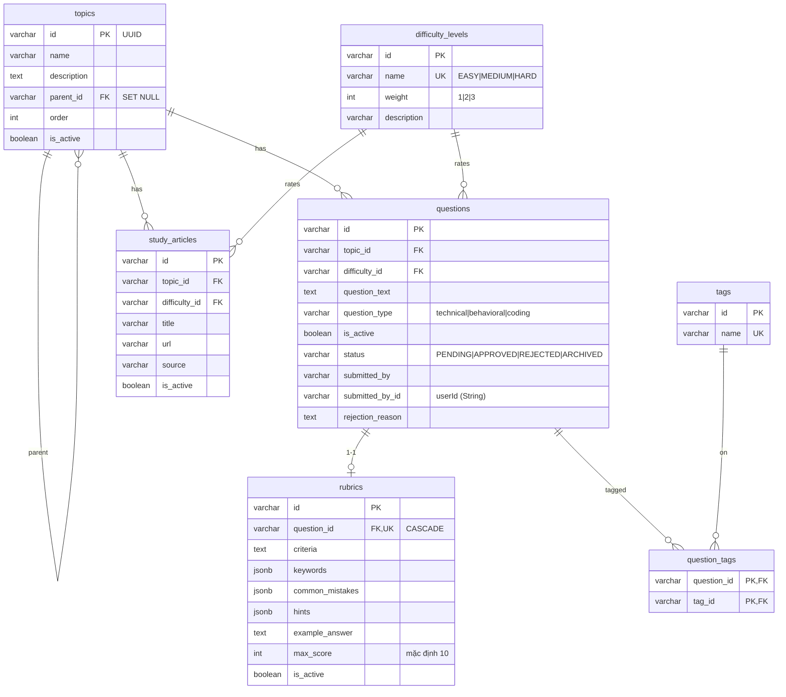
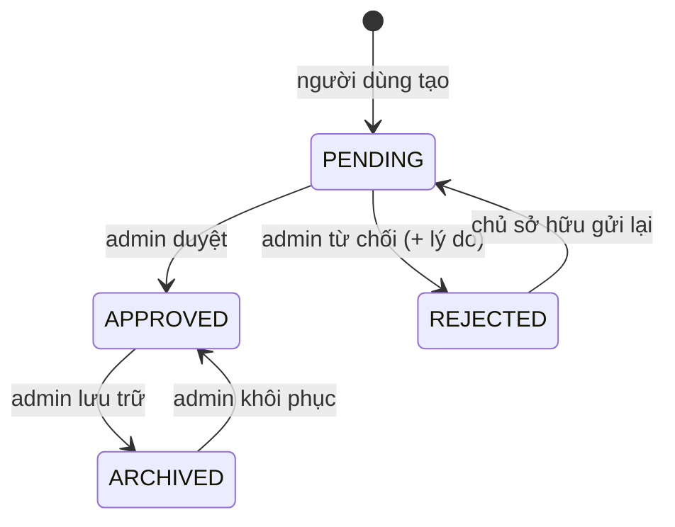
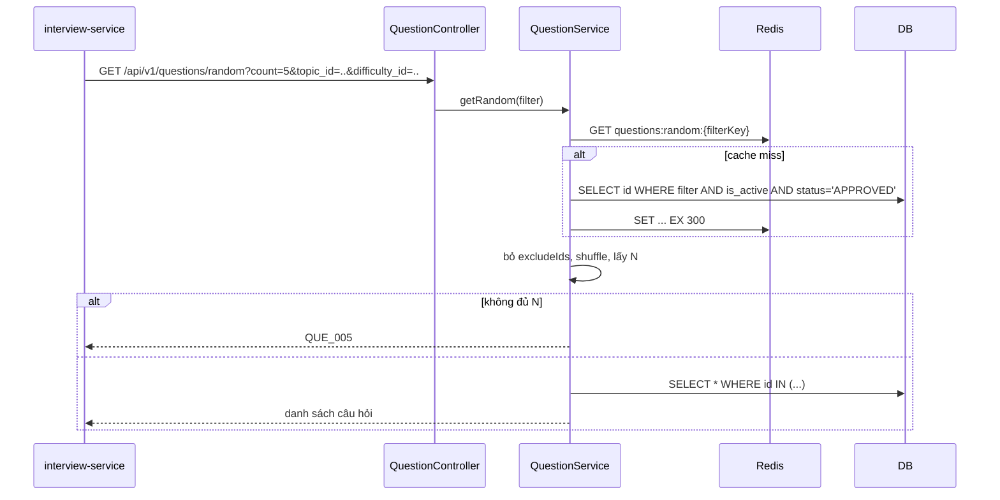
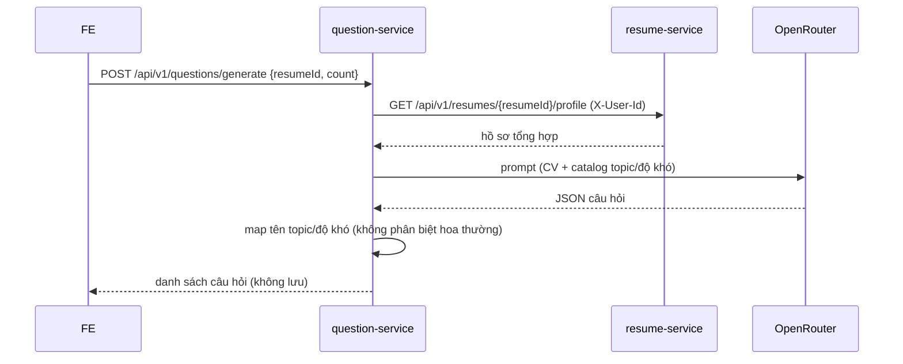

# Question service – Thiết kế chi tiết

Question service quản lý ngân hàng câu hỏi (topic dạng cây, tag, độ khó, rubric), kiểm duyệt câu hỏi người dùng gửi và cung cấp câu hỏi ngẫu nhiên cho interview.

| Thuộc tính | Giá trị |
|---|---|
| Repo | `intelli-hire-question` |
| Stack | Spring Boot 3.2.1, Java 17, Data JPA, Redis cache, Flyway, MapStruct |
| Port / context | `${SERVER_PORT:8081}` / `${CONTEXT_PATH:/api}` |
| DB | PostgreSQL schema `question`, Flyway `V1..V6` (bảng `flyway_schema_history_question`) |
| Package gốc | `org.aibles.intellihirequestion` |

## 1. Trách nhiệm

- CRUD câu hỏi + rubric; xóa mềm.
- Topic dạng cây, tag, độ khó, bài học tham khảo.
- Tìm kiếm, đếm, lấy ngẫu nhiên có loại trừ (chỉ câu đã duyệt).
- Kiểm duyệt câu hỏi người dùng gửi.
- Nhập hàng loạt; sinh câu hỏi bằng AI từ CV (không lưu).

## 2. Mô hình dữ liệu



Mọi bảng kế thừa `BaseEntity`: `id` UUID (sinh ở `@PrePersist`), `created_at`, `created_by`, `last_updated_at`, `last_updated_by` (auditing, người dùng lấy từ `X-User-Name`, mặc định `SYSTEM`). Không dùng quan hệ JPA; FK chỉ nằm trong SQL.

`questions.status` ánh xạ enum `QuestionStatus` (`@Enumerated(STRING)`); mặc định `PENDING` ở cả entity và DB.

| Migration | Nội dung |
|---|---|
| V1 | Schema ban đầu |
| V2 | `rubrics.is_active` |
| V3 | Default `study_articles.is_active` |
| V4 | Index (`topic_id`, `is_active`) |
| V5 | Seed: EASY(1), MEDIUM(2), HARD(3) … |
| V6 | Cột kiểm duyệt: `status` (mặc định `PENDING`; câu hỏi seed đặt `APPROVED`), `submitted_by`, `submitted_by_id`, `rejection_reason` |

## 3. API

Đường dẫn đầy đủ có tiền tố `/api`. Body JSON dùng camelCase; `userId` (`X-User-Id`, `submitted_by_id`) là String. Mọi endpoint (trừ health) yêu cầu request đi qua gateway với `X-User-Id`, `X-User-Role`, `X-User-Name`; endpoint ghi quyền `ADMIN` sai quyền → `QUE_403`.

### 3.1 Câu hỏi – `/api/v1/questions`

| Method | Path | Mô tả | Quyền |
|---|---|---|---|
| POST | `/` | Tạo câu hỏi (status `PENDING`); header `X-User-Id`, `X-User-Name` | Đăng nhập |
| POST | `/bulk` | Nhập hàng loạt | ADMIN |
| POST | `/generate` | Sinh câu hỏi bằng AI từ CV; body `resumeId`, `count` 1–20 (8), `questionType`, `difficultyName`, `language` (en), `focusAreas`; cần `X-User-Id` | Đăng nhập (chủ CV) |
| GET | `/{id}` | Chi tiết | Đăng nhập |
| PUT | `/{id}` | Cập nhật | ADMIN |
| DELETE | `/{id}` | Xóa mềm (kèm rubric) | ADMIN |
| GET | `/search` | Tìm theo từ khóa, phân trang | Đăng nhập |
| GET | `/random` | Ngẫu nhiên trong các câu `APPROVED` và `is_active`: `count`, `topic_id`, `difficulty_id` (interview-service truyền theo lựa chọn của người dùng), type, tags, `excludeIds` | Đăng nhập / interview-service |
| GET | `/count` | Đếm theo `topicId`, `difficultyId` | Đăng nhập |
| GET | `/submitted` | Câu hỏi do chính mình gửi (`X-User-Id`) | Đăng nhập |
| PATCH | `/{id}/moderation-status` | Gửi lại câu bị từ chối | Chủ sở hữu |
| POST / GET / PUT | `/{id}/rubric` | Tạo / xem / sửa rubric | GET: Đăng nhập; ghi: ADMIN |

### 3.2 Quản trị – `/api/v1/admin/questions`

Toàn bộ nhóm endpoint yêu cầu `X-User-Role` chứa `ADMIN`.

| Method | Path | Mô tả |
|---|---|---|
| GET | `/` | Danh sách (phân trang, lọc) |
| GET / PUT | `/{id}` | Xem / sửa |
| PATCH | `/{id}/moderation-status` | Đặt trạng thái bất kỳ; `rejectionReason` chỉ giữ khi `REJECTED` |

### 3.3 Danh mục

Đọc danh mục: người dùng đăng nhập; tạo / sửa / xóa: `ADMIN`.

| Resource | Endpoint |
|---|---|
| Topic `/api/v1/topics` | GET `/`, GET `/tree`, POST, GET/PUT/DELETE `/{id}`, GET `/{id}/questions` |
| Độ khó `/api/v1/difficulties` | GET, POST, GET/PUT/DELETE `/{id}` |
| Tag `/api/v1/tags` | GET, POST, PUT/DELETE `/{id}` |
| Bài học `/api/v1/study-articles` | GET (phân trang), POST, GET/PUT/DELETE `/{id}` |
| Health | GET `/api/health` |

### 3.4 Rubric request (camelCase)

| Trường | Ràng buộc |
|---|---|
| `criteria` | Bắt buộc, ≤ 5000 ký tự |
| `keywords`, `commonMistakes`, `hints` | `List<String>` → jsonb (`keywords`, `common_mistakes`, `hints`) |
| `exampleAnswer` | ≤ 10000 ký tự |
| `maxScore` | 1–100, mặc định 10 |

## 4. State machine kiểm duyệt



Gửi lại khi không phải chủ sở hữu → `QUE_403`; khi trạng thái không phải `REJECTED` → `QUE_409`. Endpoint admin cho phép đặt trạng thái bất kỳ.

## 5. Sequence

### 5.1 Lấy câu hỏi ngẫu nhiên



### 5.2 Sinh câu hỏi bằng AI



## 6. Cache (Redis, TTL mặc định 1h)

| Cache / key | Nội dung | Evict |
|---|---|---|
| `difficulties` (`all`) | Danh sách độ khó | create/update/delete |
| `tags` (`all`) | Danh sách tag | ghi tag |
| `topics:all`, `topics:tree` | Danh sách, cây topic | mọi ghi topic (allEntries) |
| `questions:random:*` | Danh sách id theo bộ lọc, TTL 5 phút | hết hạn; đổi trạng thái kiểm duyệt |

## 7. Cấu trúc package

```
intellihirequestion/
├── config          Redis, OpenAPI, auditing
├── controller      Question, AdminQuestion, Topic, Tag, Difficulty, StudyArticle, Health
├── dto             request/response · dto.ai · dto.resume
├── entity          + converter (QuestionTypeConverter) · enums · key (QuestionTagId)
├── exception · mapper (MapStruct) · projection · repository · specification (JPA Specification cho search)
├── service         + impl · ai (QuestionGenerationAiClient) · ai.impl (OpenRouter) · client (ResumeAggregateClient)
└── utils           SecurityUtils (đọc header, kiểm role)
```

## 8. Cấu hình

| Biến | Ý nghĩa |
|---|---|
| `SERVER_PORT`, `CONTEXT_PATH` | 8081, `/api` |
| `DB_HOST`, `DB_PORT`, `DATABASE_NAME`, `DB_SCHEMA` (question), `DATABASE_USERNAME`, `DATABASE_PASSWORD` | DB |
| `REDIS_HOST`, `REDIS_PORT` | Cache |
| `clients.resume.base-url` (http://localhost:8082), `RESUME_QUESTION_CONTEXT_PATH` | Gọi resume |
| OpenRouter API key, model (`x-ai/grok-4.1-fast`), timeout 60s | Sinh câu hỏi |

## 9. Rủi ro & lưu ý khi triển khai

1. Phân quyền dựa trên header `X-User-*` do gateway ghi đè; service không được mở port ra ngoài mạng nội bộ, nếu không header có thể bị giả mạo.
2. `/random` phải lọc `status = APPROVED` và `is_active` để câu chưa duyệt không lọt vào phỏng vấn; khi ngân hàng câu đã duyệt nhỏ, interview-service phải xử lý `QUE_005`.
3. Cache `questions:random:*` phải bị evict khi đổi trạng thái kiểm duyệt hoặc xóa câu hỏi, nếu không câu vừa lưu trữ vẫn có thể được trả trong tối đa 5 phút.
4. `/generate` phụ thuộc resume-service và OpenRouter (timeout 60 s): phải chuyển tiếp `X-User-Id` để resume-service kiểm quyền sở hữu CV, và trả lỗi rõ ràng khi AI lỗi hoặc JSON không hợp lệ.
5. Giá trị mặc định của `status` phải thống nhất giữa entity và migration để câu hỏi mới luôn vào hàng chờ kiểm duyệt.
