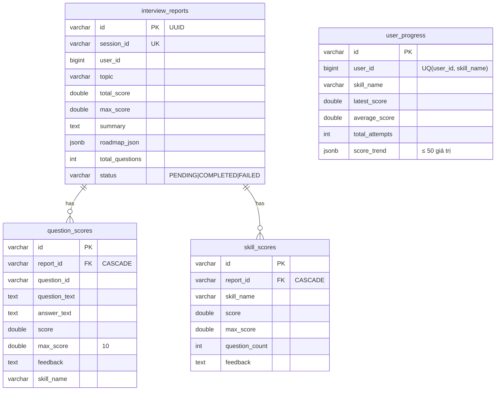
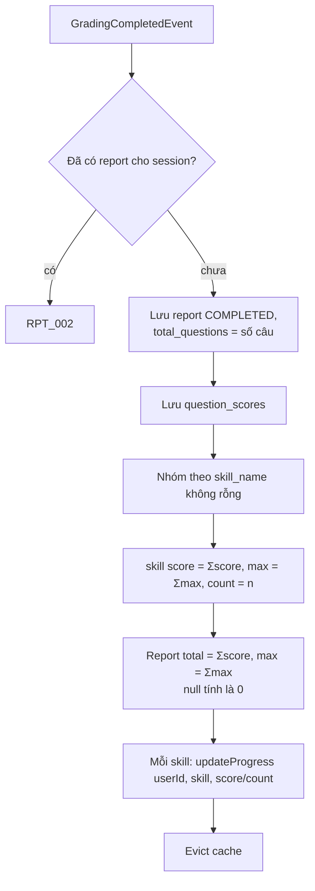

# Report service – Thiết kế chi tiết

Report service lập báo cáo từ kết quả chấm, tính điểm theo kỹ năng, thống kê và theo dõi tiến bộ của người dùng.

| Thuộc tính | Giá trị |
|---|---|
| Repo | `intelli-hire-report` |
| Stack | Spring Boot 3.2.1, Java 17, Web, Data JPA, Cache (Redis), Spring Kafka, Flyway, springdoc |
| Port / context | `${SERVER_PORT:8085}` / `${CONTEXT_PATH:/api}` |
| DB | PostgreSQL, schema mặc định, `V1__init.sql` |
| Package gốc | `org.aibles.intellihirereport` |

## 1. Trách nhiệm

- Consume `grading_completed` → tạo báo cáo, điểm từng câu, điểm kỹ năng.
- Cập nhật tiến bộ người dùng theo kỹ năng.
- API báo cáo, lịch sử, thống kê, tiến bộ; cập nhật tóm tắt/roadmap.

## 2. Mô hình dữ liệu



`BaseEntity`: `id` UUID, `created_at`, `created_by`, `last_updated_at`, `last_updated_by` (auditor từ `X-User-Name`, mặc định `SYSTEM`).

## 3. API – `/api/v1/reports`

| Method | Path | Mô tả |
|---|---|---|
| POST | `/` | Tạo báo cáo (cùng logic với Kafka) |
| PUT | `/{id}` | Cập nhật `summary`, `roadmapJson` |
| GET | `/{id}` | Theo id |
| GET | `/session/{sessionId}` | Theo phiên |
| DELETE | `/session/{sessionId}` | Xóa theo phiên |
| GET | `/history/{userId}` | Lịch sử phân trang, lọc `status` |
| GET | `/stats/{userId}` | Thống kê |
| GET | `/progress/{userId}` | Tiến bộ mọi kỹ năng |
| GET | `/progress/{userId}/{skillName}` | Tiến bộ một kỹ năng |
| POST | `/{id}/regenerate` | Thay `roadmap_json` |
| GET | `/admin/all` | Toàn bộ; cần `X-User-Role` = `ADMIN`/`ROLE_ADMIN` (không → `RPT_005`) |

Kích thước trang kẹp 1–100.

## 4. Thuật toán

### 4.1 Tạo báo cáo (`ReportServiceImpl.create`)


### 4.2 Cập nhật tiến bộ (`updateProgress`)
Khóa dòng `SELECT … FOR UPDATE` theo (user, skill):

```text
latest   = score
average  = (average × attempts + score) / (attempts + 1)
attempts = attempts + 1
trend    = (trend + [score]) giữ 50 giá trị cuối
```
Chưa có dòng → tạo mới với `attempts = 1`.

### 4.3 Thống kê (`/stats`)
- `totalSessions` = số báo cáo của user.
- Trung bình / cao nhất / thấp nhất của `total_score / max_score × 100` (chỉ khi `max_score > 0`), làm tròn 2 chữ số.
- `topSkills` = 3 kỹ năng `average_score` cao nhất; `weakSkills` = 3 thấp nhất.

## 5. Kafka consumer

| Thuộc tính | Giá trị |
|---|---|
| Topic | `${KAFKA_TOPIC_GRADING_COMPLETED:grading_completed}` |
| Group | `report-service`, `earliest` |
| Deserializer | JSON, không type header, `ignoreUnknown` |
| Lỗi | Bắt và log, **không retry, không DLT** |

## 6. Cache (Redis, GenericJackson2Json)

| Cache | Key | TTL |
|---|---|---|
| `report` | id | 1h |
| `report_session` | sessionId | 1h |
| `user_stats` | userId | 30' |
| `user_progress` | userId | 30' |
| `user_progress_skill` | `userId:skill` | 30' |

Evict khi create, update, regenerate, delete.

## 7. Cấu trúc package

```
intellihirereport/
├── config      Kafka, Redis, JPA auditing, OpenAPI
├── controller  ReportController
├── dto         + dto/kafka (GradingCompletedEvent, QuestionScoreEvent)
├── entity      + enums (ReportStatus)
├── exception   RPT_001..007, PRG_001
├── kafka       GradingCompletedConsumer
├── mapper · repository
├── service     + impl (ReportServiceImpl, UserProgressServiceImpl)
└── utils
```

## 8. Điểm lệch cần xử lý ⚠️

1. **Không có Spring Security**: mọi endpoint mở; `RPT_007` (chỉ xem dữ liệu của mình) khai báo nhưng chưa dùng.
2. `user_id` là BIGINT trong khi các service khác dùng String → cần thống nhất kiểu định danh.
3. Lỗi consumer bị nuốt → mất báo cáo; cần retry + DLT.
4. `skill_name` từ grading luôn null → `skill_scores` và `user_progress` rỗng.
5. `summary` / `roadmap_json` chưa có nguồn sinh tự động (chưa gọi LLM).
