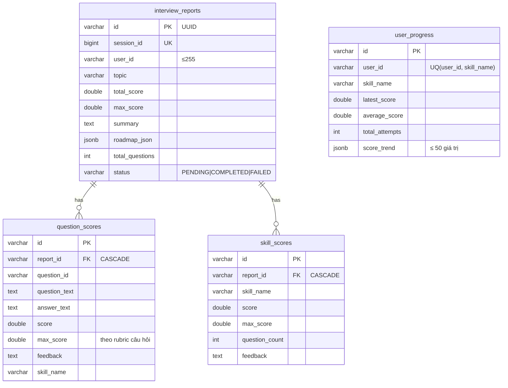
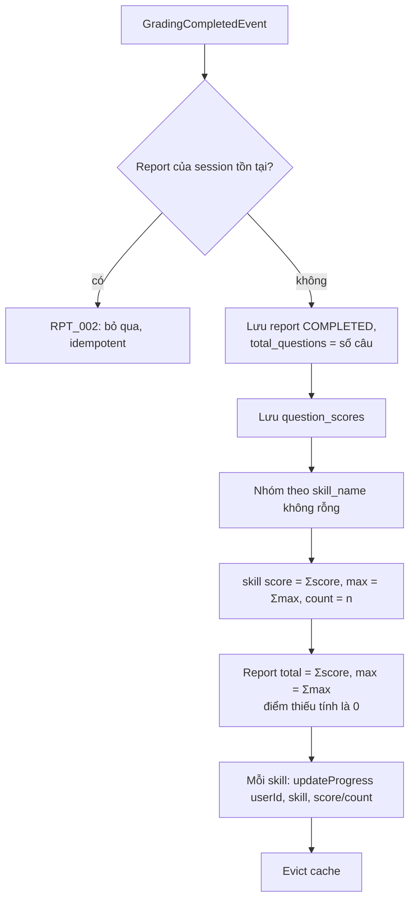

# Report service – Thiết kế chi tiết

Report service lập báo cáo từ kết quả chấm, tính điểm theo kỹ năng, thống kê và theo dõi tiến bộ của người dùng.

| Thuộc tính | Giá trị |
|---|---|
| Repo | `intelli-hire-report` |
| Stack | Spring Boot 3.2.1, Java 17, Web, Data JPA, Cache (Redis), Spring Kafka, Flyway, springdoc |
| Port / context | `${SERVER_PORT:8085}` / `${CONTEXT_PATH:/api}` |
| DB | PostgreSQL, schema mặc định, `V1__init.sql` |
| JSON | Jackson camelCase (thống nhất với mọi service) |
| Package gốc | `org.aibles.intellihirereport` |

## 1. Trách nhiệm

- Consume `grading_completed` → tạo báo cáo, điểm từng câu, điểm kỹ năng.
- Cập nhật tiến bộ người dùng theo kỹ năng.
- API báo cáo, lịch sử, thống kê, tiến bộ; cập nhật tóm tắt/roadmap.
- Chỉ cho người dùng xem dữ liệu của chính mình (trừ `ADMIN`).

## 2. Mô hình dữ liệu



`BaseEntity`: `id` UUID, `created_at`, `created_by`, `last_updated_at`, `last_updated_by` (auditor từ `X-User-Name`, mặc định `SYSTEM`). `session_id` kiểu Long, `user_id` kiểu String như mọi service (ADR-010).

## 3. API – `/api/v1/reports`

| Method | Path | Mô tả |
|---|---|---|
| POST | `/` | Tạo báo cáo (cùng logic với Kafka) |
| PUT | `/{id}` | Cập nhật `summary`, `roadmapJson` |
| GET | `/{id}` | Theo id |
| GET | `/session/{sessionId}` | Theo phiên |
| DELETE | `/session/{sessionId}` | Xóa theo phiên |
| GET | `/history/{userId}` | Lịch sử phân trang, lọc `status` |
| GET | `/stats/{userId}` | Thống kê |
| GET | `/progress/{userId}` | Tiến bộ mọi kỹ năng |
| GET | `/progress/{userId}/{skillName}` | Tiến bộ một kỹ năng |
| POST | `/{id}/regenerate` | Thay `roadmap_json` |
| GET | `/admin/all` | Toàn bộ; cần `X-User-Role` = `ADMIN`/`ROLE_ADMIN` (không → `RPT_005`) |

Kích thước trang kẹp 1–100.

Phân quyền:

- Filter xác thực bắt buộc cho mọi endpoint: đọc `X-User-Id`, `X-User-Role` do API gateway gán sau khi xác thực JWT; thiếu header → 401.
- Endpoint có `{userId}` hoặc trả về báo cáo cụ thể: `userId` của tài nguyên phải khớp người gọi, trừ `ADMIN`; không khớp → `RPT_007`.
- `POST /` chỉ dành cho `ADMIN`/lời gọi nội bộ; luồng chính tạo báo cáo qua Kafka.

## 4. Thuật toán

### 4.1 Tạo báo cáo (`ReportServiceImpl.create`)



`skillName` của mỗi câu do grading service điền từ topic/tag của câu hỏi, nên mọi câu đều đóng góp vào `skill_scores` và `user_progress`.

### 4.2 Cập nhật tiến bộ (`updateProgress`)

Khóa dòng `SELECT … FOR UPDATE` theo (user, skill):

```text
latest   = score
average  = (average × attempts + score) / (attempts + 1)
attempts = attempts + 1
trend    = (trend + [score]) giữ 50 giá trị cuối
```

Không tồn tại dòng (user, skill) → tạo mới với `attempts = 1`.

### 4.3 Thống kê (`/stats`)

- `totalSessions` = số báo cáo của user.
- Trung bình / cao nhất / thấp nhất của `total_score / max_score × 100` (chỉ khi `max_score > 0`), làm tròn 2 chữ số.
- `topSkills` = 3 kỹ năng `average_score` cao nhất; `weakSkills` = 3 thấp nhất.

### 4.4 Tóm tắt và roadmap

- `summary` và `roadmap_json` được cập nhật qua `PUT /{id}` và `POST /{id}/regenerate`.
- Sinh tự động bằng LLM (từ `question_scores`, `skill_scores`) là phần mở rộng; khi bổ sung sẽ dùng cùng cơ chế gọi OpenRouter như grading service.

## 5. Kafka consumer

| Thuộc tính | Giá trị |
|---|---|
| Topic | `${KAFKA_TOPIC_GRADING_COMPLETED:grading_completed}` |
| Group | `report-service`, `earliest` |
| Deserializer | JSON, không type header, `ignoreUnknown` |
| Lỗi | `DefaultErrorHandler(FixedBackOff(5000, 3))` → hết retry đẩy sang `grading_completed.DLT` (`DeadLetterPublishingRecoverer`), giống grading service |
| Idempotent | Theo `sessionId`; `RPT_002` (report đã tồn tại) coi là đã xử lý, không retry |

## 6. Cache (Redis, GenericJackson2Json)

| Cache | Key | TTL |
|---|---|---|
| `report` | id | 1h |
| `report_session` | sessionId | 1h |
| `user_stats` | userId | 30' |
| `user_progress` | userId | 30' |
| `user_progress_skill` | `userId:skill` | 30' |

Evict khi create, update, regenerate, delete.

## 7. Cấu trúc package

```
intellihirereport/
├── config      Kafka (error handler + DLT), Redis, JPA auditing, OpenAPI, auth filter
├── controller  ReportController
├── dto         + dto/kafka (GradingCompletedEvent, QuestionScoreEvent)
├── entity      + enums (ReportStatus)
├── exception   RPT_001..007, PRG_001
├── kafka       GradingCompletedConsumer
├── mapper · repository
├── service     + impl (ReportServiceImpl, UserProgressServiceImpl)
└── utils
```

## 8. Rủi ro & lưu ý khi triển khai

1. **Tin cậy header định danh**: phân quyền dựa vào `X-User-Id`/`X-User-Role` từ gateway → service chỉ được expose qua gateway, gateway loại bỏ header do client tự gửi; kiểm tra `RPT_007` phải áp dụng đồng nhất cho mọi endpoint theo `userId`.
2. **Thống nhất kiểu định danh**: `user_id` là String và `session_id` là Long ở mọi service; sai kiểu khi deserialize sự kiện sẽ làm message vào DLT → cần test hợp đồng (contract test) cho payload `grading_completed`.
3. **Mất hoặc trùng sự kiện**: consumer lỗi sau retry → message vào `grading_completed.DLT`, cần cơ chế phát lại; nhận lại cùng `sessionId` (do retry hoặc chấm lại) phải idempotent, và khi chấm lại cần quyết định ghi đè hay giữ báo cáo cũ.
4. **Tiến bộ theo kỹ năng**: chất lượng `skill_scores`/`user_progress` phụ thuộc `skillName` từ topic/tag; đổi tên topic/tag về sau sẽ tách lịch sử tiến bộ → nên dùng tên ổn định hoặc id kỹ năng.
5. **Tranh chấp khi cập nhật tiến bộ**: nhiều báo cáo cùng user xử lý song song → dựa vào `SELECT … FOR UPDATE` và `UQ(user_id, skill_name)`; xung đột insert dòng mới cần retry.
6. **Tóm tắt/roadmap tự động**: nếu bổ sung sinh bằng LLM thì cần xử lý bất đồng bộ (trạng thái `PENDING` → `COMPLETED`/`FAILED`) để không chặn consumer.

Danh sách rủi ro toàn hệ thống: [11 – Rủi ro & lưu ý khi triển khai](../11-rui-ro-trien-khai.md).
