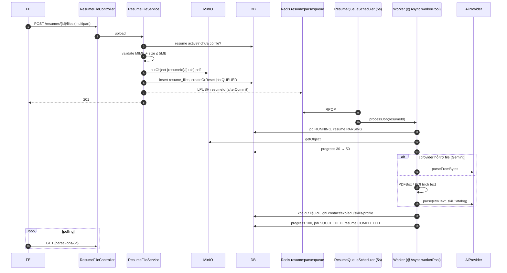
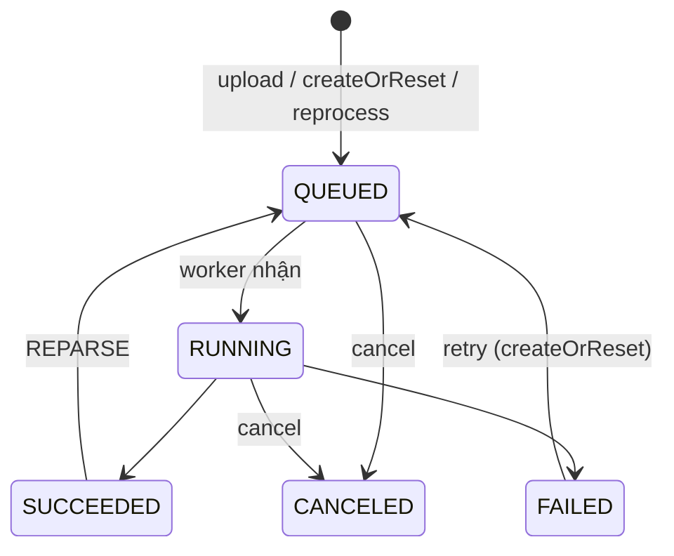
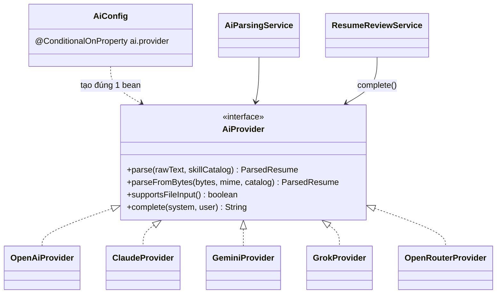

# Resume service – Thiết kế chi tiết

Resume service quản lý CV có cấu trúc, lưu file lên MinIO, parse CV bất đồng bộ bằng AI, sinh skill profile và AI review.

| Thuộc tính | Giá trị |
|---|---|
| Repo | `intelli-hire-resume` |
| Stack | Spring Boot 3.2.1, Java 17, Data JPA, Redis, MinIO SDK, PDFBox 3, Apache POI, Flyway, spring-dotenv, Testcontainers |
| Port / context | `${SERVER_PORT:8080}` (dev cần 8082) / không có (mapping đã chứa `/api`) |
| DB | PostgreSQL, Flyway (bảng `flyway_schema_history_resume`) |
| Package gốc | `org.aibles.intellihireresume` |

## 1. Trách nhiệm

- CRUD resume và các mục: liên hệ, học vấn, kinh nghiệm, kỹ năng.
- Upload / tải / xóa file (PDF, DOCX ≤ 5MB), một file mỗi resume.
- Parse CV bất đồng bộ qua hàng đợi Redis + worker pool.
- Skill profile, AI review CV.
- Danh mục kỹ năng dùng chung; hồ sơ tổng hợp cho question service.

## 2. Mô hình dữ liệu

```mermaid
erDiagram
    resumes ||--o| resume_files : "1-1"
    resumes ||--o| resume_parse_jobs : "1-1"
    resumes ||--o| resume_contacts : "1-1"
    resumes ||--o| resume_skill_profiles : "1-1"
    resumes ||--o| resume_reviews : "1-1"
    resumes ||--o{ resume_experiences : has
    resumes ||--o{ resume_educations : has
    resumes ||--o{ resume_skills : has
    skills ||--o{ resume_skills : used

    resumes {
        varchar id PK "UUID"
        varchar user_id "≤36"
        varchar title "unique theo user"
        varchar status "ResumeStatus"
        boolean is_active
        text raw_text
    }
    resume_files {
        varchar id PK
        varchar resume_id FK,UK
        varchar original_name
        varchar file_type "PDF|DOCX"
        bigint file_size_bytes
        varchar object_bucket
        text object_key
        varchar object_etag
    }
    resume_parse_jobs {
        varchar id PK
        varchar resume_id FK,UK
        varchar status "JobStatus"
        varchar job_type "PARSE|REPARSE|ANALYZE"
        int progress
        int retry_count
        text error_message
        timestamp started_at
        timestamp finished_at
    }
    resume_contacts {
        varchar id PK
        varchar resume_id FK,UK
        varchar full_name
        varchar email
        varchar phone
        varchar location
        varchar linkedin_url
    }
    resume_experiences {
        varchar id PK
        varchar resume_id FK
        varchar company
        varchar title
        date start_date
        date end_date
        boolean is_current
    }
    resume_educations {
        varchar id PK
        varchar resume_id FK
        varchar school
        varchar degree
        varchar field
        int start_year
        int end_year
    }
    skills {
        varchar id PK
        varchar name UK
        varchar category
        varchar type "TECHNICAL|TOOL|SOFT"
        json aliases
        boolean is_active
    }
    resume_skills {
        varchar id PK
        varchar resume_id FK
        varchar skill_id FK
        varchar proficiency_level
        numeric years_experience
        numeric confidence_score
        varchar evidence_text
        boolean is_primary
    }
    resume_skill_profiles {
        varchar id PK
        varchar resume_id FK,UK
        json top_skills
        numeric years_estimated
        varchar seniority
        text summary
        json signals
    }
    resume_reviews {
        varchar id PK
        varchar resume_id FK,UK
        numeric overall_score "0.0-10.0"
        json sections
        json strengths
        json weaknesses
        json priority_actions
    }
```



`BaseEntity`: `id` UUID, `created_at` (`@CreationTimestamp`), `created_by` (mặc định `system`), `updated_at`, `updated_by`. `resume_skills` có UQ(`resume_id`,`skill_id`).

### Enum
| Enum | Giá trị |
|---|---|
| `ResumeStatus` | UPLOADED, PARSING, COMPLETED, FAILED, DELETED |
| `JobStatus` | QUEUED, RUNNING, SUCCEEDED, FAILED, CANCELED |
| `JobType` | PARSE (ưu tiên 1, ~2'), REPARSE (2, ~2'), ANALYZE (3, ~5') |
| `FileType` | PDF (`application/pdf`), DOCX (`…wordprocessingml.document`), tối đa 5MB |
| `SeniorityLevel` | JUNIOR 0–2, MID 2–5, SENIOR 5–8, LEAD 8–12, PRINCIPAL 12+ năm |
| `SkillType` | TECHNICAL (trọng số 3), TOOL (2), SOFT (1) |

## 3. API

| Method | Path | Mô tả |
|---|---|---|
| POST / GET | `/api/v1/resumes` | Tạo (tiêu đề duy nhất theo user) / danh sách của tôi |
| GET / PUT / DELETE | `/api/v1/resumes/{id}` | Chi tiết / sửa / xóa mềm |
| POST | `/api/v1/resumes/{id}/reprocess` | Parse lại (REPARSE) |
| POST | `/api/v1/resumes/{resumeId}/files` | Upload multipart |
| GET | `/api/v1/resumes/{resumeId}/files` | Metadata file |
| GET | `/api/v1/resumes/{resumeId}/files/download` | Tải file |
| DELETE | `/api/v1/resumes/{resumeId}/files` | Xóa file |
| POST | `/api/v1/parse-jobs` | Tạo/reset job (`resumeId`, `jobType`) |
| GET | `/api/v1/parse-jobs/{id}` | Trạng thái, tiến độ |
| PUT | `/api/v1/parse-jobs/{id}/cancel` | Hủy |
| GET / PUT | `/api/v1/resumes/{resumeId}/contact` | Liên hệ |
| GET, POST, PUT `/{id}`, DELETE `/{id}` | `/api/v1/resumes/{resumeId}/experiences` · `/educations` · `/skills` | Kinh nghiệm, học vấn, kỹ năng |
| GET / POST `/generate` / PUT | `/api/v1/resumes/{resumeId}/skill-profile` | Skill profile |
| GET / POST `/generate` | `/api/v1/resumes/{resumeId}/review` | AI review |
| GET | `/api/v1/resumes/{resumeId}/profile` | Hồ sơ tổng hợp (question service gọi) |
| GET | `/api/v1/skills`, `/{id}`, `/search` | Danh mục kỹ năng |

Header: `X-User-Id` (bắt buộc trừ `/skills`), `X-User-Role`.

## 4. Pipeline parse CV



Retry khi gọi AI: 401 không retry · 429 chờ `retryAfter` · lỗi khác backoff 2 s, 4 s, 8 s (`ai.max-retries=3`). Lỗi cuối → job `FAILED` (`error_message` ≤ 1000 ký tự, `retry_count+1`), resume `FAILED`.

### State machine parse job

Tạo job mới khi job hiện tại `QUEUED/RUNNING` → `JOB_003`; hủy ở trạng thái khác → `JOB_002`.

## 5. Trừu tượng hóa AI



| Provider | Endpoint | Model mặc định | Ghi chú |
|---|---|---|---|
| openai (mặc định) | api.openai.com | gpt-4o-mini | |
| claude | api.anthropic.com | claude-haiku-4-5-20251001 | |
| gemini | generativelanguage.googleapis.com | gemini-2.0-flash | Hỗ trợ gửi file trực tiếp |
| grok | api.x.ai | grok-3 | |
| openrouter | openrouter.ai | x-ai/grok-4.1-fast | Duy nhất hiện thực `complete()` |

### AI review – định dạng đầu ra
```json
{
  "overall_score": 7.5,
  "sections": {
    "contact": {"score": 9, "feedback": "…"},
    "experience": {"score": 7, "feedback": "…"},
    "education": {"score": 8, "feedback": "…"},
    "skills": {"score": 7, "feedback": "…"},
    "presentation": {"score": 6, "feedback": "…"}
  },
  "strengths": ["…"],
  "weaknesses": ["…"],
  "priority_actions": ["…"]
}
```
Đồng bộ; yêu cầu resume có file (`REVIEW_002`); AI lỗi hoặc JSON thiếu → 502 `REVIEW_003`; kết quả upsert vào `resume_reviews`.

## 6. Hạ tầng phụ trợ

| Thành phần | Chi tiết |
|---|---|
| MinIO | bucket `MINIO_BUCKET` (tự tạo khi khởi động), key `{resumeId}/{uuid}.{pdf|docx}`, timeout connect 10 s, read/write 30 s |
| Worker pool | `worker.pool-size` (10), queue 100, `CallerRunsPolicy`, prefix `resume-worker-` |
| Cache | `skills:list` (theo category/ALL), `skills:detail` (theo id), TTL 10 phút |
| Metric | `resume.parse.duration{outcome}`, `file.upload.count{fileType}` |
| Filter | `HeaderAuthFilter` (X-User-Id/Role), `MdcLoggingFilter` |

## 7. Cấu trúc package

```
intellihireresume/
├── config      MinIO, Redis, Async (workerPool), AI (AiConfig)
├── controller  Resume, ResumeFile, ResumeParseJob, Contact, Experience, Education, ResumeSkill, SkillProfile, Review, CandidateProfile, Skill
├── dto         + dto.ai
├── entity      + enums
├── exception · filter · mapper · repository
└── service     + impl · ai (AiProvider, AiParsingService) · ai.impl (5 provider)
```

## 8. Cấu hình

| Biến | Ý nghĩa |
|---|---|
| `SERVER_PORT` (8082), `DB_HOST`, `DB_PORT`, `DATABASE_NAME`, … | Server & DB (không có default → bắt buộc `.env`) |
| `REDIS_HOST`, `REDIS_PORT` | Hàng đợi + cache |
| `MINIO_ENDPOINT`, `MINIO_ACCESS_KEY`, `MINIO_SECRET_KEY`, `MINIO_BUCKET` | Lưu file |
| `AI_PROVIDER` + `OPENAI_API_KEY`/`OPENAI_MODEL`, `CLAUDE_API_KEY`/`CLAUDE_MODEL`, `GEMINI_*`, `GROK_*`, `OPENROUTER_*` | AI |

## 9. Điểm lệch cần xử lý ⚠️

1. **Không kiểm quyền sở hữu**: tra resume theo id không kèm `user_id`; parse-job đọc `X-User-Id` nhưng không dùng.
2. `HeaderAuthFilter` gán `user-001` khi thiếu header và không bao giờ từ chối request.
3. AI review chỉ chạy được với `AI_PROVIDER=openrouter` (provider khác chưa hiện thực `complete()`).
4. FE đang bật mock parse CV ở môi trường dev vì worker parse từng lỗi — cần kiểm tra lại và tắt mock.
