# IntelliHire Question Service

Combined Business Requirements Document and Technical Design Document

Document status: Review draft

Repository alignment notes:
- Effective persisted schema is the initial schema plus `rubrics.is_active` added by Flyway migration `V2__add_is_active_to_rubrics.sql`.
- Current codebase implements public endpoints for topics, difficulties, tags, questions, question bulk import, random question retrieval, question search, and study article detail lookup.
- Current codebase does not implement Kafka event publishing, Spring Security JWT enforcement, rubric APIs, difficulty delete, tag get-by-id, study article CRUD/search, or internal service-to-service endpoints.
- This document is normative for sign-off and implementation planning. Where current code differs from the desired contract, the document marks the rule as `[ASSUMPTION]`, `[INFERRED RULE]`, or `[RECOMMENDED RULE]`.

Base URL conventions:
- Public API base path: `/api/v1`
- Internal service API base path: `/api/internal`
- All payloads use `snake_case`
- All IDs are UUID strings in canonical 36-character form

---

## PART A - BUSINESS REQUIREMENTS DOCUMENT

### 1. Executive Summary
The Question Service is the content authority for IntelliHire interview knowledge assets. It owns the taxonomy and reusable content needed to build interviews, evaluate candidate responses, and surface study material. By centralizing topics, difficulty levels, tags, questions, rubrics, and study articles in one service, IntelliHire prevents duplicated content models across Interview, Candidate, Assessment, and AI Evaluation services. The business value is controlled content governance, consistent interview quality, faster interviewer workflow, standardized scoring guidance, and reliable candidate preparation recommendations tied to the same canonical content catalog.

### 2. Service Overview
Responsibilities:
- Own master data for `topics`, `difficulty_levels`, and `tags`
- Own business content for `questions`, `rubrics`, `question_tags`, and `study_articles`
- Provide read APIs for interviewer-facing and service-to-service content retrieval
- Enforce referential integrity and business lifecycle rules beyond raw foreign keys
- Maintain schema-defined audit columns
- Support read-heavy catalog access through Redis-backed caching where appropriate
- Publish domain events for downstream synchronization `[RECOMMENDED RULE]`

Non-responsibilities:
- Candidate scoring and pass/fail calculation
- Interview scheduling, panel persistence, and interview lifecycle management
- Authentication token issuance
- Notification delivery
- External web crawling or automatic article ingestion
- Candidate profile management
- Historical interview snapshot storage in the current schema

Ownership team:
- `[ASSUMPTION]` Content Platform / Interview Content Squad

SLA expectation summary:
- `[ASSUMPTION]` Read operations used by interview creation and AI scoring are high-priority production paths.
- `[ASSUMPTION]` Write operations are admin-controlled and must be transactionally consistent.
- Redis and Kafka are performance and integration enablers, not the system of record. PostgreSQL remains the source of truth.
- Kong Gateway is applicable as the public ingress layer. User/Auth Service is applicable as the identity source. Kafka is target-state applicable but not yet implemented in the current codebase.

### 3. Business Goals / Success Metrics

| Business Goal | KPI / Metric | Target Value |
|---|---|---|
| Increase reuse of governed interview content | % of interview panels created from Question Service catalog | >= 80% |
| Standardize scoring guidance | % of active technical and coding questions with an active rubric | >= 95% |
| Maintain taxonomy integrity | % of active questions linked to valid topic and difficulty records | 100% |
| Improve candidate preparation coverage | % of active topic+difficulty combinations with at least one active article | >= 90% |
| Reduce content defects after release | Post-UAT production defects attributable to Question Service content | <= 2% per release |

### 4. Scope In

| In Scope | Details |
|---|---|
| Topic management | Create, read, update, hierarchy management, deactivate |
| Difficulty level management | Create, read, update, retire/delete policy |
| Tag management | Create, read, update, delete with usage restriction |
| Question management | Create, read, update, search, random retrieval, bulk import, deactivate |
| Rubric management | Create, read, update, delete/deactivate policy |
| Question-tag association management | Attach and detach tags from questions |
| Study article management | Create, read, update, search, publish, deactivate |
| Inter-service retrieval | Internal read APIs for Interview Service and AI Evaluation Service |
| Audit and lifecycle governance | Created/updated metadata and activation state rules |
| Event publication | Question and article lifecycle events `[RECOMMENDED RULE]` |

### 4. Scope Out

| Explicitly Out of Scope | Details |
|---|---|
| Candidate scoring | Owned by Assessment/Scoring Service and AI Evaluation Service |
| Interview scheduling | Owned by Interview Service |
| Token issuance | Owned by User/Auth Service |
| Notification dispatch | Owned by Notification Service |
| External content scraping | No crawler or ingestion bot in current scope |
| AI generation of question content | Not represented in current schema |
| Reporting warehouse or BI dashboards | Outside this service boundary |
| File attachments or media hosting | No schema support |

### 5. Stakeholders and Actors

| Actor | Type | Permissions Summary |
|---|---|---|
| Content Admin | Human | Full CRUD on all entities; activation and deactivation authority |
| Interviewer | Human | Read/search approved catalog; no write access |
| Candidate | Human | Indirect read of active study articles only `[ASSUMPTION]` |
| Product Owner | Business | Defines taxonomy, lifecycle rules, and sign-off criteria |
| Interview Service | System | Programmatic read of active questions and metadata |
| Candidate Service | System | Programmatic read of active study articles |
| Assessment/Scoring Service | System | `[ASSUMPTION]` Read of question context and rubric metadata |
| AI Evaluation Service | System | Read of rubric and question context |
| User/Auth Service | System | Identity and role provider `[ASSUMPTION]` |
| Notification Service | System | Event consumer for content lifecycle changes `[RECOMMENDED RULE]` |
| Architects / SRE | Platform | Dependency governance, observability, runtime health |

### 6. Business Processes / User Journeys

#### 6.1 Admin creates a question with rubric, tags, and difficulty level
Narrative: A Content Admin curates a reusable interview question and its scoring guidance so that downstream services can consume a governed asset rather than free-form content.

1. Admin selects or creates the required topic.
2. Admin selects or creates the required difficulty level.
3. Admin selects existing tags or creates new tags.
4. Admin submits `question_text`, `question_type`, `topic_id`, `difficulty_id`, optional `tag_ids`, and `is_active`.
5. System validates topic existence and active state, validates difficulty existence, and validates all tag references.
6. System saves the question and question-tag mappings transactionally.
7. Admin submits rubric details linked to the question.
8. System enforces one rubric per question and persists the rubric.
9. `[RECOMMENDED RULE]` System publishes `question.created` after the transaction commits.

#### 6.2 Interviewer browses and selects questions for an interview panel
Narrative: An Interviewer needs to find relevant active questions quickly and send the selected question IDs to Interview Service.

1. Interviewer opens the question catalog.
2. UI retrieves active topics, difficulties, and tags for filters.
3. Interviewer searches by keyword and applies topic, difficulty, type, tag, and activity filters.
4. System returns paginated question results with resolved topic and difficulty names plus tags.
5. Interviewer opens a question detail view and optionally rubric detail `[ASSUMPTION]`.
6. Interviewer selects one or more questions for an interview panel.
7. Interviewer saves the selection through Interview Service, which persists panel composition outside this service.

#### 6.3 Interview Service fetches a question set programmatically
Narrative: Interview creation requires active questions that match a configured topic, difficulty, type, and optional tags.

1. Interview Service calls the internal question retrieval endpoint using service authentication `[ASSUMPTION]`.
2. Request includes filters such as topic, difficulty, type, tags, count, and excluded question IDs.
3. Question Service validates the filters and available pool.
4. System returns active questions only.
5. If the filtered pool is smaller than the requested count, system returns a business error instead of a partial set.

#### 6.4 AI Evaluation Service retrieves rubric for scoring a candidate response
Narrative: AI Evaluation Service requires the rubric tied to the exact question to score candidate responses consistently.

1. AI Evaluation Service sends `question_id` to the internal rubric retrieval endpoint.
2. Question Service validates question existence.
3. System retrieves the active rubric linked to that question.
4. System returns rubric content including `criteria`, `keywords`, `common_mistakes`, `hints`, `example_answer`, and `max_score`.
5. If no rubric exists, system returns a not-found business error.

#### 6.5 Candidate receives study article recommendations based on topic/difficulty
Narrative: Candidate Service recommends preparation material based on the same taxonomy used for interview content.

1. Candidate Service determines the candidate's target topic and difficulty `[ASSUMPTION]`.
2. Candidate Service calls the study article search endpoint.
3. Question Service filters to active study articles only.
4. System returns article metadata and URLs for display.
5. If no articles match, system returns an empty list.
6. `[RECOMMENDED RULE]` When an article becomes active, Question Service publishes `article.published`.

### 7. Functional Requirements

**FR-001 Topic CRUD and hierarchy management**  
User story: As a Content Admin, I want to manage topics and their parent-child structure so that questions and articles can be organized consistently.  
Acceptance criteria:
1. System shall support create, read, update, and deactivate for topics.
2. System shall support root topics and child topics through `parent_id`.
3. System shall return both flat and tree representations of active topics.  
Edge cases / exception scenarios: missing parent, inactive parent, circular hierarchy, duplicate sibling names.

**FR-002 Difficulty level CRUD**  
User story: As a Content Admin, I want to manage difficulty levels so that questions and articles can be classified consistently.  
Acceptance criteria:
1. System shall support create, read, update, and retire/delete policy for difficulty levels.
2. System shall enforce unique difficulty names.
3. System shall return difficulty levels ordered by `weight`.  
Edge cases / exception scenarios: duplicate name, invalid weight, referenced difficulty cannot be retired `[RECOMMENDED RULE]`.

**FR-003 Tag CRUD**  
User story: As a Content Admin, I want to manage reusable tags so that questions can be classified by skill and theme.  
Acceptance criteria:
1. System shall support create, read, update, and delete for tags.
2. System shall enforce unique tag names.
3. System shall block tag deletion when a question-tag mapping exists.  
Edge cases / exception scenarios: duplicate name, missing tag, in-use tag deletion.

**FR-004 Question CRUD**  
User story: As a Content Admin, I want to manage questions so that the interview catalog remains current and usable.  
Acceptance criteria:
1. System shall support create, read, update, and deactivate for questions.
2. System shall require valid topic and difficulty references and a valid `question_type`.
3. System shall persist question-tag mappings transactionally with the question.  
Edge cases / exception scenarios: inactive topic, invalid type, missing difficulty, missing tags.

**FR-005 Question search and filter**  
User story: As an Interviewer, I want to search questions with multiple filters so that I can assemble relevant interview panels quickly.  
Acceptance criteria:
1. System shall support filtering by topic, difficulty, type, tag IDs, keyword, and active state.
2. System shall support offset-based pagination and deterministic sorting.
3. Search results shall include resolved topic and difficulty names and tag metadata.  
Edge cases / exception scenarios: unsupported sort field, empty result set, page size over maximum.

**FR-006 Random question retrieval**  
User story: As Interview Service, I want to retrieve a random set of active questions that match filters so that panel generation can be automated.  
Acceptance criteria:
1. System shall support `count`, `topic_id`, `difficulty_id`, `type`, `tag_ids`, and `exclude_ids`.
2. System shall return only active questions.
3. System shall return an explicit error if not enough matching questions exist.  
Edge cases / exception scenarios: invalid count, invalid type, missing filter references, exhausted pool after exclusions.

**FR-007 Bulk question import**  
User story: As a Content Admin, I want to import up to 100 questions per request so that initial content seeding is efficient.  
Acceptance criteria:
1. System shall accept 1 to 100 question items per request.
2. System shall validate each row independently and return partial success when only some rows fail.
3. System shall reject duplicate question text within the same batch, case-insensitively.  
Edge cases / exception scenarios: entirely invalid batch, oversized batch, inactive topic row, missing tag row.

**FR-008 Question-tag attach/detach**  
User story: As a Content Admin, I want to attach and detach tags from a question so that taxonomy can be adjusted without rewriting the whole question.  
Acceptance criteria:
1. System shall support attach and detach operations for existing questions and tags.
2. System shall avoid duplicate mappings.
3. Detach shall be idempotent.  
Edge cases / exception scenarios: missing question, missing tag, already-detached mapping.

**FR-009 Rubric CRUD**  
User story: As a Content Admin, I want to manage one rubric per question so that scoring guidance is standardized.  
Acceptance criteria:
1. System shall support create, read, update, and deactivate/delete policy for rubrics.
2. System shall enforce one active rubric per question.
3. System shall default `max_score` to 10 when omitted.  
Edge cases / exception scenarios: question not found, duplicate rubric, missing rubric.

**FR-010 Study article CRUD and search**  
User story: As a Content Admin, I want to manage study articles by topic and difficulty so that candidates receive relevant preparation material.  
Acceptance criteria:
1. System shall support create, read, update, search, and deactivate for study articles.
2. System shall validate topic and difficulty references before save.
3. Candidate-facing retrieval shall return active articles only.  
Edge cases / exception scenarios: missing topic, missing difficulty, inactive article filtered from candidate view.

**FR-011 Internal question retrieval**  
User story: As Interview Service, I want an internal API that returns active questions without end-user auth requirements so that service-to-service integration is stable.  
Acceptance criteria:
1. System shall expose an internal endpoint for service-authenticated question retrieval.
2. Internal question retrieval shall support filter-driven and ID-driven use cases.
3. Returned payload shall be stable and versioned for consumers `[RECOMMENDED RULE]`.  
Edge cases / exception scenarios: consumer timeout, invalid internal credentials, empty result set.

**FR-012 Internal rubric retrieval**  
User story: As AI Evaluation Service, I want an internal API that returns a question's rubric so that scoring can be automated.  
Acceptance criteria:
1. System shall expose an internal endpoint for rubric-by-question retrieval.
2. Endpoint shall return the active rubric only.
3. Endpoint shall return not found when the question exists without a rubric.  
Edge cases / exception scenarios: question not found, inactive rubric, consumer timeout.

**FR-013 Event publication** `[RECOMMENDED RULE]`  
User story: As a downstream consumer, I want content lifecycle events so that my local state stays synchronized.  
Acceptance criteria:
1. System shall publish `question.created`, `question.updated`, `question.deactivated`, and `article.published` after successful commit.
2. Event payloads shall contain only contractually approved fields.
3. Event publication failures shall be observable and retryable.  
Edge cases / exception scenarios: broker outage, duplicate delivery, consumer contract drift.

### 8. Business Rules and Constraints

| Rule ID | Rule Description | Source | Enforcement Layer |
|---|---|---|---|
| BR-001 | Topic names must be unique within the same parent scope. Root topics must be unique among root topics. | `[INFERRED RULE]` | App |
| BR-002 | Topic hierarchy must remain acyclic. | `[INFERRED RULE]` | App |
| BR-003 | A child topic may only reference an existing active parent topic. | `[INFERRED RULE]` | App |
| BR-004 | Difficulty level names must be unique. | Schema | Both |
| BR-005 | Tag names must be unique. | Schema | Both |
| BR-006 | Current implementation normalizes tag names to trimmed lowercase before persistence. | `[INFERRED RULE]` | App |
| BR-007 | A question must reference an existing topic and difficulty level. | Schema | Both |
| BR-008 | A question may only reference an active topic. | `[INFERRED RULE]` | App |
| BR-009 | `question_type` must be one of `technical`, `behavioral`, or `coding`. | Schema | Both |
| BR-010 | A rubric must reference a question, and only one rubric may exist per question. | Schema | Both |
| BR-011 | `max_score` defaults to 10 for rubrics. | Schema | DB |
| BR-012 | A question-tag pair may be stored only once. | Schema | Both |
| BR-013 | A study article must reference an existing topic and difficulty level. | Schema | Both |
| BR-014 | Topic delete is a soft delete. | `[INFERRED RULE]` | App |
| BR-015 | A topic cannot be deactivated while it has active child topics. | `[INFERRED RULE]` | App |
| BR-016 | A topic cannot be deactivated while active questions reference it. | `[INFERRED RULE]` | App |
| BR-017 | Question delete is a soft delete. | `[INFERRED RULE]` | App |
| BR-018 | When a question is deactivated, its rubric must also be deactivated. | `[INFERRED RULE]` | App |
| BR-019 | A tag cannot be deleted while it is referenced by any question. | `[INFERRED RULE]` | App |
| BR-020 | Active search and random retrieval must exclude inactive questions. | `[INFERRED RULE]` | App |
| BR-021 | Candidate-facing article retrieval must exclude inactive study articles. | `[INFERRED RULE]` | App |
| BR-022 | Audit fields are system-governed and must not be client-editable. | `[RECOMMENDED RULE]` | App |
| BR-023 | Questions or rubrics used in completed interviews should become immutable for that historical usage context. | `[RECOMMENDED RULE]` | App |
| BR-024 | Bulk import size is limited to 100 items. | `[INFERRED RULE]` | App |
| BR-025 | Random retrieval `count` must be between 1 and 50 inclusive. | `[INFERRED RULE]` | App |
| BR-026 | Outbound DTO contracts must not introduce non-schema fields such as question `title` unless schema and contract are revised together. | `[RECOMMENDED RULE]` | App |

### 9. Role and Permission Matrix

| Resource | Admin | Interviewer | Candidate | Interview Service | AI Service |
|---|---|---|---|---|---|
| topics (read) | Y | Y | N | Y | N |
| topics (write) | Y | N | N | N | N |
| topics (deactivate) | Y | N | N | N | N |
| difficulty_levels (read) | Y | Y | N | Y | N |
| difficulty_levels (write) | Y | N | N | N | N |
| difficulty_levels (delete/retire) | Y | N | N | N | N |
| tags (read) | Y | Y | N | Y | N |
| tags (write) | Y | N | N | N | N |
| tags (delete) | Y | N | N | N | N |
| questions (read) | Y | Y(active) | N | Y(active) | Y(active) |
| questions (write) | Y | N | N | N | N |
| questions (deactivate) | Y | N | N | N | N |
| question_tags (attach/detach) | Y | N | N | N | N |
| rubrics (read) | Y | Y `[ASSUMPTION]` | N | N | Y |
| rubrics (write) | Y | N | N | N | N |
| rubrics (deactivate/delete) | Y | N | N | N | N |
| study_articles (read) | Y | Y | Y(via Candidate Service) | N | N |
| study_articles (write) | Y | N | N | N | N |
| study_articles (publish/deactivate) | Y | N | N | N | N |

### 10. Open Questions and Assumptions

| ID | Question / Assumption | Impact | Owner |
|---|---|---|---|
| OQ-001 | `[ASSUMPTION]` `rubrics.is_active` is part of the approved production schema because Flyway migration V2 adds it. | High | Architecture |
| OQ-002 | The current codebase has no JWT enforcement. Should Kong perform auth only, or should the service validate JWT claims itself as well? | High | Architecture + Security |
| OQ-003 | The known outbound contract references `QuestionSummaryDTO.title`, but schema and code only support `question_text`. Which field name is authoritative? | High | Product + Architecture |
| OQ-004 | The known outbound contract references `RubricDTO.criteria[]`, but the schema stores `criteria` as `TEXT`. Should rubric criteria become structured JSON or remain free text? | High | Product + AI Team |
| OQ-005 | Difficulty level delete is required by CRUD scope but is not implemented in the current controller. Should retirement be hard delete or soft retire through schema change? | High | Product + Architecture |
| OQ-006 | Study article CRUD and search are required for business completeness but are not implemented in current controllers. | High | Product + Backend |
| OQ-007 | Internal service endpoints are required by platform context but are not implemented in current code. | High | Architecture |
| OQ-008 | What is the approved immutable history strategy for questions and rubrics used in completed interviews? | High | Architecture + Product |
| OQ-009 | `[ASSUMPTION]` Candidate access to articles is indirect through Candidate Service, not direct browser access to Question Service. | Medium | Product |
| OQ-010 | Kafka event topics are defined in platform context but no Kafka dependency or producer exists in the current codebase. | High | Architecture |
| OQ-011 | JPA auditing is not enabled in the current application. What is the approved source for `created_by` and `last_updated_by`: JWT subject, user ID claim, or upstream propagated header? | High | Security + Backend |
| OQ-012 | The current service uses inconsistent error codes in some branches. Should API contracts follow business semantics rather than current implementation defects? | Medium | Architecture |

---

## PART B - TECHNICAL DESIGN DOCUMENT

### 11. Domain Model and Entity Descriptions

**Topic**  
Represents a hierarchical subject classification for questions and study articles. A topic may be a root node or a child of another topic. Topics are soft-deactivated rather than physically removed in normal business flow.

**DifficultyLevel**  
Represents a reusable difficulty classification such as Easy, Medium, or Hard. Difficulty levels act as master data shared by questions and study articles.

**Tag**  
Represents a reusable classification label that can be attached to many questions. Tags support skill- or theme-based filtering independently from topic hierarchy.

**Question**  
Represents the main interview content item. Every question belongs to one topic and one difficulty level, has one allowed question type, and may link to zero or more tags.

**Rubric**  
Represents scoring guidance for exactly one question. It stores criteria, keywords, example answer guidance, common mistakes, hints, and maximum score. Current schema supports one rubric per question.

**QuestionTag**  
Represents the many-to-many association between questions and tags. The composite primary key prevents duplicate mappings.

**StudyArticle**  
Represents candidate preparation material linked to a topic and difficulty level. Study articles have activation state to control publication.

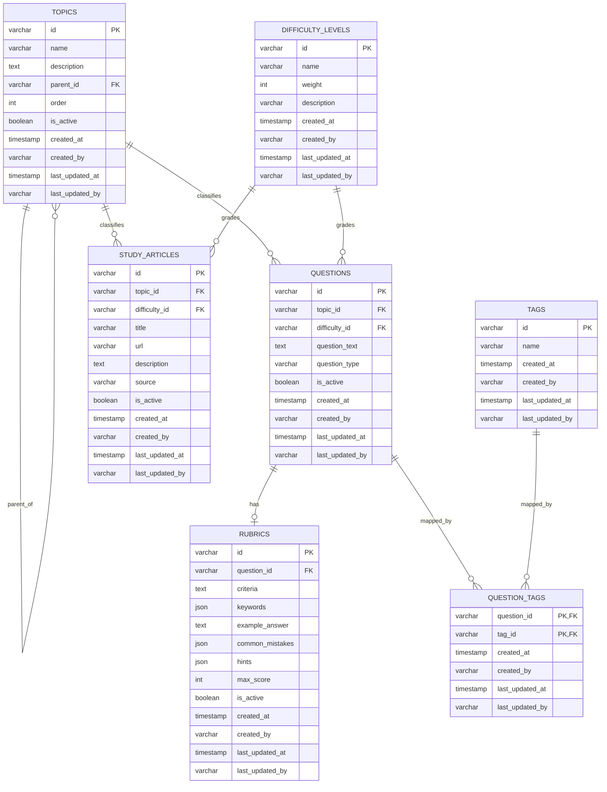

### 12. Data Dictionary

| Field | Type | Nullable | Default | Constraint | Business Meaning |
|---|---|---|---|---|---|
| `topics.id` | `VARCHAR(36)` | No | None | PK | Topic identifier |
| `topics.name` | `VARCHAR(255)` | No | None | App-level unique within parent scope | Topic display name |
| `topics.description` | `TEXT` | Yes | None | None | Topic explanation |
| `topics.parent_id` | `VARCHAR(36)` | Yes | None | FK to `topics.id`, `ON DELETE SET NULL` | Parent topic reference |
| `topics.order` | `INT` | Yes | `0` | Indexed | Display sort order |
| `topics.is_active` | `BOOLEAN` | Yes | `TRUE` | Indexed | Active/inactive lifecycle flag |
| `topics.created_at` | `TIMESTAMP` | Yes | `CURRENT_TIMESTAMP` | None | Creation timestamp |
| `topics.created_by` | `VARCHAR(36)` | Yes | None | None | Creator user ID |
| `topics.last_updated_at` | `TIMESTAMP` | Yes | `CURRENT_TIMESTAMP` | None | Last modification timestamp |
| `topics.last_updated_by` | `VARCHAR(36)` | Yes | None | None | Last modifier user ID |
| `difficulty_levels.id` | `VARCHAR(36)` | No | None | PK | Difficulty identifier |
| `difficulty_levels.name` | `VARCHAR(50)` | No | None | Unique index | Difficulty name |
| `difficulty_levels.weight` | `INT` | No | None | Indexed | Relative difficulty ordering |
| `difficulty_levels.description` | `VARCHAR(255)` | Yes | None | None | Difficulty explanation |
| `difficulty_levels.created_at` | `TIMESTAMP` | Yes | `CURRENT_TIMESTAMP` | None | Creation timestamp |
| `difficulty_levels.created_by` | `VARCHAR(36)` | Yes | None | None | Creator user ID |
| `difficulty_levels.last_updated_at` | `TIMESTAMP` | Yes | `CURRENT_TIMESTAMP` | None | Last modification timestamp |
| `difficulty_levels.last_updated_by` | `VARCHAR(36)` | Yes | None | None | Last modifier user ID |
| `tags.id` | `VARCHAR(36)` | No | None | PK | Tag identifier |
| `tags.name` | `VARCHAR(100)` | No | None | Unique index | Tag name |
| `tags.created_at` | `TIMESTAMP` | Yes | `CURRENT_TIMESTAMP` | None | Creation timestamp |
| `tags.created_by` | `VARCHAR(36)` | Yes | None | None | Creator user ID |
| `tags.last_updated_at` | `TIMESTAMP` | Yes | `CURRENT_TIMESTAMP` | None | Last modification timestamp |
| `tags.last_updated_by` | `VARCHAR(36)` | Yes | None | None | Last modifier user ID |
| `questions.id` | `VARCHAR(36)` | No | None | PK | Question identifier |
| `questions.topic_id` | `VARCHAR(36)` | No | None | FK to `topics.id` | Topic classification |
| `questions.difficulty_id` | `VARCHAR(36)` | No | None | FK to `difficulty_levels.id` | Difficulty classification |
| `questions.question_text` | `TEXT` | No | None | None | Question content |
| `questions.question_type` | `VARCHAR(50)` | No | None | Check: `technical`, `behavioral`, `coding` | Question category |
| `questions.is_active` | `BOOLEAN` | Yes | `TRUE` | Indexed | Active/inactive lifecycle flag |
| `questions.created_at` | `TIMESTAMP` | Yes | `CURRENT_TIMESTAMP` | None | Creation timestamp |
| `questions.created_by` | `VARCHAR(36)` | Yes | None | None | Creator user ID |
| `questions.last_updated_at` | `TIMESTAMP` | Yes | `CURRENT_TIMESTAMP` | None | Last modification timestamp |
| `questions.last_updated_by` | `VARCHAR(36)` | Yes | None | None | Last modifier user ID |
| `rubrics.id` | `VARCHAR(36)` | No | None | PK | Rubric identifier |
| `rubrics.question_id` | `VARCHAR(36)` | No | None | FK to `questions.id`, unique | Linked question |
| `rubrics.criteria` | `TEXT` | Yes | None | None | Scoring criteria narrative |
| `rubrics.keywords` | `JSON` | Yes | None | None | Keyword hints for scoring |
| `rubrics.example_answer` | `TEXT` | Yes | None | None | Example answer content |
| `rubrics.common_mistakes` | `JSON` | Yes | None | None | Common mistake guidance |
| `rubrics.hints` | `JSON` | Yes | None | None | Scoring hints |
| `rubrics.max_score` | `INT` | Yes | `10` | None | Maximum score |
| `rubrics.is_active` | `BOOLEAN` | No | `TRUE` | Added by V2 migration | Active/inactive lifecycle flag |
| `rubrics.created_at` | `TIMESTAMP` | Yes | `CURRENT_TIMESTAMP` | None | Creation timestamp |
| `rubrics.created_by` | `VARCHAR(36)` | Yes | None | None | Creator user ID |
| `rubrics.last_updated_at` | `TIMESTAMP` | Yes | `CURRENT_TIMESTAMP` | None | Last modification timestamp |
| `rubrics.last_updated_by` | `VARCHAR(36)` | Yes | None | None | Last modifier user ID |
| `question_tags.question_id` | `VARCHAR(36)` | No | None | PK, FK to `questions.id`, `ON DELETE CASCADE` | Linked question |
| `question_tags.tag_id` | `VARCHAR(36)` | No | None | PK, FK to `tags.id`, `ON DELETE CASCADE` | Linked tag |
| `question_tags.created_at` | `TIMESTAMP` | Yes | `CURRENT_TIMESTAMP` | None | Mapping creation timestamp |
| `question_tags.created_by` | `VARCHAR(36)` | Yes | None | None | Mapping creator |
| `question_tags.last_updated_at` | `TIMESTAMP` | Yes | `CURRENT_TIMESTAMP` | None | Mapping update timestamp |
| `question_tags.last_updated_by` | `VARCHAR(36)` | Yes | None | None | Mapping updater |
| `study_articles.id` | `VARCHAR(36)` | No | None | PK | Study article identifier |
| `study_articles.topic_id` | `VARCHAR(36)` | No | None | FK to `topics.id` | Topic classification |
| `study_articles.difficulty_id` | `VARCHAR(36)` | No | None | FK to `difficulty_levels.id` | Difficulty classification |
| `study_articles.title` | `VARCHAR(255)` | No | None | None | Article title |
| `study_articles.url` | `VARCHAR(500)` | No | None | None | Canonical article URL |
| `study_articles.description` | `TEXT` | Yes | None | None | Article description |
| `study_articles.source` | `VARCHAR(100)` | Yes | None | Indexed | Publisher/source label |
| `study_articles.is_active` | `BOOLEAN` | Yes | `TRUE` | Indexed | Publication state |
| `study_articles.created_at` | `TIMESTAMP` | Yes | `CURRENT_TIMESTAMP` | None | Creation timestamp |
| `study_articles.created_by` | `VARCHAR(36)` | Yes | None | None | Creator user ID |
| `study_articles.last_updated_at` | `TIMESTAMP` | Yes | `CURRENT_TIMESTAMP` | None | Last modification timestamp |
| `study_articles.last_updated_by` | `VARCHAR(36)` | Yes | None | None | Last modifier user ID |

### 13. API Design

Section rules:
- Public APIs are exposed under `/api/v1`.
- Internal service APIs are exposed under `/api/internal`.
- Public responses follow the `BaseResponse` envelope used in the current codebase.
- Public write endpoints require `ADMIN` role `[ASSUMPTION]`.
- Public read endpoints require `ADMIN` or `INTERVIEWER`, except candidate-facing article reads which are expected to flow through Candidate Service `[ASSUMPTION]`.
- Current implementation path mismatch: difficulty endpoints are currently `/api/v1/difficulties`; the canonical resource name in this document is `/difficulty-levels`.
- Current implementation path mismatch: question search is currently `/api/v1/questions/search`; the canonical list/search endpoint in this document is `GET /questions`.

#### 13.1 Topics

##### [GET] /topics
Purpose        : Retrieve active topics as a flat list ordered by `order ASC, name ASC`  
Auth           : JWT Bearer | Role required: `ADMIN`, `INTERVIEWER`  
Path Params    : None  
Query Params   : `active` boolean optional, default `true`  
Request Body   : None  
Response Body  : `BaseResponse<List<TopicResponse>>`  
Success Code   : `200`  
Error Codes    :
- `401 AUTH_001` Missing or invalid token `[RECOMMENDED RULE]`
- `403 AUTH_002` Role not permitted `[RECOMMENDED RULE]`
- `500 COM_002` Internal server error  
Pagination     : None

Example `curl`:
```bash
curl -X GET "http://question-service/api/v1/topics?active=true" \
  -H "Authorization: Bearer <jwt>"
```

Example response:
```json
{
  "success": true,
  "error_code": null,
  "data": [
    {
      "id": "7f3c1c6d-41be-4f6f-a52f-1b2a778ab111",
      "name": "Java Backend",
      "description": "Java server-side interview domain",
      "parent_id": null,
      "order": 1,
      "is_active": true,
      "created_at": "2026-03-12T09:00:00",
      "last_updated_at": "2026-03-12T09:00:00"
    },
    {
      "id": "ad4ce5d7-2f65-4eb8-9d7e-8bce80ff2214",
      "name": "Spring Boot",
      "description": "Spring ecosystem questions",
      "parent_id": "7f3c1c6d-41be-4f6f-a52f-1b2a778ab111",
      "order": 2,
      "is_active": true,
      "created_at": "2026-03-12T09:05:00",
      "last_updated_at": "2026-03-12T09:05:00"
    }
  ],
  "errors": null,
  "timestamp": "2026-03-12T10:00:00"
}
```

##### [GET] /topics/tree
Purpose        : Retrieve active topics as a nested tree  
Auth           : JWT Bearer | Role required: `ADMIN`, `INTERVIEWER`  
Path Params    : None  
Query Params   : None  
Request Body   : None  
Response Body  : `BaseResponse<List<TopicTreeResponse>>`  
Success Code   : `200`  
Error Codes    : `401`, `403`, `500`  
Pagination     : None

Example `curl`:
```bash
curl -X GET "http://question-service/api/v1/topics/tree" \
  -H "Authorization: Bearer <jwt>"
```

Example response:
```json
{
  "success": true,
  "error_code": null,
  "data": [
    {
      "id": "7f3c1c6d-41be-4f6f-a52f-1b2a778ab111",
      "name": "Java Backend",
      "description": "Java server-side interview domain",
      "order": 1,
      "children": [
        {
          "id": "ad4ce5d7-2f65-4eb8-9d7e-8bce80ff2214",
          "name": "Spring Boot",
          "description": "Spring ecosystem questions",
          "order": 2,
          "children": []
        }
      ]
    }
  ],
  "errors": null,
  "timestamp": "2026-03-12T10:01:00"
}
```

##### [GET] /topics/{id}
Purpose        : Retrieve a single topic by ID  
Auth           : JWT Bearer | Role required: `ADMIN`, `INTERVIEWER`  
Path Params    : `id` UUID of topic  
Query Params   : None  
Request Body   : None  
Response Body  : `BaseResponse<TopicResponse>`  
Success Code   : `200`  
Error Codes    :
- `404 TOP_001` Topic not found
- `401 AUTH_001` Missing or invalid token `[RECOMMENDED RULE]`
- `403 AUTH_002` Role not permitted `[RECOMMENDED RULE]`
- `500 COM_002` Internal server error  
Pagination     : None

Example `curl`:
```bash
curl -X GET "http://question-service/api/v1/topics/7f3c1c6d-41be-4f6f-a52f-1b2a778ab111" \
  -H "Authorization: Bearer <jwt>"
```

Example response:
```json
{
  "success": true,
  "error_code": null,
  "data": {
    "id": "7f3c1c6d-41be-4f6f-a52f-1b2a778ab111",
    "name": "Java Backend",
    "description": "Java server-side interview domain",
    "parent_id": null,
    "order": 1,
    "is_active": true,
    "created_at": "2026-03-12T09:00:00",
    "last_updated_at": "2026-03-12T09:00:00"
  },
  "errors": null,
  "timestamp": "2026-03-12T10:02:00"
}
```

##### [POST] /topics
Purpose        : Create a topic  
Auth           : JWT Bearer | Role required: `ADMIN`  
Path Params    : None  
Query Params   : None  
Request Body   :
```json
{
  "name": "string, required, max 255",
  "description": "string, optional, max 1000",
  "parent_id": "uuid, optional",
  "order": "integer, optional, default 0",
  "is_active": "boolean, optional, default true"
}
```  
Response Body  : `BaseResponse<TopicResponse>`  
Success Code   : `201`  
Error Codes    :
- `400 COM_001` Validation error
- `404 TOP_001` Parent topic not found
- `409 TOP_003` Topic already exists under same parent
- `423 TOP_004` Parent topic inactive `[RECOMMENDED RULE]`
- `401`, `403`, `500`
Pagination     : None

Example `curl`:
```bash
curl -X POST "http://question-service/api/v1/topics" \
  -H "Authorization: Bearer <jwt>" \
  -H "Content-Type: application/json" \
  -d '{
    "name": "Spring Boot",
    "description": "Spring ecosystem questions",
    "parent_id": "7f3c1c6d-41be-4f6f-a52f-1b2a778ab111",
    "order": 2,
    "is_active": true
  }'
```

Example response:
```json
{
  "success": true,
  "error_code": null,
  "data": {
    "id": "ad4ce5d7-2f65-4eb8-9d7e-8bce80ff2214",
    "name": "Spring Boot",
    "description": "Spring ecosystem questions",
    "parent_id": "7f3c1c6d-41be-4f6f-a52f-1b2a778ab111",
    "order": 2,
    "is_active": true,
    "created_at": "2026-03-12T10:03:00",
    "last_updated_at": "2026-03-12T10:03:00"
  },
  "errors": null,
  "timestamp": "2026-03-12T10:03:00"
}
```

##### [PUT] /topics/{id}
Purpose        : Update topic attributes  
Auth           : JWT Bearer | Role required: `ADMIN`  
Path Params    : `id` UUID of topic  
Query Params   : None  
Request Body   : Same as `POST /topics`  
Response Body  : `BaseResponse<TopicResponse>`  
Success Code   : `200`  
Error Codes    :
- `400 COM_001` Validation error
- `400 TOP_002` Topic circular reference
- `404 TOP_001` Topic or parent not found
- `409 TOP_003` Duplicate topic name under same parent
- `423 TOP_004` Parent topic inactive `[RECOMMENDED RULE]`
- `401`, `403`, `500`
Pagination     : None

Example `curl`:
```bash
curl -X PUT "http://question-service/api/v1/topics/ad4ce5d7-2f65-4eb8-9d7e-8bce80ff2214" \
  -H "Authorization: Bearer <jwt>" \
  -H "Content-Type: application/json" \
  -d '{
    "name": "Spring Boot Core",
    "description": "Updated Spring core interview questions",
    "parent_id": "7f3c1c6d-41be-4f6f-a52f-1b2a778ab111",
    "order": 2,
    "is_active": true
  }'
```

Example response:
```json
{
  "success": true,
  "error_code": null,
  "data": {
    "id": "ad4ce5d7-2f65-4eb8-9d7e-8bce80ff2214",
    "name": "Spring Boot Core",
    "description": "Updated Spring core interview questions",
    "parent_id": "7f3c1c6d-41be-4f6f-a52f-1b2a778ab111",
    "order": 2,
    "is_active": true,
    "created_at": "2026-03-12T10:03:00",
    "last_updated_at": "2026-03-12T10:05:00"
  },
  "errors": null,
  "timestamp": "2026-03-12T10:05:00"
}
```

##### [DELETE] /topics/{id}
Purpose        : Soft deactivate a topic  
Auth           : JWT Bearer | Role required: `ADMIN`  
Path Params    : `id` UUID of topic  
Query Params   : None  
Request Body   : None  
Response Body  : `BaseResponse<Void>`  
Success Code   : `200`  
Error Codes    :
- `404 TOP_001` Topic not found
- `400 TOP_005` Topic has active children
- `400 TOP_006` Topic has active questions
- `401`, `403`, `500`
Pagination     : None

Example `curl`:
```bash
curl -X DELETE "http://question-service/api/v1/topics/ad4ce5d7-2f65-4eb8-9d7e-8bce80ff2214" \
  -H "Authorization: Bearer <jwt>"
```

Example response:
```json
{
  "success": true,
  "error_code": null,
  "data": null,
  "errors": null,
  "timestamp": "2026-03-12T10:06:00"
}
```

#### 13.2 Difficulty Levels

##### [GET] /difficulty-levels
Purpose        : Retrieve all difficulty levels ordered by `weight ASC`  
Auth           : JWT Bearer | Role required: `ADMIN`, `INTERVIEWER`  
Path Params    : None  
Query Params   : None  
Request Body   : None  
Response Body  : `BaseResponse<List<DifficultyLevelResponse>>`  
Success Code   : `200`  
Error Codes    : `401`, `403`, `500`
Pagination     : None

Example `curl`:
```bash
curl -X GET "http://question-service/api/v1/difficulties" \
  -H "Authorization: Bearer <jwt>"
```

Example response:
```json
{
  "success": true,
  "error_code": null,
  "data": [
    {
      "id": "15b7d3d1-4f44-4a07-bd52-4dbe6fc7d001",
      "name": "Easy",
      "weight": 1,
      "description": "Entry level"
    },
    {
      "id": "41bfbf25-a648-4fdf-8e0a-a441f22af002",
      "name": "Medium",
      "weight": 2,
      "description": "Mid-level"
    }
  ],
  "errors": null,
  "timestamp": "2026-03-12T10:07:00"
}
```

##### [GET] /difficulty-levels/{id}
Purpose        : Retrieve a single difficulty level  
Auth           : JWT Bearer | Role required: `ADMIN`, `INTERVIEWER`  
Path Params    : `id` UUID of difficulty level  
Query Params   : None  
Request Body   : None  
Response Body  : `BaseResponse<DifficultyLevelResponse>`  
Success Code   : `200`  
Error Codes    :
- `404 DIF_001` Difficulty level not found
- `401`, `403`, `500`
Pagination     : None

Example `curl`:
```bash
curl -X GET "http://question-service/api/v1/difficulties/41bfbf25-a648-4fdf-8e0a-a441f22af002" \
  -H "Authorization: Bearer <jwt>"
```

Example response:
```json
{
  "success": true,
  "error_code": null,
  "data": {
    "id": "41bfbf25-a648-4fdf-8e0a-a441f22af002",
    "name": "Medium",
    "weight": 2,
    "description": "Mid-level"
  },
  "errors": null,
  "timestamp": "2026-03-12T10:08:00"
}
```

##### [POST] /difficulty-levels
Purpose        : Create a difficulty level  
Auth           : JWT Bearer | Role required: `ADMIN`  
Path Params    : None  
Query Params   : None  
Request Body   :
```json
{
  "name": "string, required, max 50",
  "weight": "integer, required, min 1, max 100",
  "description": "string, optional, max 255"
}
```  
Response Body  : `BaseResponse<DifficultyLevelResponse>`  
Success Code   : `201`  
Error Codes    :
- `400 COM_001` Validation error
- `409 DIF_002` Difficulty level already exists
- `401`, `403`, `500`
Pagination     : None

Example `curl`:
```bash
curl -X POST "http://question-service/api/v1/difficulties" \
  -H "Authorization: Bearer <jwt>" \
  -H "Content-Type: application/json" \
  -d '{
    "name": "Hard",
    "weight": 3,
    "description": "Senior-level complexity"
  }'
```

Example response:
```json
{
  "success": true,
  "error_code": null,
  "data": {
    "id": "cbaf28d7-4c39-4cc4-9b42-9501c2f47003",
    "name": "Hard",
    "weight": 3,
    "description": "Senior-level complexity"
  },
  "errors": null,
  "timestamp": "2026-03-12T10:09:00"
}
```

##### [PUT] /difficulty-levels/{id}
Purpose        : Update a difficulty level  
Auth           : JWT Bearer | Role required: `ADMIN`  
Path Params    : `id` UUID of difficulty level  
Query Params   : None  
Request Body   : Same as `POST /difficulty-levels`  
Response Body  : `BaseResponse<DifficultyLevelResponse>`  
Success Code   : `200`  
Error Codes    :
- `400 COM_001` Validation error
- `404 DIF_001` Difficulty level not found
- `409 DIF_002` Difficulty level already exists
- `401`, `403`, `500`
Pagination     : None

Example `curl`:
```bash
curl -X PUT "http://question-service/api/v1/difficulties/41bfbf25-a648-4fdf-8e0a-a441f22af002" \
  -H "Authorization: Bearer <jwt>" \
  -H "Content-Type: application/json" \
  -d '{
    "name": "Medium",
    "weight": 2,
    "description": "Mid-level production readiness"
  }'
```

Example response:
```json
{
  "success": true,
  "error_code": null,
  "data": {
    "id": "41bfbf25-a648-4fdf-8e0a-a441f22af002",
    "name": "Medium",
    "weight": 2,
    "description": "Mid-level production readiness"
  },
  "errors": null,
  "timestamp": "2026-03-12T10:10:00"
}
```

##### [DELETE] /difficulty-levels/{id}
Purpose        : Retire or delete an unused difficulty level `[RECOMMENDED RULE]`  
Auth           : JWT Bearer | Role required: `ADMIN`  
Path Params    : `id` UUID of difficulty level  
Query Params   : `mode` enum optional: `hard_delete`, default `hard_delete`  
Request Body   : None  
Response Body  : `BaseResponse<Void>`  
Success Code   : `200`  
Error Codes    :
- `404 DIF_001` Difficulty level not found
- `409 DIF_003` Difficulty level is in use `[RECOMMENDED RULE]`
- `401`, `403`, `500`
Pagination     : None

Example `curl`:
```bash
curl -X DELETE "http://question-service/api/v1/difficulty-levels/cbaf28d7-4c39-4cc4-9b42-9501c2f47003" \
  -H "Authorization: Bearer <jwt>"
```

Example response:
```json
{
  "success": true,
  "error_code": null,
  "data": null,
  "errors": null,
  "timestamp": "2026-03-12T10:11:00"
}
```

#### 13.3 Tags

##### [GET] /tags
Purpose        : Retrieve all tags ordered by name  
Auth           : JWT Bearer | Role required: `ADMIN`, `INTERVIEWER`  
Path Params    : None  
Query Params   : None  
Request Body   : None  
Response Body  : `BaseResponse<List<TagResponse>>`  
Success Code   : `200`  
Error Codes    : `401`, `403`, `500`
Pagination     : None

Example `curl`:
```bash
curl -X GET "http://question-service/api/v1/tags" \
  -H "Authorization: Bearer <jwt>"
```

Example response:
```json
{
  "success": true,
  "error_code": null,
  "data": [
    {
      "id": "e1af4a19-5481-4c7b-8cb0-5dce5ee90011",
      "name": "java"
    },
    {
      "id": "b5d9217a-2fbf-4701-a61d-c52c2f530012",
      "name": "spring-boot"
    }
  ],
  "errors": null,
  "timestamp": "2026-03-12T10:12:00"
}
```

##### [GET] /tags/{id}
Purpose        : Retrieve a single tag `[RECOMMENDED RULE]`  
Auth           : JWT Bearer | Role required: `ADMIN`, `INTERVIEWER`  
Path Params    : `id` UUID of tag  
Query Params   : None  
Request Body   : None  
Response Body  : `BaseResponse<TagResponse>`  
Success Code   : `200`  
Error Codes    :
- `404 TAG_001` Tag not found
- `401`, `403`, `500`
Pagination     : None

Example `curl`:
```bash
curl -X GET "http://question-service/api/v1/tags/e1af4a19-5481-4c7b-8cb0-5dce5ee90011" \
  -H "Authorization: Bearer <jwt>"
```

Example response:
```json
{
  "success": true,
  "error_code": null,
  "data": {
    "id": "e1af4a19-5481-4c7b-8cb0-5dce5ee90011",
    "name": "java"
  },
  "errors": null,
  "timestamp": "2026-03-12T10:13:00"
}
```

##### [POST] /tags
Purpose        : Create a tag  
Auth           : JWT Bearer | Role required: `ADMIN`  
Path Params    : None  
Query Params   : None  
Request Body   :
```json
{
  "name": "string, required, max 100"
}
```  
Response Body  : `BaseResponse<TagResponse>`  
Success Code   : `201`  
Error Codes    :
- `400 COM_001` Validation error
- `409 TAG_002` Tag already exists
- `401`, `403`, `500`
Pagination     : None

Example `curl`:
```bash
curl -X POST "http://question-service/api/v1/tags" \
  -H "Authorization: Bearer <jwt>" \
  -H "Content-Type: application/json" \
  -d '{
    "name": "System Design"
  }'
```

Example response:
```json
{
  "success": true,
  "error_code": null,
  "data": {
    "id": "4f44f5bb-ae27-41b3-8d59-7e2e09990013",
    "name": "system design"
  },
  "errors": null,
  "timestamp": "2026-03-12T10:14:00"
}
```

##### [PUT] /tags/{id}
Purpose        : Update a tag  
Auth           : JWT Bearer | Role required: `ADMIN`  
Path Params    : `id` UUID of tag  
Query Params   : None  
Request Body   : Same as `POST /tags`  
Response Body  : `BaseResponse<TagResponse>`  
Success Code   : `200`  
Error Codes    :
- `400 COM_001` Validation error
- `404 TAG_001` Tag not found
- `409 TAG_002` Tag already exists
- `401`, `403`, `500`
Pagination     : None

Example `curl`:
```bash
curl -X PUT "http://question-service/api/v1/tags/4f44f5bb-ae27-41b3-8d59-7e2e09990013" \
  -H "Authorization: Bearer <jwt>" \
  -H "Content-Type: application/json" \
  -d '{
    "name": "Distributed Systems"
  }'
```

Example response:
```json
{
  "success": true,
  "error_code": null,
  "data": {
    "id": "4f44f5bb-ae27-41b3-8d59-7e2e09990013",
    "name": "distributed systems"
  },
  "errors": null,
  "timestamp": "2026-03-12T10:15:00"
}
```

##### [DELETE] /tags/{id}
Purpose        : Delete an unused tag  
Auth           : JWT Bearer | Role required: `ADMIN`  
Path Params    : `id` UUID of tag  
Query Params   : None  
Request Body   : None  
Response Body  : `BaseResponse<Void>`  
Success Code   : `200`  
Error Codes    :
- `404 TAG_001` Tag not found
- `400 TAG_003` Tag is in use by questions
- `401`, `403`, `500`
Pagination     : None

Example `curl`:
```bash
curl -X DELETE "http://question-service/api/v1/tags/4f44f5bb-ae27-41b3-8d59-7e2e09990013" \
  -H "Authorization: Bearer <jwt>"
```

Example response:
```json
{
  "success": true,
  "error_code": null,
  "data": null,
  "errors": null,
  "timestamp": "2026-03-12T10:16:00"
}
```

#### 13.4 Questions

##### [GET] /questions
Purpose        : Canonical list/search endpoint for questions `[RECOMMENDED RULE]`  
Auth           : JWT Bearer | Role required: `ADMIN`, `INTERVIEWER`  
Path Params    : None  
Query Params   : `page` int default `0`, `size` int default `20`, max `100`, `sort` string default `created_at,desc`, `topic_id`, `difficulty_id`, `type`, `tag_ids` repeatable, `keyword`, `is_active`  
Request Body   : None  
Response Body  : `BaseResponse<PageResponse<QuestionResponse>>`  
Success Code   : `200`  
Error Codes    :
- `400 COM_001` Invalid query parameter
- `401`, `403`, `500`
Pagination     : Offset-based, default page size `20`

Example `curl`:
```bash
curl -X GET "http://question-service/api/v1/questions?page=0&size=20&sort=createdAt,desc&topic_id=ad4ce5d7-2f65-4eb8-9d7e-8bce80ff2214&difficulty_id=41bfbf25-a648-4fdf-8e0a-a441f22af002&type=TECHNICAL&keyword=repository&is_active=true" \
  -H "Authorization: Bearer <jwt>"
```

Example response:
```json
{
  "success": true,
  "error_code": null,
  "data": {
    "content": [
      {
        "id": "9c71474b-a7f0-4ea2-8e30-13c301f30021",
        "topic_id": "ad4ce5d7-2f65-4eb8-9d7e-8bce80ff2214",
        "topic_name": "Spring Boot Core",
        "difficulty_id": "41bfbf25-a648-4fdf-8e0a-a441f22af002",
        "difficulty_name": "Medium",
        "question_text": "Explain the difference between @Component, @Service, and @Repository.",
        "question_type": "TECHNICAL",
        "tags": [
          {
            "id": "e1af4a19-5481-4c7b-8cb0-5dce5ee90011",
            "name": "java"
          },
          {
            "id": "b5d9217a-2fbf-4701-a61d-c52c2f530012",
            "name": "spring-boot"
          }
        ],
        "is_active": true,
        "created_at": "2026-03-12T09:30:00",
        "last_updated_at": "2026-03-12T09:30:00"
      }
    ],
    "page": 0,
    "size": 20,
    "total_elements": 1,
    "total_pages": 1,
    "first": true,
    "last": true
  },
  "errors": null,
  "timestamp": "2026-03-12T10:17:00"
}
```

##### [GET] /questions/search
Purpose        : Current implementation compatibility endpoint for question search  
Auth           : JWT Bearer | Role required: `ADMIN`, `INTERVIEWER`  
Path Params    : None  
Query Params   : Same as `GET /questions`  
Request Body   : None  
Response Body  : Same as `GET /questions`  
Success Code   : `200`  
Error Codes    : Same as `GET /questions`  
Pagination     : Offset-based, default page size `20`

Example `curl`:
```bash
curl -X GET "http://question-service/api/v1/questions/search?page=0&size=20&sort=createdAt,desc&keyword=repository" \
  -H "Authorization: Bearer <jwt>"
```

Example response:
```json
{
  "success": true,
  "error_code": null,
  "data": {
    "content": [
      {
        "id": "9c71474b-a7f0-4ea2-8e30-13c301f30021",
        "topic_id": "ad4ce5d7-2f65-4eb8-9d7e-8bce80ff2214",
        "topic_name": "Spring Boot Core",
        "difficulty_id": "41bfbf25-a648-4fdf-8e0a-a441f22af002",
        "difficulty_name": "Medium",
        "question_text": "Explain the difference between @Component, @Service, and @Repository.",
        "question_type": "TECHNICAL",
        "tags": [
          {
            "id": "e1af4a19-5481-4c7b-8cb0-5dce5ee90011",
            "name": "java"
          }
        ],
        "is_active": true,
        "created_at": "2026-03-12T09:30:00",
        "last_updated_at": "2026-03-12T09:30:00"
      }
    ],
    "page": 0,
    "size": 20,
    "total_elements": 1,
    "total_pages": 1,
    "first": true,
    "last": true
  },
  "errors": null,
  "timestamp": "2026-03-12T10:18:00"
}
```

##### [GET] /questions/{id}
Purpose        : Retrieve a single question with resolved topic, difficulty, and tags  
Auth           : JWT Bearer | Role required: `ADMIN`, `INTERVIEWER`  
Path Params    : `id` UUID of question  
Query Params   : None  
Request Body   : None  
Response Body  : `BaseResponse<QuestionResponse>`  
Success Code   : `200`  
Error Codes    :
- `404 QUE_001` Question not found
- `401`, `403`, `500`
Pagination     : None

Example `curl`:
```bash
curl -X GET "http://question-service/api/v1/questions/9c71474b-a7f0-4ea2-8e30-13c301f30021" \
  -H "Authorization: Bearer <jwt>"
```

Example response:
```json
{
  "success": true,
  "error_code": null,
  "data": {
    "id": "9c71474b-a7f0-4ea2-8e30-13c301f30021",
    "topic_id": "ad4ce5d7-2f65-4eb8-9d7e-8bce80ff2214",
    "topic_name": "Spring Boot Core",
    "difficulty_id": "41bfbf25-a648-4fdf-8e0a-a441f22af002",
    "difficulty_name": "Medium",
    "question_text": "Explain the difference between @Component, @Service, and @Repository.",
    "question_type": "TECHNICAL",
    "tags": [
      {
        "id": "e1af4a19-5481-4c7b-8cb0-5dce5ee90011",
        "name": "java"
      },
      {
        "id": "b5d9217a-2fbf-4701-a61d-c52c2f530012",
        "name": "spring-boot"
      }
    ],
    "is_active": true,
    "created_at": "2026-03-12T09:30:00",
    "last_updated_at": "2026-03-12T09:30:00"
  },
  "errors": null,
  "timestamp": "2026-03-12T10:19:00"
}
```

##### [POST] /questions
Purpose        : Create a question and initial tag mappings  
Auth           : JWT Bearer | Role required: `ADMIN`  
Path Params    : None  
Query Params   : None  
Request Body   :
```json
{
  "topic_id": "uuid, required",
  "difficulty_id": "uuid, required",
  "question_text": "string, required, max 5000",
  "question_type": "enum TECHNICAL|BEHAVIORAL|CODING, required",
  "tag_ids": ["uuid, optional"],
  "is_active": "boolean, optional, default true"
}
```  
Response Body  : `BaseResponse<QuestionResponse>`  
Success Code   : `201`  
Error Codes    :
- `400 COM_001` Validation error
- `400 QUE_003` Invalid question type
- `404 TOP_001` Topic not found
- `404 DIF_001` Difficulty level not found
- `404 TAG_001` One or more tags not found `[RECOMMENDED RULE]`
- `423 TOP_004` Topic inactive
- `401`, `403`, `500`
Pagination     : None

Example `curl`:
```bash
curl -X POST "http://question-service/api/v1/questions" \
  -H "Authorization: Bearer <jwt>" \
  -H "Content-Type: application/json" \
  -d '{
    "topic_id": "ad4ce5d7-2f65-4eb8-9d7e-8bce80ff2214",
    "difficulty_id": "41bfbf25-a648-4fdf-8e0a-a441f22af002",
    "question_text": "Explain the difference between @Component, @Service, and @Repository.",
    "question_type": "TECHNICAL",
    "tag_ids": [
      "e1af4a19-5481-4c7b-8cb0-5dce5ee90011",
      "b5d9217a-2fbf-4701-a61d-c52c2f530012"
    ],
    "is_active": true
  }'
```

Example response:
```json
{
  "success": true,
  "error_code": null,
  "data": {
    "id": "9c71474b-a7f0-4ea2-8e30-13c301f30021",
    "topic_id": "ad4ce5d7-2f65-4eb8-9d7e-8bce80ff2214",
    "topic_name": "Spring Boot Core",
    "difficulty_id": "41bfbf25-a648-4fdf-8e0a-a441f22af002",
    "difficulty_name": "Medium",
    "question_text": "Explain the difference between @Component, @Service, and @Repository.",
    "question_type": "TECHNICAL",
    "tags": [
      {
        "id": "e1af4a19-5481-4c7b-8cb0-5dce5ee90011",
        "name": "java"
      },
      {
        "id": "b5d9217a-2fbf-4701-a61d-c52c2f530012",
        "name": "spring-boot"
      }
    ],
    "is_active": true,
    "created_at": "2026-03-12T10:20:00",
    "last_updated_at": "2026-03-12T10:20:00"
  },
  "errors": null,
  "timestamp": "2026-03-12T10:20:00"
}
```

##### [PUT] /questions/{id}
Purpose        : Update a question and replace its tag mappings  
Auth           : JWT Bearer | Role required: `ADMIN`  
Path Params    : `id` UUID of question  
Query Params   : None  
Request Body   : Same as `POST /questions`  
Response Body  : `BaseResponse<QuestionResponse>`  
Success Code   : `200`  
Error Codes    :
- `400 COM_001` Validation error
- `400 QUE_003` Invalid question type
- `404 QUE_001` Question not found
- `404 TOP_001` Topic not found
- `404 DIF_001` Difficulty level not found
- `404 TAG_001` One or more tags not found `[RECOMMENDED RULE]`
- `423 TOP_004` Topic inactive
- `401`, `403`, `500`
Pagination     : None

Example `curl`:
```bash
curl -X PUT "http://question-service/api/v1/questions/9c71474b-a7f0-4ea2-8e30-13c301f30021" \
  -H "Authorization: Bearer <jwt>" \
  -H "Content-Type: application/json" \
  -d '{
    "topic_id": "ad4ce5d7-2f65-4eb8-9d7e-8bce80ff2214",
    "difficulty_id": "cbaf28d7-4c39-4cc4-9b42-9501c2f47003",
    "question_text": "Explain the lifecycle of a Spring bean and how proxying affects it.",
    "question_type": "TECHNICAL",
    "tag_ids": [
      "e1af4a19-5481-4c7b-8cb0-5dce5ee90011",
      "4f44f5bb-ae27-41b3-8d59-7e2e09990013"
    ],
    "is_active": true
  }'
```

Example response:
```json
{
  "success": true,
  "error_code": null,
  "data": {
    "id": "9c71474b-a7f0-4ea2-8e30-13c301f30021",
    "topic_id": "ad4ce5d7-2f65-4eb8-9d7e-8bce80ff2214",
    "topic_name": "Spring Boot Core",
    "difficulty_id": "cbaf28d7-4c39-4cc4-9b42-9501c2f47003",
    "difficulty_name": "Hard",
    "question_text": "Explain the lifecycle of a Spring bean and how proxying affects it.",
    "question_type": "TECHNICAL",
    "tags": [
      {
        "id": "e1af4a19-5481-4c7b-8cb0-5dce5ee90011",
        "name": "java"
      },
      {
        "id": "4f44f5bb-ae27-41b3-8d59-7e2e09990013",
        "name": "distributed systems"
      }
    ],
    "is_active": true,
    "created_at": "2026-03-12T10:20:00",
    "last_updated_at": "2026-03-12T10:25:00"
  },
  "errors": null,
  "timestamp": "2026-03-12T10:25:00"
}
```

##### [DELETE] /questions/{id}
Purpose        : Soft deactivate a question and its linked rubric  
Auth           : JWT Bearer | Role required: `ADMIN`  
Path Params    : `id` UUID of question  
Query Params   : None  
Request Body   : None  
Response Body  : `BaseResponse<Void>`  
Success Code   : `200`  
Error Codes    :
- `404 QUE_001` Question not found
- `401`, `403`, `500`
Pagination     : None

Example `curl`:
```bash
curl -X DELETE "http://question-service/api/v1/questions/9c71474b-a7f0-4ea2-8e30-13c301f30021" \
  -H "Authorization: Bearer <jwt>"
```

Example response:
```json
{
  "success": true,
  "error_code": null,
  "data": null,
  "errors": null,
  "timestamp": "2026-03-12T10:26:00"
}
```

##### [GET] /questions/random
Purpose        : Retrieve a random set of active questions using optional filters  
Auth           : JWT Bearer | Role required: `ADMIN`, `INTERVIEWER` or internal consumer `[ASSUMPTION]`  
Path Params    : None  
Query Params   : `count` required integer `1..50`, `topic_id`, `difficulty_id`, `type`, `tag_ids` repeatable, `exclude_ids` repeatable  
Request Body   : None  
Response Body  : `BaseResponse<List<QuestionResponse>>`  
Success Code   : `200`  
Error Codes    :
- `400 COM_001` Validation error
- `400 QUE_003` Invalid question type
- `404 TOP_001` Topic not found
- `404 DIF_001` Difficulty level not found
- `404 QUE_005` Not enough questions available
- `401`, `403`, `500`
Pagination     : None

Example `curl`:
```bash
curl -X GET "http://question-service/api/v1/questions/random?count=2&topic_id=ad4ce5d7-2f65-4eb8-9d7e-8bce80ff2214&difficulty_id=41bfbf25-a648-4fdf-8e0a-a441f22af002&type=TECHNICAL&exclude_ids=1b8b2dc5-1111-4444-8888-abcdef000001" \
  -H "Authorization: Bearer <jwt>"
```

Example response:
```json
{
  "success": true,
  "error_code": null,
  "data": [
    {
      "id": "9c71474b-a7f0-4ea2-8e30-13c301f30021",
      "topic_id": "ad4ce5d7-2f65-4eb8-9d7e-8bce80ff2214",
      "topic_name": "Spring Boot Core",
      "difficulty_id": "41bfbf25-a648-4fdf-8e0a-a441f22af002",
      "difficulty_name": "Medium",
      "question_text": "Explain the difference between @Component, @Service, and @Repository.",
      "question_type": "TECHNICAL",
      "tags": [
        {
          "id": "b5d9217a-2fbf-4701-a61d-c52c2f530012",
          "name": "spring-boot"
        }
      ],
      "is_active": true,
      "created_at": "2026-03-12T09:30:00",
      "last_updated_at": "2026-03-12T09:30:00"
    },
    {
      "id": "a2c54914-9234-41a0-8b85-32f3e9700022",
      "topic_id": "ad4ce5d7-2f65-4eb8-9d7e-8bce80ff2214",
      "topic_name": "Spring Boot Core",
      "difficulty_id": "41bfbf25-a648-4fdf-8e0a-a441f22af002",
      "difficulty_name": "Medium",
      "question_text": "How would you externalize configuration in a Spring Boot application?",
      "question_type": "TECHNICAL",
      "tags": [
        {
          "id": "b5d9217a-2fbf-4701-a61d-c52c2f530012",
          "name": "spring-boot"
        }
      ],
      "is_active": true,
      "created_at": "2026-03-12T09:40:00",
      "last_updated_at": "2026-03-12T09:40:00"
    }
  ],
  "errors": null,
  "timestamp": "2026-03-12T10:27:00"
}
```

##### [POST] /questions/bulk
Purpose        : Bulk import questions with partial success support  
Auth           : JWT Bearer | Role required: `ADMIN`  
Path Params    : None  
Query Params   : None  
Request Body   :
```json
{
  "questions": [
    {
      "topic_id": "uuid, required",
      "difficulty_id": "uuid, required",
      "question_text": "string, required, max 5000",
      "question_type": "enum TECHNICAL|BEHAVIORAL|CODING, required",
      "tag_ids": ["uuid, optional"],
      "is_active": "boolean, optional"
    }
  ]
}
```  
Response Body  : `BaseResponse<BulkImportResponse>`  
Success Code   : `200`  
Error Codes    :
- `400 COM_001` Validation error
- `400 QUE_007` Questions list must not be empty
- `400 QUE_008` Questions list must not exceed 100 items
- `401`, `403`, `500`
Pagination     : None

Example `curl`:
```bash
curl -X POST "http://question-service/api/v1/questions/bulk" \
  -H "Authorization: Bearer <jwt>" \
  -H "Content-Type: application/json" \
  -d '{
    "questions": [
      {
        "topic_id": "ad4ce5d7-2f65-4eb8-9d7e-8bce80ff2214",
        "difficulty_id": "41bfbf25-a648-4fdf-8e0a-a441f22af002",
        "question_text": "What is dependency injection in Spring?",
        "question_type": "TECHNICAL",
        "tag_ids": ["b5d9217a-2fbf-4701-a61d-c52c2f530012"]
      },
      {
        "topic_id": "00000000-0000-0000-0000-000000000999",
        "difficulty_id": "41bfbf25-a648-4fdf-8e0a-a441f22af002",
        "question_text": "Invalid topic example",
        "question_type": "TECHNICAL"
      },
      {
        "topic_id": "ad4ce5d7-2f65-4eb8-9d7e-8bce80ff2214",
        "difficulty_id": "41bfbf25-a648-4fdf-8e0a-a441f22af002",
        "question_text": "Explain Spring bean scopes.",
        "question_type": "TECHNICAL"
      }
    ]
  }'
```

Example response:
```json
{
  "success": true,
  "error_code": null,
  "data": {
    "total": 3,
    "created": 2,
    "failed": 1,
    "errors": [
      {
        "index": 1,
        "error": "Topic not found: 00000000-0000-0000-0000-000000000999"
      }
    ]
  },
  "errors": null,
  "timestamp": "2026-03-12T10:28:00"
}
```

#### 13.5 Question Tags

##### [POST] /questions/{id}/tags
Purpose        : Attach one or more tags to a question `[ASSUMPTION]`  
Auth           : JWT Bearer | Role required: `ADMIN`  
Path Params    : `id` UUID of question  
Query Params   : None  
Request Body   :
```json
{
  "tag_ids": ["uuid, required, unique within request"]
}
```  
Response Body  : `BaseResponse<QuestionResponse>`  
Success Code   : `200`  
Error Codes    :
- `400 COM_001` Validation error
- `404 QUE_001` Question not found
- `404 TAG_001` Tag not found
- `409 TAG_005` Tag already attached `[RECOMMENDED RULE]`
- `401`, `403`, `500`
Pagination     : None

Example `curl`:
```bash
curl -X POST "http://question-service/api/v1/questions/9c71474b-a7f0-4ea2-8e30-13c301f30021/tags" \
  -H "Authorization: Bearer <jwt>" \
  -H "Content-Type: application/json" \
  -d '{
    "tag_ids": ["4f44f5bb-ae27-41b3-8d59-7e2e09990013"]
  }'
```

Example response:
```json
{
  "success": true,
  "error_code": null,
  "data": {
    "id": "9c71474b-a7f0-4ea2-8e30-13c301f30021",
    "topic_id": "ad4ce5d7-2f65-4eb8-9d7e-8bce80ff2214",
    "topic_name": "Spring Boot Core",
    "difficulty_id": "41bfbf25-a648-4fdf-8e0a-a441f22af002",
    "difficulty_name": "Medium",
    "question_text": "Explain the difference between @Component, @Service, and @Repository.",
    "question_type": "TECHNICAL",
    "tags": [
      {
        "id": "e1af4a19-5481-4c7b-8cb0-5dce5ee90011",
        "name": "java"
      },
      {
        "id": "b5d9217a-2fbf-4701-a61d-c52c2f530012",
        "name": "spring-boot"
      },
      {
        "id": "4f44f5bb-ae27-41b3-8d59-7e2e09990013",
        "name": "distributed systems"
      }
    ],
    "is_active": true,
    "created_at": "2026-03-12T09:30:00",
    "last_updated_at": "2026-03-12T10:29:00"
  },
  "errors": null,
  "timestamp": "2026-03-12T10:29:00"
}
```

##### [DELETE] /questions/{id}/tags/{tagId}
Purpose        : Detach a tag from a question `[ASSUMPTION]`  
Auth           : JWT Bearer | Role required: `ADMIN`  
Path Params    : `id` UUID of question, `tagId` UUID of tag  
Query Params   : None  
Request Body   : None  
Response Body  : `BaseResponse<Void>`  
Success Code   : `200`  
Error Codes    :
- `404 QUE_001` Question not found
- `404 TAG_001` Tag not found
- `404 TAG_006` Tag is not attached to question `[RECOMMENDED RULE]`
- `401`, `403`, `500`
Pagination     : None

Example `curl`:
```bash
curl -X DELETE "http://question-service/api/v1/questions/9c71474b-a7f0-4ea2-8e30-13c301f30021/tags/4f44f5bb-ae27-41b3-8d59-7e2e09990013" \
  -H "Authorization: Bearer <jwt>"
```

Example response:
```json
{
  "success": true,
  "error_code": null,
  "data": null,
  "errors": null,
  "timestamp": "2026-03-12T10:30:00"
}
```

#### 13.6 Rubrics

##### [POST] /rubrics
Purpose        : Create a rubric for a question `[ASSUMPTION]`  
Auth           : JWT Bearer | Role required: `ADMIN`  
Path Params    : None  
Query Params   : None  
Request Body   :
```json
{
  "question_id": "uuid, required",
  "criteria": "string, optional",
  "keywords": "json object, optional",
  "example_answer": "string, optional",
  "common_mistakes": "json object, optional",
  "hints": "json object, optional",
  "max_score": "integer, optional, default 10",
  "is_active": "boolean, optional, default true"
}
```  
Response Body  : `BaseResponse<RubricResponse>`  
Success Code   : `201`  
Error Codes    :
- `400 COM_001` Validation error
- `404 QUE_001` Question not found
- `409 RUB_002` Rubric already exists for question
- `401`, `403`, `500`
Pagination     : None

Example `curl`:
```bash
curl -X POST "http://question-service/api/v1/rubrics" \
  -H "Authorization: Bearer <jwt>" \
  -H "Content-Type: application/json" \
  -d '{
    "question_id": "9c71474b-a7f0-4ea2-8e30-13c301f30021",
    "criteria": "Must explain stereotype purpose, bean registration, and persistence exception translation.",
    "keywords": {
      "required": ["bean registration", "stereotype", "persistence exception translation"],
      "optional": ["component scanning", "transactional boundaries"]
    },
    "example_answer": "A strong answer distinguishes generic component registration from service intent and repository-specific exception translation.",
    "common_mistakes": {
      "items": ["Treating all stereotypes as runtime-identical with no semantic meaning."]
    },
    "hints": {
      "items": ["Mention repository exception translation and service-layer intent."]
    },
    "max_score": 10,
    "is_active": true
  }'
```

Example response:
```json
{
  "success": true,
  "error_code": null,
  "data": {
    "id": "2da205f7-2605-4a13-9ad8-6505fc770031",
    "question_id": "9c71474b-a7f0-4ea2-8e30-13c301f30021",
    "criteria": "Must explain stereotype purpose, bean registration, and persistence exception translation.",
    "keywords": {
      "required": ["bean registration", "stereotype", "persistence exception translation"],
      "optional": ["component scanning", "transactional boundaries"]
    },
    "example_answer": "A strong answer distinguishes generic component registration from service intent and repository-specific exception translation.",
    "common_mistakes": {
      "items": ["Treating all stereotypes as runtime-identical with no semantic meaning."]
    },
    "hints": {
      "items": ["Mention repository exception translation and service-layer intent."]
    },
    "max_score": 10,
    "is_active": true
  },
  "errors": null,
  "timestamp": "2026-03-12T10:31:00"
}
```

##### [GET] /rubrics/{id}
Purpose        : Retrieve a rubric by rubric ID `[ASSUMPTION]`  
Auth           : JWT Bearer | Role required: `ADMIN`, `INTERVIEWER` `[ASSUMPTION]`  
Path Params    : `id` UUID of rubric  
Query Params   : None  
Request Body   : None  
Response Body  : `BaseResponse<RubricResponse>`  
Success Code   : `200`  
Error Codes    :
- `404 RUB_001` Rubric not found
- `401`, `403`, `500`
Pagination     : None

Example `curl`:
```bash
curl -X GET "http://question-service/api/v1/rubrics/2da205f7-2605-4a13-9ad8-6505fc770031" \
  -H "Authorization: Bearer <jwt>"
```

Example response:
```json
{
  "success": true,
  "error_code": null,
  "data": {
    "id": "2da205f7-2605-4a13-9ad8-6505fc770031",
    "question_id": "9c71474b-a7f0-4ea2-8e30-13c301f30021",
    "criteria": "Must explain stereotype purpose, bean registration, and persistence exception translation.",
    "keywords": {
      "required": ["bean registration", "stereotype", "persistence exception translation"],
      "optional": ["component scanning", "transactional boundaries"]
    },
    "example_answer": "A strong answer distinguishes generic component registration from service intent and repository-specific exception translation.",
    "common_mistakes": {
      "items": ["Treating all stereotypes as runtime-identical with no semantic meaning."]
    },
    "hints": {
      "items": ["Mention repository exception translation and service-layer intent."]
    },
    "max_score": 10,
    "is_active": true
  },
  "errors": null,
  "timestamp": "2026-03-12T10:32:00"
}
```

##### [PUT] /rubrics/{id}
Purpose        : Update rubric content `[ASSUMPTION]`  
Auth           : JWT Bearer | Role required: `ADMIN`  
Path Params    : `id` UUID of rubric  
Query Params   : None  
Request Body   : Same fields as `POST /rubrics` except `question_id` immutable after create `[RECOMMENDED RULE]`  
Response Body  : `BaseResponse<RubricResponse>`  
Success Code   : `200`  
Error Codes    :
- `400 COM_001` Validation error
- `404 RUB_001` Rubric not found
- `409 RUB_003` Rubric locked by historical interview usage `[RECOMMENDED RULE]`
- `401`, `403`, `500`
Pagination     : None

Example `curl`:
```bash
curl -X PUT "http://question-service/api/v1/rubrics/2da205f7-2605-4a13-9ad8-6505fc770031" \
  -H "Authorization: Bearer <jwt>" \
  -H "Content-Type: application/json" \
  -d '{
    "criteria": "Must explain stereotypes, bean registration, persistence exception translation, and practical usage guidance.",
    "keywords": {
      "required": ["bean registration", "stereotype", "repository exception translation"],
      "optional": ["component scanning", "service boundaries"]
    },
    "example_answer": "A strong answer separates generic component scanning from service intent and repository-specific translation.",
    "common_mistakes": {
      "items": ["Stating that the three stereotypes have no practical design value."]
    },
    "hints": {
      "items": ["Mention semantic intent, exception translation, and layering."]
    },
    "max_score": 10,
    "is_active": true
  }'
```

Example response:
```json
{
  "success": true,
  "error_code": null,
  "data": {
    "id": "2da205f7-2605-4a13-9ad8-6505fc770031",
    "question_id": "9c71474b-a7f0-4ea2-8e30-13c301f30021",
    "criteria": "Must explain stereotypes, bean registration, persistence exception translation, and practical usage guidance.",
    "keywords": {
      "required": ["bean registration", "stereotype", "repository exception translation"],
      "optional": ["component scanning", "service boundaries"]
    },
    "example_answer": "A strong answer separates generic component scanning from service intent and repository-specific translation.",
    "common_mistakes": {
      "items": ["Stating that the three stereotypes have no practical design value."]
    },
    "hints": {
      "items": ["Mention semantic intent, exception translation, and layering."]
    },
    "max_score": 10,
    "is_active": true
  },
  "errors": null,
  "timestamp": "2026-03-12T10:33:00"
}
```

##### [DELETE] /rubrics/{id}
Purpose        : Soft deactivate a rubric `[ASSUMPTION]`  
Auth           : JWT Bearer | Role required: `ADMIN`  
Path Params    : `id` UUID of rubric  
Query Params   : None  
Request Body   : None  
Response Body  : `BaseResponse<Void>`  
Success Code   : `200`  
Error Codes    :
- `404 RUB_001` Rubric not found
- `409 RUB_003` Rubric locked by historical interview usage `[RECOMMENDED RULE]`
- `401`, `403`, `500`
Pagination     : None

Example `curl`:
```bash
curl -X DELETE "http://question-service/api/v1/rubrics/2da205f7-2605-4a13-9ad8-6505fc770031" \
  -H "Authorization: Bearer <jwt>"
```

Example response:
```json
{
  "success": true,
  "error_code": null,
  "data": null,
  "errors": null,
  "timestamp": "2026-03-12T10:34:00"
}
```

#### 13.7 Study Articles

##### [GET] /study-articles
Purpose        : Search study articles by topic, difficulty, source, and active flag `[ASSUMPTION]`  
Auth           : JWT Bearer | Role required: `ADMIN`, `INTERVIEWER`, `CANDIDATE_SERVICE` `[ASSUMPTION]`  
Path Params    : None  
Query Params   : `page` int default `0`, `size` int default `20`, `sort` string default `title,asc`, `topic_id`, `difficulty_id`, `source`, `is_active`  
Request Body   : None  
Response Body  : `BaseResponse<PageResponse<StudyArticleResponse>>`  
Success Code   : `200`  
Error Codes    : `400`, `401`, `403`, `500`
Pagination     : Offset-based, default page size `20`

Example `curl`:
```bash
curl -X GET "http://question-service/api/v1/study-articles?page=0&size=20&topic_id=ad4ce5d7-2f65-4eb8-9d7e-8bce80ff2214&difficulty_id=41bfbf25-a648-4fdf-8e0a-a441f22af002&is_active=true" \
  -H "Authorization: Bearer <jwt>"
```

Example response:
```json
{
  "success": true,
  "error_code": null,
  "data": {
    "content": [
      {
        "id": "a4df0f56-7fb4-44bb-a405-dfe2d9640041",
        "topic_id": "ad4ce5d7-2f65-4eb8-9d7e-8bce80ff2214",
        "topic_name": "Spring Boot Core",
        "difficulty_id": "41bfbf25-a648-4fdf-8e0a-a441f22af002",
        "difficulty_name": "Medium",
        "title": "Spring Boot Interview Preparation Roadmap",
        "url": "https://engineering.example.com/spring-boot-roadmap",
        "description": "Curated preparation guide for mid-level Spring Boot interviews.",
        "source": "Engineering Blog",
        "is_active": true
      }
    ],
    "page": 0,
    "size": 20,
    "total_elements": 1,
    "total_pages": 1,
    "first": true,
    "last": true
  },
  "errors": null,
  "timestamp": "2026-03-12T10:35:00"
}
```

##### [GET] /study-articles/{id}
Purpose        : Retrieve one study article by ID  
Auth           : JWT Bearer | Role required: `ADMIN`, `INTERVIEWER`, `CANDIDATE_SERVICE` `[ASSUMPTION]`  
Path Params    : `id` UUID of study article  
Query Params   : None  
Request Body   : None  
Response Body  : `BaseResponse<StudyArticleResponse>`  
Success Code   : `200`  
Error Codes    :
- `404 SA_001` Study article not found
- `401`, `403`, `500`
Pagination     : None

Example `curl`:
```bash
curl -X GET "http://question-service/api/v1/study-articles/a4df0f56-7fb4-44bb-a405-dfe2d9640041" \
  -H "Authorization: Bearer <jwt>"
```

Example response:
```json
{
  "success": true,
  "error_code": null,
  "data": {
    "id": "a4df0f56-7fb4-44bb-a405-dfe2d9640041",
    "topic_id": "ad4ce5d7-2f65-4eb8-9d7e-8bce80ff2214",
    "topic_name": "Spring Boot Core",
    "difficulty_id": "41bfbf25-a648-4fdf-8e0a-a441f22af002",
    "difficulty_name": "Medium",
    "title": "Spring Boot Interview Preparation Roadmap",
    "url": "https://engineering.example.com/spring-boot-roadmap",
    "description": "Curated preparation guide for mid-level Spring Boot interviews.",
    "source": "Engineering Blog",
    "is_active": true
  },
  "errors": null,
  "timestamp": "2026-03-12T10:36:00"
}
```

##### [POST] /study-articles
Purpose        : Create a study article `[ASSUMPTION]`  
Auth           : JWT Bearer | Role required: `ADMIN`  
Path Params    : None  
Query Params   : None  
Request Body   :
```json
{
  "topic_id": "uuid, required",
  "difficulty_id": "uuid, required",
  "title": "string, required, max 255",
  "url": "string, required, max 500",
  "description": "string, optional",
  "source": "string, optional, max 100",
  "is_active": "boolean, optional, default true"
}
```  
Response Body  : `BaseResponse<StudyArticleResponse>`  
Success Code   : `201`  
Error Codes    :
- `400 COM_001` Validation error
- `404 TOP_001` Topic not found
- `404 DIF_001` Difficulty level not found
- `401`, `403`, `500`
Pagination     : None

Example `curl`:
```bash
curl -X POST "http://question-service/api/v1/study-articles" \
  -H "Authorization: Bearer <jwt>" \
  -H "Content-Type: application/json" \
  -d '{
    "topic_id": "ad4ce5d7-2f65-4eb8-9d7e-8bce80ff2214",
    "difficulty_id": "41bfbf25-a648-4fdf-8e0a-a441f22af002",
    "title": "Spring Boot Interview Preparation Roadmap",
    "url": "https://engineering.example.com/spring-boot-roadmap",
    "description": "Curated preparation guide for mid-level Spring Boot interviews.",
    "source": "Engineering Blog",
    "is_active": true
  }'
```

Example response:
```json
{
  "success": true,
  "error_code": null,
  "data": {
    "id": "a4df0f56-7fb4-44bb-a405-dfe2d9640041",
    "topic_id": "ad4ce5d7-2f65-4eb8-9d7e-8bce80ff2214",
    "topic_name": "Spring Boot Core",
    "difficulty_id": "41bfbf25-a648-4fdf-8e0a-a441f22af002",
    "difficulty_name": "Medium",
    "title": "Spring Boot Interview Preparation Roadmap",
    "url": "https://engineering.example.com/spring-boot-roadmap",
    "description": "Curated preparation guide for mid-level Spring Boot interviews.",
    "source": "Engineering Blog",
    "is_active": true
  },
  "errors": null,
  "timestamp": "2026-03-12T10:37:00"
}
```

##### [PUT] /study-articles/{id}
Purpose        : Update a study article `[ASSUMPTION]`  
Auth           : JWT Bearer | Role required: `ADMIN`  
Path Params    : `id` UUID of study article  
Query Params   : None  
Request Body   : Same as `POST /study-articles`  
Response Body  : `BaseResponse<StudyArticleResponse>`  
Success Code   : `200`  
Error Codes    :
- `400 COM_001` Validation error
- `404 SA_001` Study article not found
- `404 TOP_001` Topic not found
- `404 DIF_001` Difficulty level not found
- `401`, `403`, `500`
Pagination     : None

Example `curl`:
```bash
curl -X PUT "http://question-service/api/v1/study-articles/a4df0f56-7fb4-44bb-a405-dfe2d9640041" \
  -H "Authorization: Bearer <jwt>" \
  -H "Content-Type: application/json" \
  -d '{
    "topic_id": "ad4ce5d7-2f65-4eb8-9d7e-8bce80ff2214",
    "difficulty_id": "cbaf28d7-4c39-4cc4-9b42-9501c2f47003",
    "title": "Advanced Spring Boot Interview Preparation Roadmap",
    "url": "https://engineering.example.com/advanced-spring-boot-roadmap",
    "description": "Preparation guide for senior Spring Boot interviews.",
    "source": "Engineering Blog",
    "is_active": true
  }'
```

Example response:
```json
{
  "success": true,
  "error_code": null,
  "data": {
    "id": "a4df0f56-7fb4-44bb-a405-dfe2d9640041",
    "topic_id": "ad4ce5d7-2f65-4eb8-9d7e-8bce80ff2214",
    "topic_name": "Spring Boot Core",
    "difficulty_id": "cbaf28d7-4c39-4cc4-9b42-9501c2f47003",
    "difficulty_name": "Hard",
    "title": "Advanced Spring Boot Interview Preparation Roadmap",
    "url": "https://engineering.example.com/advanced-spring-boot-roadmap",
    "description": "Preparation guide for senior Spring Boot interviews.",
    "source": "Engineering Blog",
    "is_active": true
  },
  "errors": null,
  "timestamp": "2026-03-12T10:38:00"
}
```

##### [DELETE] /study-articles/{id}
Purpose        : Soft deactivate a study article `[ASSUMPTION]`  
Auth           : JWT Bearer | Role required: `ADMIN`  
Path Params    : `id` UUID of study article  
Query Params   : None  
Request Body   : None  
Response Body  : `BaseResponse<Void>`  
Success Code   : `200`  
Error Codes    :
- `404 SA_001` Study article not found
- `401`, `403`, `500`
Pagination     : None

Example `curl`:
```bash
curl -X DELETE "http://question-service/api/v1/study-articles/a4df0f56-7fb4-44bb-a405-dfe2d9640041" \
  -H "Authorization: Bearer <jwt>"
```

Example response:
```json
{
  "success": true,
  "error_code": null,
  "data": null,
  "errors": null,
  "timestamp": "2026-03-12T10:39:00"
}
```

#### 13.8 Internal Service APIs

##### [GET] /internal/questions
Purpose        : Retrieve active questions for service-to-service consumption  
Auth           : Internal service credential via Kong or mTLS; no end-user JWT required `[ASSUMPTION]`  
Path Params    : None  
Query Params   : `ids` repeatable optional, `topic_id`, `difficulty_id`, `type`, `tag_ids` repeatable, `count`, `exclude_ids` repeatable, `active` default `true`  
Request Body   : None  
Response Body  :
```json
{
  "questions": [
    {
      "id": "9c71474b-a7f0-4ea2-8e30-13c301f30021",
      "topic_id": "ad4ce5d7-2f65-4eb8-9d7e-8bce80ff2214",
      "difficulty_id": "41bfbf25-a648-4fdf-8e0a-a441f22af002",
      "question_text": "Explain the difference between @Component, @Service, and @Repository.",
      "question_type": "TECHNICAL",
      "tags": ["java", "spring-boot"]
    }
  ],
  "generated_at": "2026-03-12T10:40:00"
}
```  
Success Code   : `200`  
Error Codes    :
- `400 INT_001` Invalid internal query `[RECOMMENDED RULE]`
- `401 INT_002` Invalid service credentials `[RECOMMENDED RULE]`
- `404 QUE_005` Not enough questions available
- `500 COM_002` Internal server error  
Pagination     : None unless `ids` omitted and list retrieval is used `[ASSUMPTION]`

Example `curl`:
```bash
curl -X GET "http://question-service/api/internal/questions?topic_id=ad4ce5d7-2f65-4eb8-9d7e-8bce80ff2214&difficulty_id=41bfbf25-a648-4fdf-8e0a-a441f22af002&count=2" \
  -H "X-Service-Name: interview-service" \
  -H "X-Service-Token: <service-token>"
```

Example response:
```json
{
  "questions": [
    {
      "id": "9c71474b-a7f0-4ea2-8e30-13c301f30021",
      "topic_id": "ad4ce5d7-2f65-4eb8-9d7e-8bce80ff2214",
      "difficulty_id": "41bfbf25-a648-4fdf-8e0a-a441f22af002",
      "question_text": "Explain the difference between @Component, @Service, and @Repository.",
      "question_type": "TECHNICAL",
      "tags": ["java", "spring-boot"]
    },
    {
      "id": "a2c54914-9234-41a0-8b85-32f3e9700022",
      "topic_id": "ad4ce5d7-2f65-4eb8-9d7e-8bce80ff2214",
      "difficulty_id": "41bfbf25-a648-4fdf-8e0a-a441f22af002",
      "question_text": "How would you externalize configuration in a Spring Boot application?",
      "question_type": "TECHNICAL",
      "tags": ["spring-boot"]
    }
  ],
  "generated_at": "2026-03-12T10:40:00"
}
```

##### [GET] /internal/rubrics/{questionId}
Purpose        : Retrieve the active rubric for a question for AI scoring  
Auth           : Internal service credential via Kong or mTLS; no end-user JWT required `[ASSUMPTION]`  
Path Params    : `questionId` UUID of question  
Query Params   : None  
Request Body   : None  
Response Body  :
```json
{
  "id": "2da205f7-2605-4a13-9ad8-6505fc770031",
  "question_id": "9c71474b-a7f0-4ea2-8e30-13c301f30021",
  "criteria": "Must explain stereotype purpose, bean registration, and persistence exception translation.",
  "keywords": {
    "required": ["bean registration", "stereotype", "persistence exception translation"]
  },
  "example_answer": "A strong answer distinguishes generic component registration from service intent and repository-specific exception translation.",
  "common_mistakes": {
    "items": ["Treating all stereotypes as runtime-identical."]
  },
  "hints": {
    "items": ["Mention repository exception translation."]
  },
  "max_score": 10,
  "is_active": true
}
```  
Success Code   : `200`  
Error Codes    :
- `401 INT_002` Invalid service credentials `[RECOMMENDED RULE]`
- `404 QUE_001` Question not found
- `404 RUB_001` Rubric not found
- `500 COM_002` Internal server error  
Pagination     : None

Example `curl`:
```bash
curl -X GET "http://question-service/api/internal/rubrics/9c71474b-a7f0-4ea2-8e30-13c301f30021" \
  -H "X-Service-Name: ai-evaluation-service" \
  -H "X-Service-Token: <service-token>"
```

Example response:
```json
{
  "id": "2da205f7-2605-4a13-9ad8-6505fc770031",
  "question_id": "9c71474b-a7f0-4ea2-8e30-13c301f30021",
  "criteria": "Must explain stereotype purpose, bean registration, and persistence exception translation.",
  "keywords": {
    "required": ["bean registration", "stereotype", "persistence exception translation"]
  },
  "example_answer": "A strong answer distinguishes generic component registration from service intent and repository-specific exception translation.",
  "common_mistakes": {
    "items": ["Treating all stereotypes as runtime-identical."]
  },
  "hints": {
    "items": ["Mention repository exception translation."]
  },
  "max_score": 10,
  "is_active": true
}
```

### 14. Validation Rules and Error Model

#### 14.1 Global Validation Rules

| Rule | Applies To | Validation |
|---|---|---|
| UUID format required | All path IDs and foreign-key references | 36-char canonical UUID string |
| `TopicRequest.name` | Topics | Required, max 255 |
| `TopicRequest.description` | Topics | Optional, max 1000 |
| `DifficultyLevelRequest.name` | Difficulty levels | Required, max 50 |
| `DifficultyLevelRequest.weight` | Difficulty levels | Required, integer 1..100 |
| `DifficultyLevelRequest.description` | Difficulty levels | Optional, max 255 |
| `TagRequest.name` | Tags | Required, max 100 |
| `QuestionRequest.question_text` | Questions | Required, max 5000 |
| `QuestionRequest.question_type` | Questions | Required enum `TECHNICAL`, `BEHAVIORAL`, `CODING` |
| `RandomQuestionRequest.count` | Random question retrieval | Required, integer 1..50 |
| `BulkImportRequest.questions` | Bulk import | Required, size 1..100 |
| `StudyArticle.title` | Study articles | Required, max 255 |
| `StudyArticle.url` | Study articles | Required, max 500 |
| `StudyArticle.source` | Study articles | Optional, max 100 |
| Referential IDs | Questions, rubrics, study articles | Must exist before write completes |
| Active-state eligibility | Question create/update, candidate article reads | Must not use inactive source records |

#### 14.2 Standard Error Response Envelope

Public API error envelope:
```json
{
  "success": false,
  "error_code": "COM_001",
  "data": null,
  "errors": [
    {
      "field": "question_text",
      "message": "Question text must not be blank",
      "rejected_value": ""
    }
  ],
  "timestamp": "2026-03-12T10:45:00"
}
```

Internal API error envelope `[RECOMMENDED RULE]`:
```json
{
  "error_code": "RUB_001",
  "message": "Rubric not found",
  "timestamp": "2026-03-12T10:45:00",
  "trace_id": "2b3cd8cbf18d4d07"
}
```

#### 14.3 Error Code Registry

| Code | HTTP Status | Message Template |
|---|---|---|
| `QUE_001` | 404 | Question not found |
| `QUE_002` | 409 | Question already exists |
| `QUE_003` | 400 | Invalid question type |
| `QUE_005` | 404 | Not enough questions available. Found `{found}` but requested `{requested}` |
| `QUE_007` | 400 | Questions list must not be empty |
| `QUE_008` | 400 | Questions list must not exceed 100 items |
| `TOP_001` | 404 | Topic not found |
| `TOP_002` | 400 | Topic circular reference |
| `TOP_003` | 409 | Topic already exists |
| `TOP_004` | 423 | Topic is inactive or locked |
| `TOP_005` | 400 | Topic has active children |
| `TOP_006` | 400 | Topic has active questions |
| `RUB_001` | 404 | Rubric not found |
| `RUB_002` | 409 | Rubric already exists for question |
| `RUB_003` | 409 | Rubric cannot be changed because it is locked by historical usage `[RECOMMENDED RULE]` |
| `TAG_001` | 404 | Tag not found |
| `TAG_002` | 409 | Tag already exists |
| `TAG_003` | 400 | Tag is in use by questions |
| `TAG_004` | 423 | Tag inactive or locked `[RECOMMENDED RULE]` |
| `TAG_005` | 409 | Tag already attached to question `[RECOMMENDED RULE]` |
| `TAG_006` | 404 | Tag is not attached to question `[RECOMMENDED RULE]` |
| `DIF_001` | 404 | Difficulty level not found |
| `DIF_002` | 409 | Difficulty level already exists |
| `DIF_003` | 409 | Difficulty level is in use `[RECOMMENDED RULE]` |
| `SA_001` | 404 | Study article not found |
| `COM_001` | 400 | Validation error |
| `COM_002` | 500 | Internal server error |
| `COM_003` | 400 | Bad request |
| `AUTH_001` | 401 | Missing or invalid bearer token `[RECOMMENDED RULE]` |
| `AUTH_002` | 403 | Caller does not have the required role `[RECOMMENDED RULE]` |
| `INT_001` | 400 | Invalid internal query `[RECOMMENDED RULE]` |
| `INT_002` | 401 | Invalid internal service credentials `[RECOMMENDED RULE]` |

### 15. End-to-End Flow Diagrams (Mermaid)

Implementation note:
- Diagrams below describe the approved target-state architecture.
- Kafka publication and rubric/internal endpoints are not implemented in the current codebase.
- Redis invalidation for question changes is only partially implemented today; target-state flow is shown.

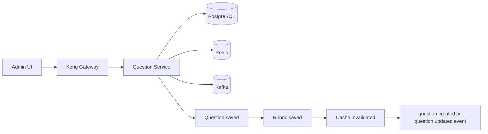

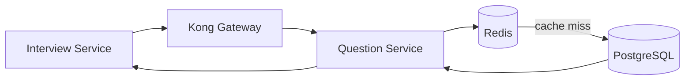

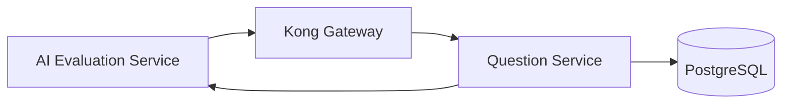

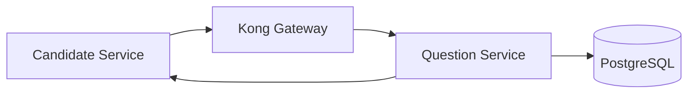

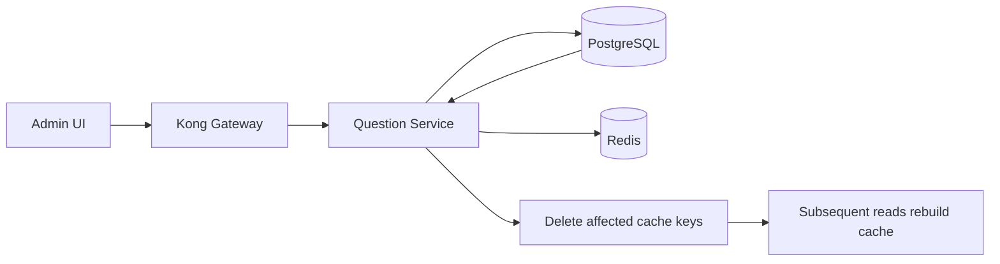

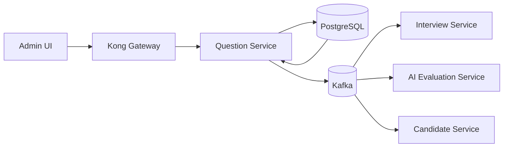

### 16. Sequence Diagrams (Mermaid)

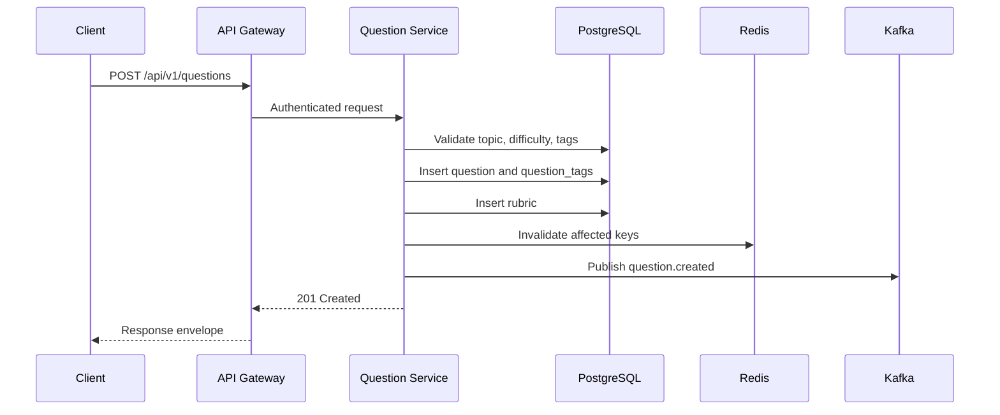

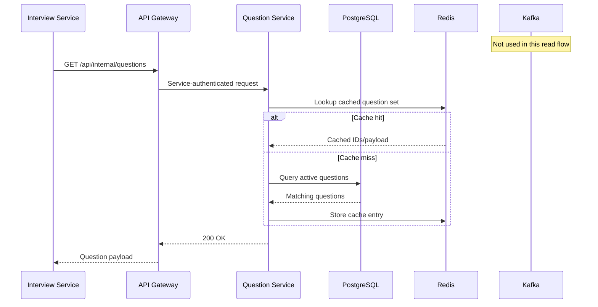

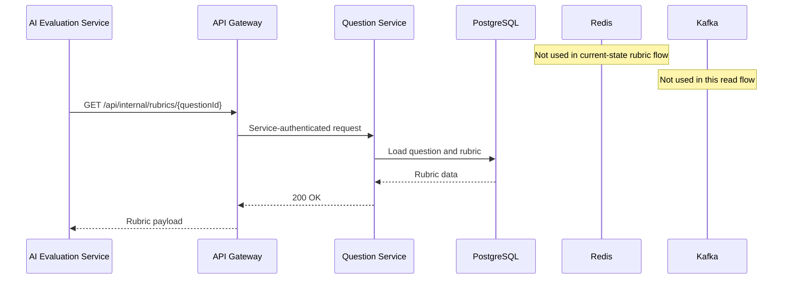

```mermaid
%% DIAGRAM: seq-candidate-receives-study-articles
sequenceDiagram
    participant Client as Candidate Service
    participant Gateway as API Gateway
    participant Service as Question Service
    participant DB as PostgreSQL
    participant Redis
    participant Kafka
    Note over Redis: Optional future cache; not used in current code
    Note over Kafka: Not used in this read flow
    Client->>Gateway: GET /api/v1/study-articles?topic_id=...&difficulty_id=...
    Gateway->>Service: Authenticated request
    Service->>DB: Query active study articles
    DB-->>Service: Article list
    Service-->>Gateway: 200 OK
    Gateway-->>Client: Article response
```

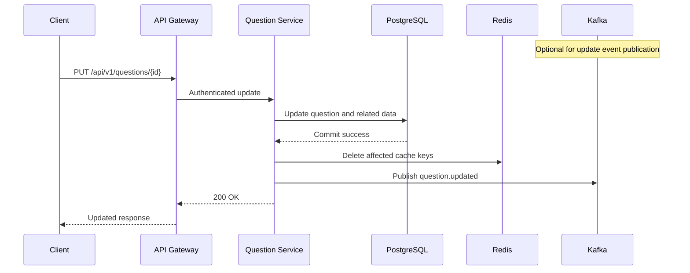

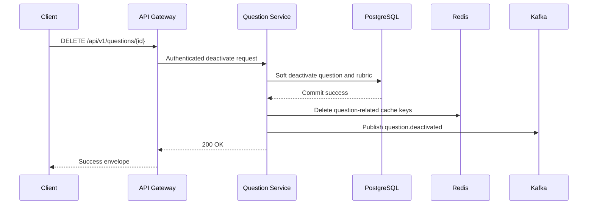

### 17. Inter-Service Integration Map

| Direction | Service | Protocol | Event/Endpoint | Payload | Timeout | Retry | Fallback | Failure Impact |
|---|---|---|---|---|---|---|---|---|
| Inbound | Kong Gateway | HTTPS REST | `/api/v1/*` | Public JSON API | `[ASSUMPTION]` 3s | Gateway retry disabled for writes; 1 retry for idempotent reads | Return gateway error | Public API unavailable |
| Inbound | Interview Service | HTTPS REST | `GET /api/internal/questions` | Question summary list | `[ASSUMPTION]` 2s | 2 retries with backoff for idempotent calls | Return cached interview template or fail interview creation | Interview creation blocked |
| Inbound | Candidate Service | HTTPS REST | `GET /api/v1/study-articles` | Study article list | `[ASSUMPTION]` 2s | 2 retries for reads | Empty recommendations with warning banner `[ASSUMPTION]` | Candidate prep recommendations unavailable |
| Inbound | AI Evaluation Service | HTTPS REST | `GET /api/internal/rubrics/{questionId}` | Rubric payload | `[ASSUMPTION]` 1.5s | 2 retries for reads | Mark evaluation pending manual review | AI scoring delayed |
| Inbound | Assessment/Scoring Service | HTTPS REST | `[ASSUMPTION]` question/rubric lookup | Question and rubric context | `[ASSUMPTION]` 2s | 2 retries | Fail scoring orchestration | Score generation blocked |
| Outbound | PostgreSQL 15 | JDBC | All entity persistence | Relational rows | 2s connect, 2s query `[ASSUMPTION]` | Hikari connection retry | None | Service cannot read/write source of truth |
| Outbound | Redis 7 | RESP | Cache read/write | Cached query results | 100ms `[ASSUMPTION]` | 1 retry for cache ops | Continue without cache | Latency increase only |
| Outbound | Kafka | Async event | `question.created` | Question change event | `[ASSUMPTION]` 500ms produce ack | 3 retries + DLQ `[RECOMMENDED RULE]` | Outbox reprocessor `[RECOMMENDED RULE]` | Downstream systems fall out of sync |
| Outbound | Kafka | Async event | `question.updated` | Question/rubric change event | `[ASSUMPTION]` 500ms produce ack | 3 retries + DLQ `[RECOMMENDED RULE]` | Outbox reprocessor `[RECOMMENDED RULE]` | Scoring and interview views stale |
| Outbound | Kafka | Async event | `question.deactivated` | Question retirement event | `[ASSUMPTION]` 500ms produce ack | 3 retries + DLQ `[RECOMMENDED RULE]` | Outbox reprocessor `[RECOMMENDED RULE]` | Consumers may continue using retired questions |
| Outbound | Kafka | Async event | `article.published` | Article publication event | `[ASSUMPTION]` 500ms produce ack | 3 retries + DLQ `[RECOMMENDED RULE]` | Outbox reprocessor `[RECOMMENDED RULE]` | Candidate recommendations stale |
| Dependency | User/Auth Service | JWT claim issuance, no direct runtime call in current code | Not applicable current-state | JWT claims `[ASSUMPTION]` | Not applicable | Not applicable | Kong-side validation fallback | Unauthorized access risk if misconfigured |

### 18. Data Management and Lifecycle

Soft delete vs hard delete:
- `topics`: soft delete by setting `is_active=false`
- `questions`: soft delete by setting `is_active=false`
- `rubrics`: soft delete by setting `is_active=false`
- `study_articles`: soft delete by setting `is_active=false` `[ASSUMPTION]`
- `tags`: hard delete only when no `question_tags` reference exists
- `difficulty_levels`: current schema supports hard delete only; `[RECOMMENDED RULE]` add retire policy or schema support for `is_active`
- `question_tags`: hard delete association rows on detach or question/tag delete

Archival rules and retention policy:
- `[ASSUMPTION]` Active catalog records remain online indefinitely.
- `[RECOMMENDED RULE]` Deactivated questions, rubrics, topics, and articles are retained for 7 years for auditability.
- `[RECOMMENDED RULE]` Deleted tag mappings are retained in audit logs, not in operational tables.

Versioning strategy for questions/rubrics:
- Current schema does not provide explicit versioning.
- `[RECOMMENDED RULE]` Adopt clone-on-change immutability for any question or rubric used in a completed interview.
- `[RECOMMENDED RULE]` Historical interview usage should reference a frozen content snapshot owned either by Interview Service or by a dedicated immutable snapshot model introduced in a later schema revision.
- Until versioning exists, editing in-use questions or rubrics is a business risk and should be blocked or tightly controlled.

Audit trail ownership:
- Schema defines `created_at`, `created_by`, `last_updated_at`, `last_updated_by` for all primary entities and `question_tags`.
- Current code partially sets audit fields manually and does not enable JPA auditing globally.
- `[RECOMMENDED RULE]` Source of `created_by` and `last_updated_by` must be the authenticated principal ID, not a free-form header.

Seed / master data list:
- Master data: `topics`, `difficulty_levels`, `tags`
- Operational content: `questions`, `rubrics`, `study_articles`
- Association data: `question_tags`

Backward compatibility policy for API changes:
- Public and internal payload changes require additive-only evolution within a major version.
- Removing fields or changing field types requires a new versioned endpoint or contract revision.
- Current mismatch between `question_text` and external `title` contract must be resolved before consumer rollout.

### 19. Non-Functional Requirements

| Category | Requirement | Target / Metric |
|---|---|---|
| Latency | P99 read latency for `GET /questions` | <= 250ms without cache `[ASSUMPTION]` |
| Latency | P99 read latency for `GET /questions/random` | <= 100ms with Redis cache hit |
| Latency | P99 read latency for `GET /internal/rubrics/{questionId}` | <= 75ms `[ASSUMPTION]` |
| Throughput | Peak read throughput | 300 RPS `[ASSUMPTION]` |
| Throughput | Peak write throughput | 30 RPS `[ASSUMPTION]` |
| Availability | Public API uptime SLA | 99.9% monthly |
| Availability | Internal API uptime SLA | 99.95% monthly `[ASSUMPTION]` |
| Cache TTL | Topic/tag/difficulty cache TTL | 60 minutes in current Redis config |
| Cache TTL | Random question cache TTL | 5 minutes in current implementation |
| Read/Write Ratio | Expected steady-state ratio | 85:15 `[ASSUMPTION]` |
| Scalability | Horizontal scaling | Stateless application pods behind Kong; min 2 replicas `[ASSUMPTION]` |
| Consistency | Source-of-truth model | Strong consistency on PostgreSQL commit; eventual consistency for cache and Kafka consumers |
| RBAC | Authorization model | JWT Bearer with embedded roles; `ADMIN` for writes, `INTERVIEWER` for public reads, service credentials for internal reads `[ASSUMPTION]` |
| Observability | Metrics | Prometheus metrics for request count, latency, error rate, DB pool, cache hits/misses |
| Observability | Tracing | OpenTelemetry trace on 100% of inbound requests `[RECOMMENDED RULE]` |
| Logging | Structured logs | JSON logs with trace ID, endpoint, error code, and principal ID `[RECOMMENDED RULE]` |
| Resilience | DB connection pooling | HikariCP min 5, max 20 in current config |
| Resilience | Cache outage behavior | Service must continue without Redis for non-cached correctness |
| Resilience | Kafka outage behavior | `[RECOMMENDED RULE]` Use outbox or retry/DLQ; committed writes must not be lost |
| Security | Input validation | Bean validation for all request bodies and query constraints |
| Security | Transport | TLS termination at Kong and TLS between services `[ASSUMPTION]` |
| Data integrity | Referential integrity | PostgreSQL foreign keys and application-level business validation |
| Deployment | Platform | Kubernetes on AWS EKS `[ASSUMPTION]` |
| Disaster recovery | RPO / RTO | RPO <= 15 minutes, RTO <= 60 minutes `[ASSUMPTION]` |

### 20. Risks, Dependencies, and Design Decisions

| ID | Type | Description | Impact | Mitigation |
|---|---|---|---|---|
| R-001 | Risk | Current codebase has no Spring Security JWT enforcement although platform requirements assume JWT Bearer auth. | High | Implement service-side JWT validation or formalize Kong-only auth ownership before production sign-off. |
| R-002 | Risk | Kafka publication is defined in platform context but not implemented in the current codebase. | High | Introduce Kafka producer with outbox pattern before downstream teams rely on events. |
| R-003 | Risk | Rubric APIs and internal service endpoints are absent from the current implementation. | High | Add controllers, DTOs, services, and integration tests before consumer onboarding. |
| R-004 | Risk | Study article CRUD and search are absent, leaving candidate recommendation use case incomplete. | High | Implement article write and search endpoints plus publication workflow. |
| R-005 | Risk | Cache invalidation for question/rubric mutations is incomplete; current code only invalidates random cache during bulk import. | High | Invalidate affected cache keys on create, update, delete, and rubric change events. |
| R-006 | Risk | Audit fields are not consistently populated because JPA auditing is not enabled and manual field population is partial. | High | Enable JPA auditing or standardize audit assignment in services using authenticated principal ID. |
| R-007 | Risk | Schema-contract mismatch exists: external DTO references `title` for questions and array criteria for rubrics, while schema stores `question_text` and text criteria. | High | Resolve contract at architecture review and version the public/internal DTOs explicitly. |
| R-008 | Risk | Current implementation uses inconsistent topic error codes and tag lookup semantics compared with intended business meaning. | Medium | Correct error code mapping and document contract tests before release. |
| R-009 | Risk | `question_tags` audit columns exist in schema but are not mapped in the JPA entity. | Medium | Decide whether to manage association audit fields or remove them from schema in a future migration. |
| R-010 | Risk | Current entity mapping defines rubric JSON columns as `jsonb` while initial migration uses `JSON`, creating potential schema drift. | Medium | Standardize on `jsonb` or `json` and align Flyway migrations with entity mapping. |
| DEP-001 | Dependency | PostgreSQL 15 is the source of truth for all content entities. | High | Managed backups, schema migration governance, and connection pool sizing. |
| DEP-002 | Dependency | Redis 7 is used for cache-backed read optimization. | Medium | Ensure cache availability and safe fallback behavior. |
| DEP-003 | Dependency | Kong Gateway is the ingress and policy enforcement layer. | High | Finalize route definitions, auth policy, and service credentials. |
| DEP-004 | Dependency | User/Auth Service provides JWT claims and principal identity semantics. | High | Freeze claim contract for `sub`, `roles`, and tenant context if applicable. |
| DEP-005 | Dependency | Interview Service, Candidate Service, and AI Evaluation Service depend on stable payloads and endpoint availability. | High | Publish versioned API contracts and consumer test suites. |
| D-001 | Decision | Use soft delete for topics, questions, rubrics, and study articles to preserve referential consistency and auditability. | Medium | Retain `is_active` semantics and filter inactive records from normal reads. |
| D-002 | Decision | Use hard delete for tags only when unreferenced because tags are lightweight taxonomy labels. | Low | Block deletion when `question_tags` references exist. |
| D-003 | Decision | Keep offset-based pagination for search because current code already implements `page`, `size`, and `sort`. | Low | Revisit cursor pagination only if large-page performance degrades materially. |
| D-004 | Decision | Keep random question cache TTL at 5 minutes because current implementation already uses that value. | Low | Invalidate on content changes and monitor stale-hit risk. |
| D-005 | Decision | Treat public API response envelope as stable and reuse current `BaseResponse` contract. | Medium | Add contract tests for success and error envelopes. |
| D-006 | Decision | Internal read APIs should avoid user-scoped response envelopes and return consumer-focused payloads. | Medium | Keep internal contracts slim and versioned separately from public APIs. |

